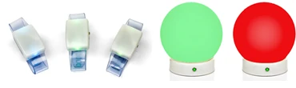
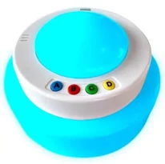
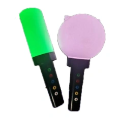

# Het tabblad Galaxy

Het tabblad Galaxy geeft u uitgebreide controle over uw aangesloten draadloze Galaxy LED-apparaten. Dit tabblad is alleen zichtbaar wanneer Galaxy-ondersteuning is ingeschakeld in Quiz Setup. Galaxy-apparaten bestaan in verschillende uitvoeringen, zoals polsbandjes, bollen, kubussen en QuizXpress Torches.

{ width="374" loading=lazy } { width="103" loading=lazy } { width="115" loading=lazy }

Tijdens een quiz geven Galaxy-apparaten feedback aan de spelers door van kleur te veranderen (om een paar voorbeelden te noemen: uw stem is ontvangen, uw antwoord was juist, uw antwoord was onjuist, u bent uit het spel).

Deze wijzigingen gebeuren allemaal automatisch. Maar met Galaxy kunt u nog meer! Op het tabblad Galaxy in QuizXpress Director zijn diverse opties om uw Galaxy-apparaten handmatig op verschillende manieren te gebruiken:

- Ze op een vaste kleur zetten (bijvoorbeeld passend bij de kleuren van uw evenement)

- Een of meer gelukkige winnaars kiezen

- Ze als lichtshow gebruiken tijdens het afspelen van muziek

Op de volgende pagina vindt u een afbeelding van het tabblad Galaxy in QuizXpress Director en een verdere uitleg van de opties.

**Sectie Algemeen**

- Show correct/incorrect: toon of het gegeven antwoord juist of onjuist was

- Include inactive players: de Galaxy-apparaten van spelers die inactief zijn (uit het spel gevallen) doen ook mee

- High luminosity: geef de lampen meer helderheid (dit betekent iets meer stroomverbruik)

- Show chosen answer: geeft aan of het licht de kleur van het gekozen antwoord toont

- ABCD color boxes: stel de kleuren in die voor de antwoorden A, B, C en D worden getoond

**Sectie Vaste kleur**

Hier kunt u alle Galaxy-apparaten op een vaste kleur zetten. U kunt dit bijvoorbeeld gebruiken om ze in te stellen op een kleur die bij uw evenement past, tijdens pauzes, of om een bepaalde sfeer te creëren — bijvoorbeeld tijdens het afspelen van een video.

**Selecteer winnaar(s)**

Met deze sectie kunt u een of meer gelukkige winnaars uit het publiek kiezen door de Galaxy-apparaten van de winnaars te laten oplichten. Het licht van de gelukkige winnaar(s) beweegt door het publiek en komt tot stilstand, waarmee de winnaar bekend is. De opties zijn als volgt:

- Color: stelt de beginkleur van de Galaxy-apparaten van alle spelers in.

- Color Winner(s): stelt de kleur in van het Galaxy-apparaat (de Galaxy-apparaten) van de gelukkige winnaar(s).

- Number of winners: stelt in hoeveel spelers winnen.

- Light speed: stelt de snelheid in, in milliseconden, waarmee het licht van de gelukkige winnaar(s) door de menigte beweegt.

- Random selection: indien ingeschakeld, bewegen de lichten willekeurig door het publiek. Anders bewegen de lichten door de Galaxy-apparaten vanaf nummer 1 omhoog. Let op: als de spelers in het publiek willekeurig zijn geplaatst, heeft deze instelling geen effect. Hij werkt alleen als de instelling Random selection uit staat en de spelers op een rij zitten (bijvoorbeeld voor een publiek).

- Knop Start: laat alle Galaxy-apparaten in het publiek oplichten met de beginkleur.

- Choose Lucky Winner(s): laat het licht van de gelukkige winnaar(s) door het publiek bewegen.

- Stop Gradually: laat het licht van de gelukkige winnaars geleidelijk tot stilstand komen.

- Stop: stopt het licht van de gelukkige winnaars direct; de winnaar(s) zijn meteen bekend.

Het vak Winners toont de gelukkige winnaar(s), zodat de quizmaster ook de keypadnummers ziet van de speler(s) die hebben gewonnen (let op: deze zijn niet noodzakelijk dezelfde als de Galaxy-apparaatnummers — spelers kunnen een Galaxy-apparaat met een ander ID hebben).

**Selecteer afvaller(s)**

Met de optie Reverse Lucky Winner(s) kiest u een of meer winnaars door spelers geleidelijk te laten afvallen. Waar Lucky Winner(s) een of meer winnaars uit een publiek kiest, laat Reverse Lucky Winner(s) spelers afvallen tot er een of meer winnaars overblijven. De opties zijn als volgt:

- Color: stelt de beginkleur van de Galaxy-apparaten van alle spelers in.

- Dropout(s) Color: stelt de kleur in voor de spelers die zijn afgevallen.

- Number to Drop: stelt het aantal spelers in dat afvalt.

- Flash before Drop: hier geeft u aan of de Galaxy-apparaten moeten knipperen voordat de afgevallen spelers worden getoond. Er zijn drie opties:

  - Current color: laat de Galaxy-apparaten van alle resterende spelers knipperen in de huidige kleur

  - Random color: laat de Galaxy-apparaten van alle resterende spelers knipperen in een willekeurige kleur (bij elke flits toont elk Galaxy-apparaat een andere willekeurige kleur).

  - Random all same color: laat de Galaxy-apparaten van alle resterende spelers knipperen in dezelfde willekeurige kleur (bij elke flits wordt een andere willekeurige kleur getoond voor alle Galaxy-apparaten).

- Knop Start: laat alle Galaxy-apparaten in het publiek oplichten met de beginkleur.

- Knop Drop: laat het opgegeven aantal spelers afvallen.

Het vak *Remaining* toont de keypadnummers die nog meedoen om te winnen.

**Lichtshow**

Met de instellingen voor de lichtshow voegt u een extra dimensie toe aan muziek die wordt afgespeeld, door de Galaxy-apparaten als lichtshow te gebruiken. De opties zijn als volgt:

- Tempo (beats per minute): stelt de frequentie in waarmee de apparaten oplichten

- Knop Tap Tempo: meestal kent u het tempo (beats per minuut) van de muziek niet. Door een paar keer in de maat van de muziek op de knop Tap Tempo te tikken, wordt het tempo bepaald en getoond in het vak Tempo (beats per minute).

- Knop Start: start de lichtshow

- Er zijn drie kleuropties voor de lichtshow:

  - Fixed color: laat alle Galaxy-apparaten knipperen in de vaste kleur

  - Random color: laat alle Galaxy-apparaten knipperen in een willekeurige kleur (bij elke flits toont elk Galaxy-apparaat een andere willekeurige kleur).

  - Random all same color: laat alle Galaxy-apparaten knipperen in dezelfde willekeurige kleur (bij elke flits wordt een andere willekeurige kleur getoond voor alle Galaxy-apparaten).
