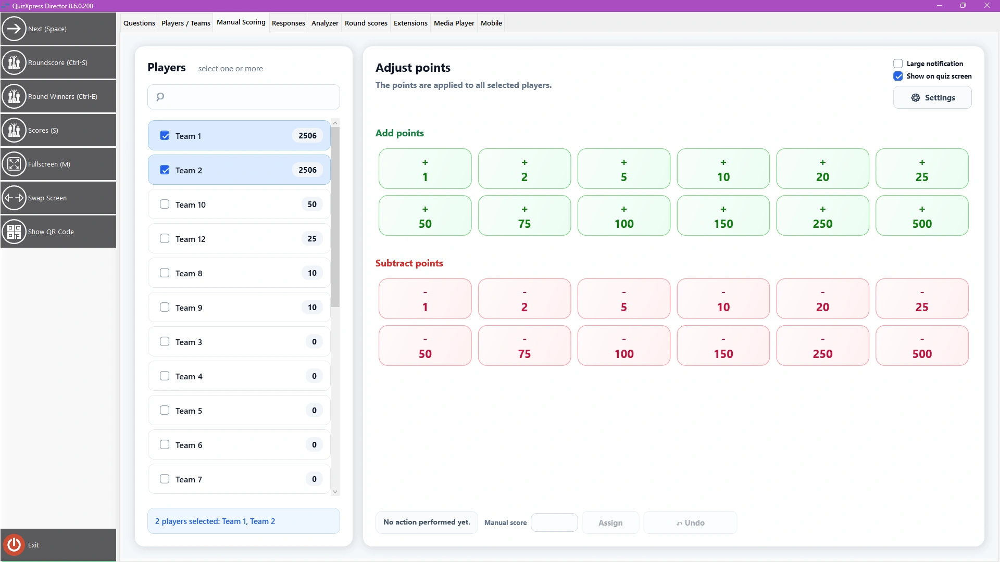

# La vista Manual Scoring

Esta vista le ayuda a sumar o restar puntos rápidamente a uno o más equipos, por ejemplo, por actividades que se desarrollan fuera de QuizXpress. La pantalla tiene este aspecto:

{ loading=lazy }

Seleccione uno o más jugadores en la lista de la izquierda y, a continuación, pulse cualquiera de los botones preasignados (puede modificar la asignación con Settings). Con el interruptor ‘Show on quiz screen’ puede decidir si el cambio de puntos se muestra al público. Puede deshacer el último cambio con el botón Undo y utilizar el botón Assign para sumar o restar un número arbitrario de puntos.
