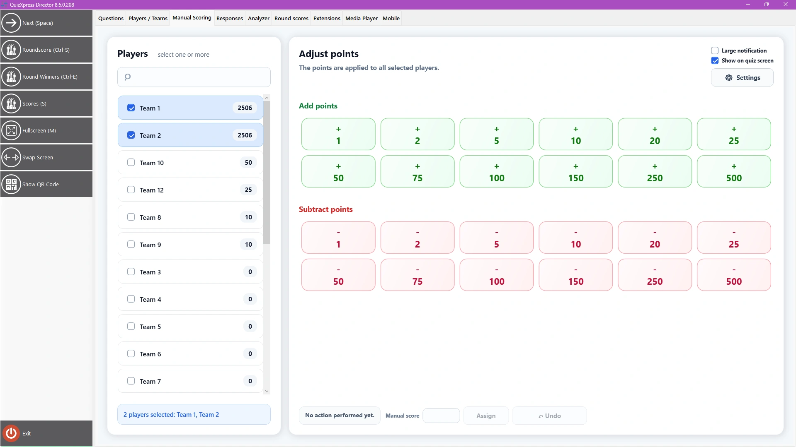

# La scheda Punteggio Manuale

Questa scheda consente di aggiungere/sottrarre rapidamente punti a una o più squadre, ad esempio per attività che si svolgono al di fuori di QuizXpress. La schermata si presenta così:

{ loading=lazy }

Selezionare uno o più giocatori dall’elenco a sinistra, quindi cliccare uno dei pulsanti preassegnati (l’assegnazione può essere modificata dalle ‘Impostazioni’). Con l’interruttore ‘Mostra sullo schermo quiz’ si decide se la variazione di punteggio debba essere mostrata al pubblico. È possibile annullare l’ultima modifica con il pulsante ‘Annulla’ e usare il pulsante ‘Assegna’ per aggiungere o sottrarre un numero arbitrario di punti.
