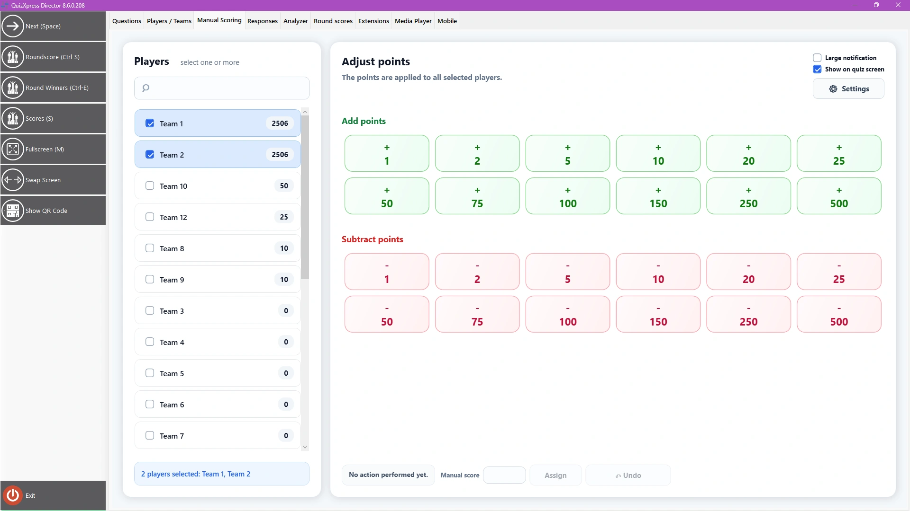

# De weergave Handmatige score

Met deze weergave voegt u snel punten toe aan of trekt u punten af van een of meer teams, bijvoorbeeld voor activiteiten die buiten QuizXpress plaatsvinden. Het scherm ziet er zo uit:

{ loading=lazy }

Selecteer een of meer spelers in de lijst links en tik dan op een van de vooraf toegewezen knoppen (de toewijzing kunt u wijzigen met Instellingen). Met de schakelaar ‘Tonen op quizscherm’ bepaalt u of de puntenwijziging aan het publiek wordt getoond. U kunt de laatste wijziging ongedaan maken met de knop Ongedaan maken, en met de knop Toekennen een willekeurig aantal punten toevoegen of aftrekken.
