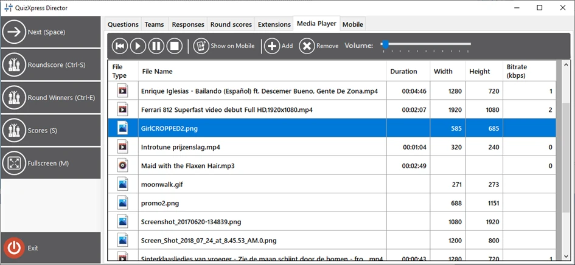
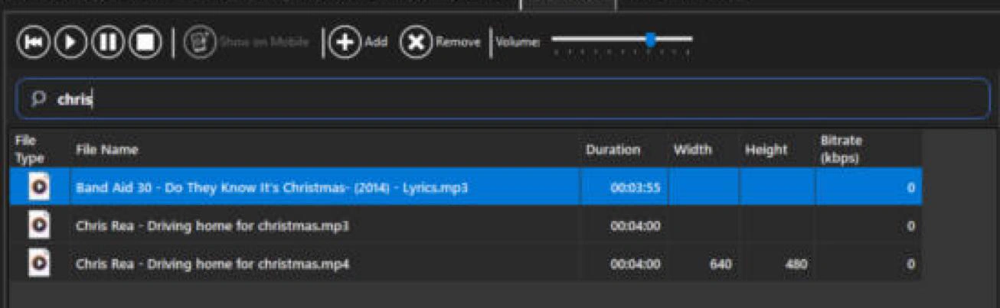
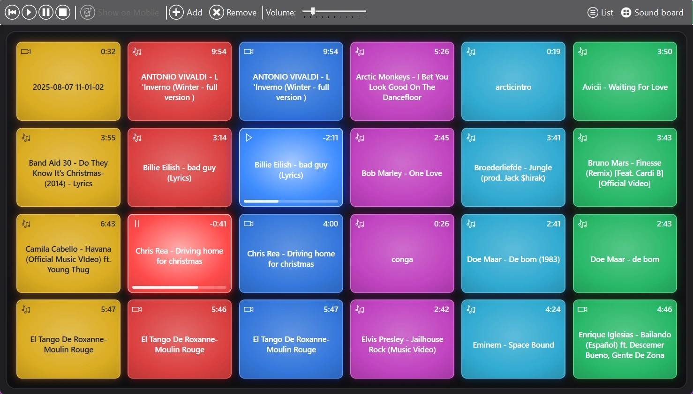
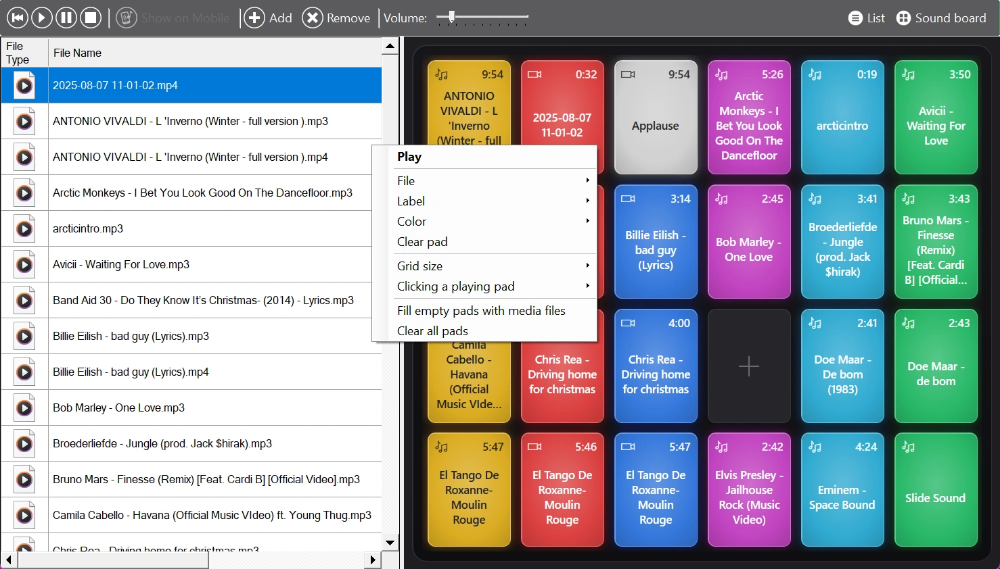

# La scheda Media Player

Questa scheda di Director mostra il lettore multimediale di QuizXpress. Con il lettore multimediale è possibile:

- Avviare un video a schermo intero sullo schermo principale

- Mostrare un’immagine a schermo intero sullo schermo principale

- Avviare la riproduzione di un file MP3

- Presentare un’immagine promozionale sull’app Smart Buzzer

- Riprodurre di nuovo/riprendere il video della diapositiva corrente

- Riprodurre di nuovo/riprendere l’audio della diapositiva corrente

- Regolare il volume del lettore del quiz

- Gestire un elenco di file multimediali

- Riprodurre file con un clic dalla [console dei suoni](#la-console-dei-suoni)

Quando si aggiungono file all’elenco, questi vengono in realtà copiati nella cartella locale dei dati dell’applicazione QuizXpress (percorso in Esplora risorse: %AppData%\QuizXpress\Media). In questo modo si evitano problemi se i file originali vengono spostati, eliminati, ecc. Pertanto, se si elimina un file dall’elenco, esso viene eliminato dall’archivio di QuizXpress, ma il file originale resta intatto.

{ width="605" loading=lazy }

## Cercare nell’elenco

Con molti file multimediali, usare il campo di ricerca sopra l’elenco per trovarne uno rapidamente. Digitare parte del nome di un file e l’elenco mostra solo i file che lo contengono, ad esempio 'chris' trova sia 'Chris Rea - Driving home for christmas' sia 'Band Aid 30 - Do They Know It's Christmas'. Maiuscole e minuscole non hanno importanza. Premere Esc o svuotare il campo per mostrare di nuovo tutti i file.

{ width="605" loading=lazy }

Mentre si digita nel campo di ricerca, tasti come Spazio, 'C' e 'S' vengono inviati al campo e non attivano le scorciatoie di Director. La ricerca filtra soltanto l’elenco; la console dei suoni conserva tutti i suoi pad.

## La console dei suoni

Accanto all’elenco, la scheda Media Player dispone di una console dei suoni (sound board): una griglia di pad colorati e luminosi, come i launch pad usati dai DJ. Con un clic su un pad si riproduce il suo audio, video o immagine, così jingle, applausi e musiche di ingresso sono sempre a portata di mano.

{ loading=lazy }

- Il pad in riproduzione si illumina e mostra il tempo rimanente e una barra di avanzamento. Un pad in pausa mostra un simbolo di pausa.
- Fare di nuovo clic su un pad in riproduzione per fermarlo.
- I pad inattivi mostrano la durata del loro file.

Facendo clic su un pad si seleziona anche il suo file nell’elenco, quindi i pulsanti di riproduzione, pausa, stop e riavvolgimento della barra degli strumenti agiscono su quel file.

### Mostrare l’elenco, la console dei suoni o entrambi

Usare i pulsanti 'List' e 'Sound board' a destra della barra degli strumenti per mostrare l’elenco, la console dei suoni o entrambi affiancati. Almeno uno dei due è sempre visibile. Quando sono mostrati entrambi, trascinare il divisore tra i due per dare più spazio all’uno o all’altro. Director ricorda la scelta effettuata.

### Collocare i file sui pad

La prima volta che si apre la console dei suoni, viene riempita automaticamente con i file multimediali. Per organizzarla personalmente:

- Trascinare un file dall’elenco su un pad.
- Trascinare i file direttamente da Esplora risorse di Windows su un pad. Vengono aggiunti all’elenco multimediale (copiati nella cartella multimediale, come con 'Add') e collocati su quel pad. Quando si rilasciano più file, gli altri vanno sui pad vuoti successivi.
- Trascinare un pad su un altro pad per scambiarli.

Dopo aver modificato personalmente la console, i nuovi file multimediali non vengono più aggiunti automaticamente. Usare 'Fill empty pads with media files' (vedere sotto) per aggiungerli.

{ loading=lazy }

### Opzioni dei pad e della console

Fare clic con il pulsante destro del mouse su un pad per:

- 'Play' o 'Stop': avviarlo o fermarlo.
- 'File': scegliere quale file multimediale viene riprodotto dal pad. Oltre ai file multimediali, un pad può anche controllare l’audio o il video della diapositiva corrente ('Slide Sound' e 'Slide Video').
- 'Label': assegnare al pad un nome breve, ad esempio 'Applause' invece di un lungo nome di file. Lasciarlo vuoto per mostrare di nuovo il nome del file.
- 'Color': scegliere un colore, oppure 'Automatic' per colorare i pad per colonna.
- 'Clear pad': rimuovere il file dal pad. Il file resta nell’elenco multimediale.

Lo stesso menu, disponibile anche facendo clic con il pulsante destro sulla console attorno ai pad, offre opzioni per l’intera console:

- 'Grid size': da 3 × 4 fino a 8 × 8 pad. I pad mantengono la loro posizione quando si cambia la dimensione.
- 'Clicking a playing pad': scegliere se un clic su un pad in riproduzione lo ferma (impostazione predefinita), lo riavvia oppure lo mette in pausa e lo riprende.
- 'Fill empty pads with media files': colloca sui pad vuoti i file multimediali che non sono ancora sulla console.
- 'Clear all pads': svuota la console. I file multimediali vengono conservati.

!!! note
    La console dei suoni è memorizzata su questo computer, accanto alla cartella multimediale (%AppData%\QuizXpress\SoundBoard.xml), quindi sarà ancora presente la prossima volta che si esegue uno show. Quando si elimina un file dall’elenco multimediale, esso viene rimosso anche dai suoi pad.
