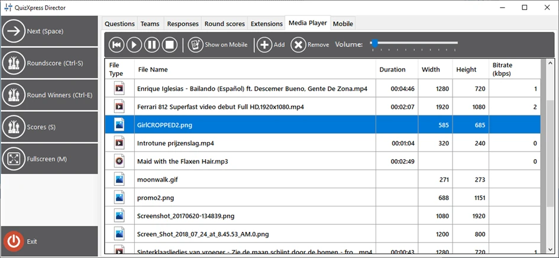
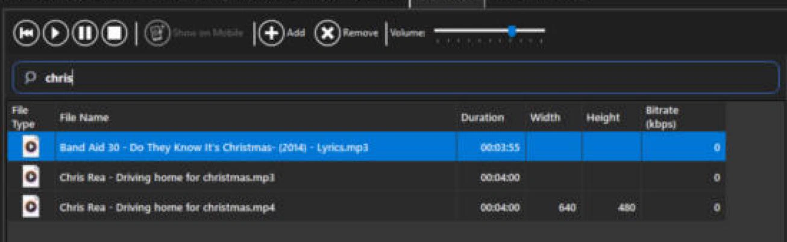
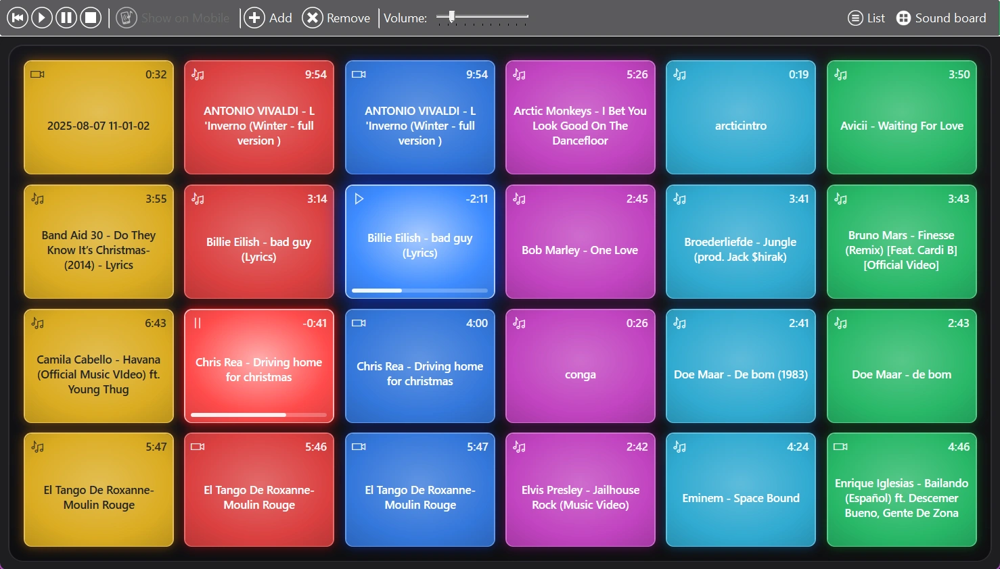
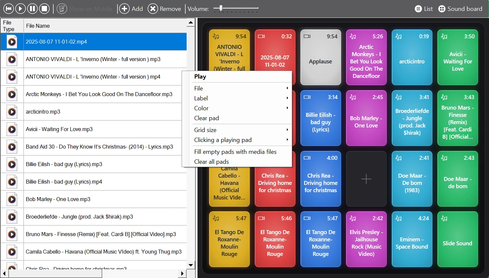

# Het tabblad Media speler

Dit tabblad in Director toont de QuizXpress-mediaspeler. Met de mediaspeler kunt u:

- Een video op volledig scherm starten op het hoofdscherm

- Een afbeelding op volledig scherm tonen op het hoofdscherm

- Een MP3-bestand afspelen

- Een promo-afbeelding tonen in de Smart Buzzer-app

- De video op de huidige dia opnieuw afspelen/hervatten

- Het geluid op de huidige dia opnieuw afspelen/hervatten

- Het volume van de quizspeler aanpassen

- Een lijst met mediabestanden bijhouden

- Bestanden met één klik afspelen vanaf het [soundboard](#het-soundboard)

Wanneer u bestanden aan de lijst toevoegt, worden ze gekopieerd naar de lokale gegevensmap van de QuizXpress-toepassing (Verkenner-pad %AppData%\QuizXpress\Media). Dit voorkomt problemen als de oorspronkelijke bestanden worden verplaatst, verwijderd, enzovoort. Als u een bestand uit de lijst verwijdert, wordt het dus uit de QuizXpress-opslag verwijderd, maar blijft het oorspronkelijke bestand onaangetast.

{ width="605" loading=lazy }

## De lijst doorzoeken

Bij veel mediabestanden gebruikt u het zoekveld boven de lijst om snel een bestand te vinden. Typ een deel van een bestandsnaam en de lijst toont alleen de bestanden die dit bevatten, bijvoorbeeld 'chris' vindt zowel 'Chris Rea - Driving home for christmas' als 'Band Aid 30 - Do They Know It's Christmas'. Hoofdletters en kleine letters maken niet uit. Druk op Esc of maak het veld leeg om weer alle bestanden te tonen.

{ width="605" loading=lazy }

Terwijl u in het zoekveld typt, gaan toetsen zoals Spatie, 'C' en 'S' naar het veld en activeren ze de Director-sneltoetsen niet. Het zoeken filtert alleen de lijst; het soundboard behoudt al zijn pads.

## Het soundboard

Naast de lijst heeft het tabblad Media speler een soundboard: een raster van kleurrijke, gloeiende pads, zoals de launchpads die dj’s gebruiken. Eén klik op een pad speelt het geluid, de video of de afbeelding af, zodat jingles, applaus en opkomstmuziek altijd binnen handbereik zijn.

{ loading=lazy }

- Het pad dat wordt afgespeeld licht op en toont de resterende tijd en een voortgangsbalk. Een gepauzeerd pad toont een pauzesymbool.
- Klik nogmaals op een afspelend pad om het te stoppen.
- Pads die niet actief zijn tonen de lengte van hun bestand.

Als u op een pad klikt, wordt ook het bijbehorende bestand in de lijst geselecteerd, zodat de knoppen voor afspelen, pauzeren, stoppen en terugspoelen in de werkbalk op dat bestand werken.

### De lijst, het soundboard of beide tonen

Met de knoppen 'Lijst' en 'Soundboard' rechts in de werkbalk toont u de lijst, het soundboard of beide naast elkaar. Minstens één van beide is altijd zichtbaar. Als beide zichtbaar zijn, sleept u de scheidingslijn ertussen om een van beide meer ruimte te geven. Director onthoudt uw keuze.

### Bestanden op de pads zetten

De eerste keer dat u het soundboard opent, wordt het automatisch gevuld met uw mediabestanden. Zo rangschikt u het zelf:

- Sleep een bestand uit de lijst naar een pad.
- Sleep bestanden rechtstreeks vanuit Windows Verkenner naar een pad. Ze worden aan de medialijst toegevoegd (gekopieerd naar de mediamap, net als met 'Toevoegen') en op dat pad gezet. Als u meerdere bestanden tegelijk loslaat, komen de overige op de volgende lege pads terecht.
- Sleep een pad naar een ander pad om ze te verwisselen.

Zodra u het bord zelf heeft aangepast, worden nieuwe mediabestanden er niet meer automatisch aan toegevoegd. Gebruik 'Lege pads vullen met mediabestanden' (zie hieronder) om ze toe te voegen.

{ loading=lazy }

### Pad- en bordopties

Klik met de rechtermuisknop op een pad om:

- Het te laten 'Afspelen' of te 'Stoppen'.
- 'Bestand': te kiezen welk mediabestand het pad afspeelt. Naast uw mediabestanden kan een pad ook het geluid of de video van de huidige dia bedienen ('Dia-geluid' en 'Dia-video').
- 'Label': het pad een korte naam te geven, bijvoorbeeld 'Applaus' in plaats van een lange bestandsnaam. Laat het leeg om weer de bestandsnaam te tonen.
- 'Kleur': een kleur te kiezen, of 'Automatisch' om de pads per kolom te kleuren.
- 'Pad leegmaken': het bestand van het pad te verwijderen. Het bestand blijft in de medialijst staan.

Hetzelfde menu, dat ook beschikbaar is als u met de rechtermuisknop op het bord rond de pads klikt, heeft opties voor het hele bord:

- 'Rastergrootte': van 3 × 4 tot 8 × 8 pads. Pads behouden hun plaats wanneer u de grootte wijzigt.
- 'Klikken op een afspelend pad': kies of een klik op een afspelend pad het stopt (de standaard), opnieuw start, of pauzeert en hervat.
- 'Lege pads vullen met mediabestanden': zet de mediabestanden die nog niet op het bord staan op de lege pads.
- 'Alle pads leegmaken': maakt het bord leeg. Uw mediabestanden blijven behouden.

!!! note
    Het soundboard wordt op deze computer opgeslagen, naast de mediamap (%AppData%\QuizXpress\SoundBoard.xml), zodat het er de volgende keer dat u een show draait nog steeds is. Wanneer u een bestand uit de medialijst verwijdert, wordt het ook van zijn pads verwijderd.
