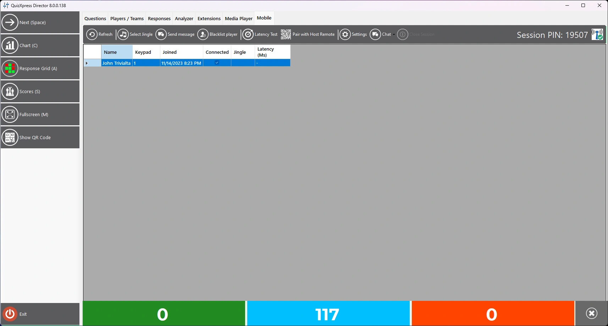
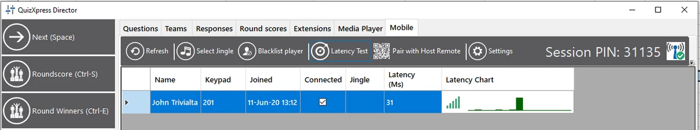
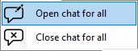
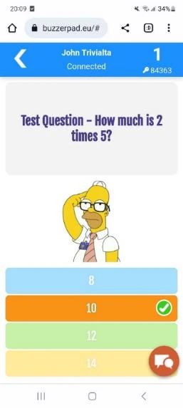
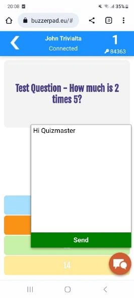
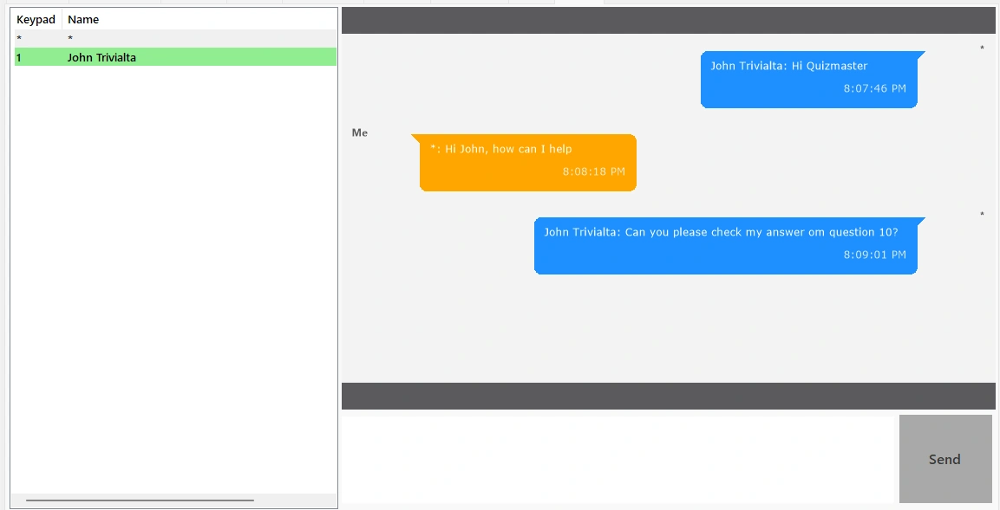
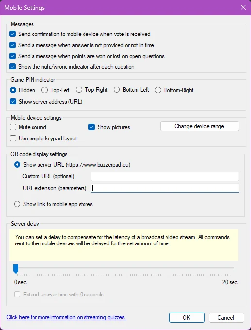
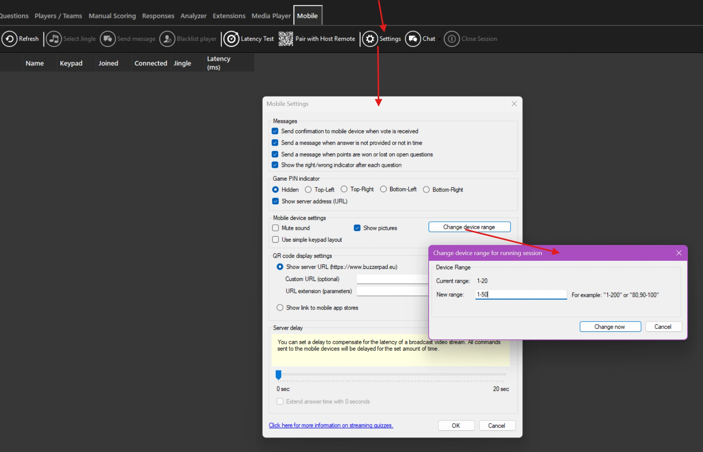

# L’onglet Mobile

L’onglet Mobile affiche tous les appareils mobiles actuellement connectés.

{ loading=lazy }

Depuis cet onglet, vous pouvez :

- Select Jingle : forcer la **sélection du jingle** pour tous les joueurs utilisant l’application Smart Buzzer

- **Send Message :** envoyer un message au ou aux joueurs sélectionnés

- **Blacklist Player : bloquer définitivement le joueur sélectionné afin qu’il ne puisse plus rejoindre votre quiz**

- **Latency Test : vérifier la qualité de connexion de tous les appareils**

- **Pair with Host Remote : afficher le QR code à scanner avec l’application Director (télécommande mobile de l’animateur de quiz) pour ajouter cet ordinateur à la liste des ordinateurs pouvant être contrôlés.**

- Settings : ouvrir la boîte de dialogue des paramètres mobiles

- Chat : ouvrir une session de discussion permettant de discuter avec tous les joueurs

- À droite, vous voyez le PIN actuel (en mode serveur)

## Test de latence

Le test de latence est surtout utilisé en mode Wi-Fi local, pour vérifier que tous vos joueurs disposent d’une connexion solide avec votre routeur. Il envoie un ping à tous les appareils et mesure le temps nécessaire pour recevoir une réponse. Ce temps est tracé derrière chaque appareil mobile dans un graphique comme celui-ci :

{ loading=lazy }

Lorsqu’un appareil est très lent ou déconnecté, le graphique devient rouge, et en tant qu’animateur de quiz, vous pouvez demander au joueur de se rapprocher du point d’accès. Remarque : ne laissez pas le test de latence actif pendant votre quiz, car il consomme de la bande passante Wi-Fi et de la capacité du serveur.

## Discussion instantanée

Vous pouvez lancer une session de discussion avec les joueurs en cliquant sur le bouton Chat.

{ width="171" loading=lazy }  
Après le lancement de la discussion, les joueurs voient un bouton de discussion sur leur téléphone.

{ width="163" loading=lazy } { width="166" loading=lazy }

En appuyant sur le bouton de discussion, les joueurs peuvent envoyer des messages à l’animateur de quiz, qui sont visibles dans un onglet nommé « Chat ». L’animateur de quiz voit tous les messages par utilisateur et peut renvoyer un message à chaque joueur individuellement.

{ width="416" loading=lazy }

!!! note

    actuellement, cette fonctionnalité n’est disponible que pour les joueurs utilisant le buzzer web buzzerpad. Elle n’est pas encore disponible dans l’application Smart Buzzer.*

## Paramètres

Quelques paramètres avancés se trouvent sous le bouton *Settings* :

{ width="332" loading=lazy }

Les cases à cocher du haut contrôlent des messages de confirmation facultatifs envoyés aux appareils connectés. Ces messages aident les utilisateurs à comprendre ce qui se passe. La première option renvoie à l’appareil chaque réponse reçue, avec un message du type « We received answer D ». La deuxième option n’envoie un avertissement que si aucune réponse n’a été reçue, ou si la réponse n’a pas été traitée à temps (par exemple en raison de la latence du flux vidéo). La troisième option envoie à l’appareil un message avec les points gagnés/perdus après chaque question, et la dernière option vous permet de contrôler si l’appareil indique que le joueur a répondu correctement ou incorrectement.

Avec le paramètre « Game PIN indicator », vous pouvez configurer l’affichage d’un indicateur de PIN à quatre emplacements différents de l’écran du quiz pendant le quiz. Ce paramètre ne s’applique pas en mode Wi-Fi, puisqu’aucun PIN n’y est utilisé. L’indicateur de PIN se présente ainsi :

{ width="310" loading=lazy }

D’autres paramètres contrôlent le keypad mobile, par exemple s’il doit émettre des sons et, pour le site web buzzerpad, une option permettant de le régler sur un comportement de keypad simple, c’est-à-dire n’affichant qu’un keypad à 7 boutons (mode hérité). Vous pouvez aussi indiquer ici si vous souhaitez afficher des images sur les téléphones mobiles également.

La section QR code display vous permet d’indiquer si vous souhaitez afficher un QR code pointant vers le buzzer web, tel que défini dans QuizXpress Setup, ou un lien vers l’application Smart Buzzer dans les boutiques d’applications iOS et Android. Si vous affichez l’URL du buzzer web, vous pouvez spécifier des paramètres supplémentaires dans le champ URL Extension, qui peuvent servir à personnaliser l’aspect du keypad web. Pour plus d’informations, reportez-vous à [Personnaliser le site web buzzerpad](../using-mobile-keypads/branding-the-buzzerpad-website.md).

Le curseur Server delay permet de retarder toutes les actions envoyées aux appareils mobiles, afin de mieux les synchroniser avec votre flux de diffusion. Laissez cette valeur à 0 si vous ne diffusez pas en streaming. Par exemple, si la latence de votre flux YouTube est d’environ 3 secondes, vous pouvez régler le délai sur 3 secondes. Ainsi, lorsque le compte à rebours démarre sur le flux YouTube des joueurs, il démarre aussi sur leur appareil. Sans ce délai, le compte à rebours de l’appareil démarrerait 3 secondes avant celui de YouTube, ce qui peut prêter à confusion.

Lorsque l’option « Extend answer time » est cochée, le système continue d’accepter les votes même après l’expiration du compte à rebours, pendant la durée définie par le curseur « Server delay ». Cela permet de compenser la latence du flux. Par exemple, s’il y a 5 secondes de délai sur le flux, les joueurs à l’autre bout du flux voient encore l’horloge tourner pendant 5 secondes alors qu’elle est déjà arrêtée dans le studio. Ainsi, lorsque cette option est activée, le système accepte encore les votes pendant ces 5 dernières secondes, ce qui évite aux joueurs de manquer une question.

**Change mobile device range on the fly**

Imaginez que vous ayez lancé un quiz en ligne avec jusqu’à 20 joueurs attendus (plage d’appareils « 1-20 »), et que 10 minutes après le début de votre introduction, 15 autres joueurs souhaitent se joindre à vous. Auparavant, vous deviez redémarrer le quiz et faire se réinscrire tout le monde avec le nouveau PIN, etc. Pour éviter cela, vous pouvez désormais mettre à jour la plage d’appareils mobiles pendant que votre quiz est en cours.

Pour cela, ouvrez Director dans le lecteur de quiz, allez dans l’onglet Mobile et cliquez sur le bouton Settings. Cliquez ensuite sur le bouton Change device range et saisissez la nouvelle plage :

{ loading=lazy }

Le système vérifie la validité de la plage et demande une confirmation. Après votre approbation, le serveur est mis à jour. Notez que si vous réduisez la plage — par exemple en passant de « 1-50 » à « 1-20 » — les joueurs connectés qui se trouvent en dehors de la nouvelle plage seront déconnectés.
