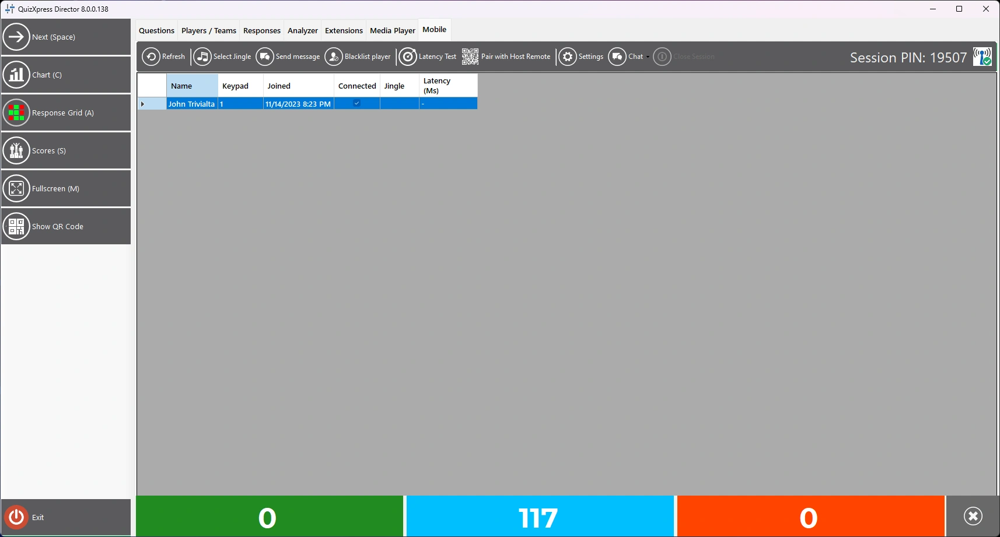
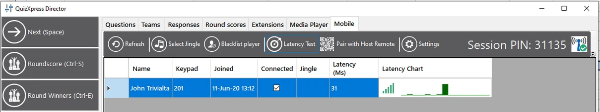
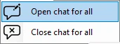
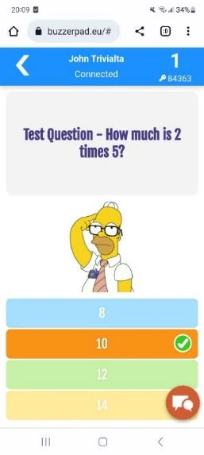
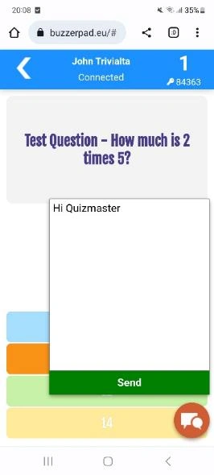
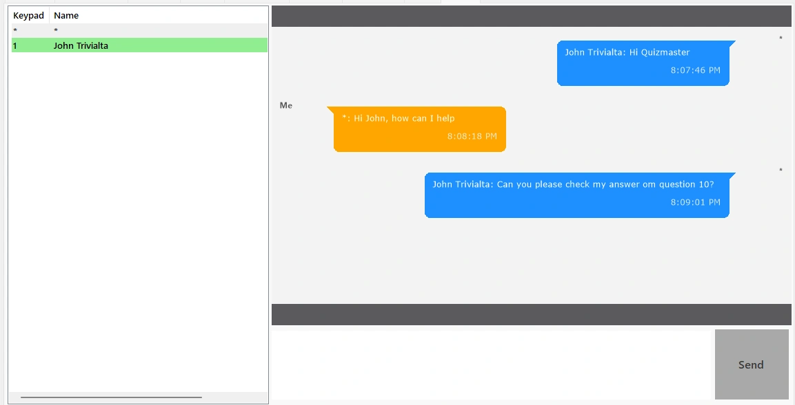
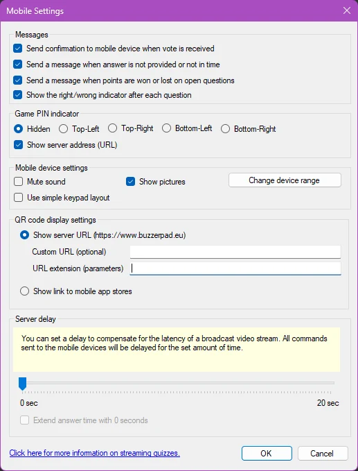
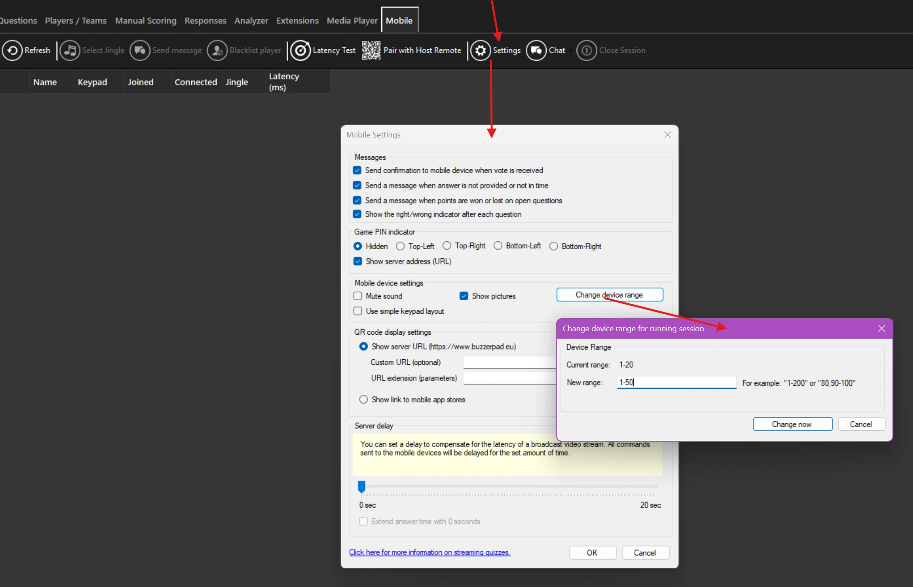

# Het tabblad Mobile

Het tabblad Mobile toont alle momenteel verbonden mobiele apparaten.

{ loading=lazy }

Hier kunt u:

- Selecteer Jingle: **jingleselectie** afdwingen voor alle spelers die de Smart Buzzer-app gebruiken

- **Bericht versturen:** een bericht sturen naar de geselecteerde speler(s)

- **Speler uitsluiten: de geselecteerde speler permanent blokkeren zodat hij niet opnieuw aan uw quiz kan deelnemen**

- **Latencytest: de verbindingskwaliteit van alle apparaten controleren**

- **Koppelen met Host Remote: de QR-code tonen die door de Director-app (mobiele quizmasterafstandsbediening) moet worden gescand om deze computer toe te voegen aan de lijst met computers die kunnen worden bediend.**

- Instellingen: het dialoogvenster met de mobiele instellingen openen

- Chat: een chatsessie openen waarmee u met alle spelers kunt chatten

- Rechts ziet u de huidige PIN (bij gebruik in servermodus)

## Latencytest

De latencytest wordt vooral gebruikt bij lokale wifi, om te testen of al uw spelers een stabiele verbinding met uw router hebben. Hij stuurt een ping naar alle apparaten en meet hoe lang het duurt voordat er een antwoord binnenkomt. Dit wordt achter elk mobiel apparaat uitgezet in een grafiek zoals deze:

{ loading=lazy }

Wanneer een apparaat erg traag is of de verbinding is verbroken, wordt de grafiek rood, en kunt u als quizmaster de speler waarschuwen dichter bij het toegangspunt te gaan staan. Let op: laat de latencytest niet draaien tijdens uw quiz, want de test gebruikt wifi-bandbreedte en servercapaciteit.

## Direct chatten

U kunt een chatsessie met de spelers starten door op de knop Chat te klikken.

{ width="171" loading=lazy }  
Nadat u de chat heeft gestart, zien spelers een chatknop op hun telefoon.

{ width="163" loading=lazy } { width="166" loading=lazy }

Door op de chatknop te drukken, kunnen spelers chatberichten naar de quizmaster sturen, die zichtbaar zijn op een tabblad met de naam ‘Chat’. De quizmaster ziet alle chatberichten per gebruiker en kan elke speler afzonderlijk een bericht terugsturen.

{ width="416" loading=lazy }

!!! note

    deze functie is momenteel alleen beschikbaar voor spelers op de buzzerpad-webbuzzer. In de Smart Buzzer-app is hij nog niet beschikbaar.*

## Instellingen

Onder de knop *Instellingen* vindt u een aantal geavanceerde instellingen:

{ width="332" loading=lazy }

De selectievakjes bovenaan bepalen optionele bevestigingsberichten die naar de verbonden apparaten worden gestuurd. Deze berichten helpen gebruikers te begrijpen wat er gebeurt. De eerste optie meldt elk ontvangen antwoord terug naar het apparaat met een bericht zoals ‘We hebben antwoord D ontvangen’. De tweede optie stuurt alleen een waarschuwing terug wanneer er geen antwoord is ontvangen, of het antwoord niet op tijd is verwerkt (bijvoorbeeld door latency in de videostream). De derde optie stuurt na elke vraag een bericht met de gewonnen/verloren punten naar het apparaat, en met de laatste optie bepaalt u of het apparaat toont of de speler juist of onjuist heeft geantwoord.

Met de instelling ‘Spel PIN indicator’ kunt u een PIN-indicator configureren die tijdens de quiz op vier verschillende plaatsen op het quizscherm wordt getoond. Deze instelling geldt niet bij gebruik van wifi-modus, omdat in die modus geen PIN wordt gebruikt. De PIN-indicator ziet er als volgt uit:

{ width="310" loading=lazy }

Er zijn ook enkele instellingen voor het mobiele keypad, zoals of het geluiden moet afspelen, en, voor de buzzerpad-website, een optie om het simpel keypadgedrag te geven, wat betekent dat alleen een keypad met 7 knoppen wordt getoond (verouderde modus). Hier kunt u ook aangeven of u ook afbeeldingen op de mobiele telefoons wilt tonen.

In de sectie QR-codeweergave geeft u aan of u een QR-code wilt tonen die naar de webbuzzer verwijst zoals ingesteld in QuizXpress Setup, of een link naar de Smart Buzzer-app in de iOS- en Android-appstores. Als u de URL van de webbuzzer toont, kunt u in het veld URL Extension extra parameters opgeven waarmee u het webkeypad een eigen uitstraling kunt geven. Raadpleeg voor meer informatie [De buzzerpad-website van een eigen huisstijl voorzien](../using-mobile-keypads/branding-the-buzzerpad-website.md).

Met de schuifregelaar Server vertraging kunt u alle acties die naar de mobiele apparaten worden gestuurd vertragen, voor een betere synchronisatie met uw uitzendstream. Houd deze waarde op 0 wanneer u niet streamt. Als de latency van uw YouTube-stream bijvoorbeeld ~3 seconden is, kunt u de vertraging op 3 seconden zetten. Dit betekent dat wanneer het aftellen in de YouTube-stream van de spelers begint, het ook op hun apparaat begint. Zonder de vertraging zou het aftellen op het apparaat 3 seconden eerder beginnen dan de timer op YouTube, wat verwarrend kan zijn.

Wanneer de optie ‘Extend answer time’ is aangevinkt, blijft het systeem stemmen accepteren ook nadat de aftelklok is afgelopen, gedurende de tijd die is ingesteld met de schuifregelaar ‘Server vertraging’. Hiermee kunt u compenseren voor streamlatency. Als er bijvoorbeeld een vertraging van 5 seconden op de stream zit, kijken de spelers aan de andere kant van de stream nog 5 seconden naar de tikkende klok nadat die in de studio al is gestopt. Als deze optie aan staat, accepteert het systeem dus nog stemmen in deze laatste 5 seconden, zodat spelers geen vraag mislopen.

**Het bereik van mobiele apparaten tijdens de quiz wijzigen**

Stel, u heeft een online quiz gestart waarbij u maximaal 20 spelers verwacht (apparaatbereik “1-20”), en 10 minuten na uw introductie willen er nog 15 spelers meedoen. Vroeger moest u dan de quiz herstarten en iedereen opnieuw laten registreren met de nieuwe PIN, enzovoort. Om dit te voorkomen, kunt u het bereik van mobiele apparaten nu bijwerken terwijl uw quiz draait.

Open hiervoor Director in de quizspeler, ga naar het tabblad Mobile en klik op de knop Instellingen. Klik vervolgens op de knop Apparaatbereik wijzigen en voer het nieuwe bereik in:

{ loading=lazy }

Het systeem controleert of het bereik geldig is en vraagt om bevestiging. Na uw goedkeuring wordt de server bijgewerkt. Let op: als u het bereik kleiner maakt — bijvoorbeeld van “1-50” naar “1-20” — worden de verbonden spelers die buiten het nieuwe bereik vallen losgekoppeld.
