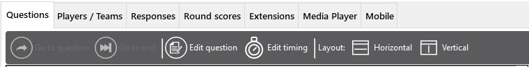

# La vista Questions

La scheda ‘Questions’ offre una panoramica di tutte le domande del quiz caricato. È possibile vedere le miniature di tutte le diapositive e, selezionando una domanda, nel riquadro a destra vengono mostrati la domanda, le risposte e la documentazione (si noti che non si tratta di una rappresentazione grafica completa).

{ width="582" loading=lazy }

Con la barra degli strumenti è possibile eseguire le seguenti operazioni:

- **Go to question: passare a una domanda specifica (possibile solo quando nessuna domanda è in conto alla rovescia). Per farlo, fare clic su un’altra domanda nell’elenco, quindi su ‘Go to question’.**

- **Go to end: passare alla fine del quiz (possibile solo quando nessuna domanda è in conto alla rovescia). Facendo clic su questo pulsante viene mostrata la panoramica dei punteggi finali.**

- **Edit question: modifica immediata della domanda selezionata (correggere l’ortografia, cambiare la risposta corretta, ecc.)**

- **Edit timing**: regolare i tempi delle domande (durata del conto alla rovescia)

- **Layout Horizontal/Vertical: passare da una disposizione orizzontale a una verticale**

L’elenco delle domande mostra un’indicazione visiva delle domande già visitate (verde) e della domanda corrente (giallo).

Quando la diapositiva selezionata è una diapositiva di minigioco, è possibile fare doppio clic su quella voce per modificare ‘al volo’ la configurazione memorizzata. Un esempio di utilizzo: un quiz con diversi minigiochi Wheel of Fortune usati per assegnare una serie di premi ai vincitori dei round: una volta assegnato un premio, potrebbe essere opportuno rimuoverlo dalla Wheel of Fortune successiva se si dispone di una sola copia di quel premio.
