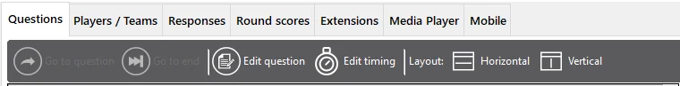

# La scheda Domande

La scheda ‘Domande’ offre una panoramica di tutte le domande del quiz caricato. È possibile vedere le miniature di tutte le diapositive e, selezionando una domanda, nel riquadro a destra vengono mostrati la domanda, le risposte e la documentazione (si noti che non si tratta di una rappresentazione grafica completa).

{ width="582" loading=lazy }

Con la barra degli strumenti è possibile eseguire le seguenti operazioni:

- **Vai alla Domanda: passare a una domanda specifica (possibile solo quando nessuna domanda è attiva o in fase di avvio). Per utilizzarlo, fare clic su un’altra domanda nell’elenco, quindi su ‘Vai alla Domanda’.**

- **Vai alla Fine: saltare alla fine del quiz (possibile solo quando nessuna domanda è attiva o in fase di avvio). Facendo clic su questo pulsante viene mostrata la schermata dei punteggi finali.**

- **Modifica Domanda: modificare ‘al volo’ la domanda selezionata (correggere l’ortografia, cambiare la risposta corretta, ecc.)**

- **Modifica Tempo**: regolare i tempi delle domande (durata countdown)

- **Layout Orizzontale/Verticale: passare da una disposizione orizzontale a una verticale**

L’elenco delle domande mostra un’indicazione visiva delle domande già svolte (verde) e della domanda corrente (giallo).

Quando la diapositiva selezionata è una diapositiva di Modulo Gioco, è possibile fare doppio clic su quella voce per modificare ‘al volo’ la configurazione memorizzata. Un esempio in cui poterla adottare è quando il quiz presenta diverse sessioni del Modulo Ruota della Fortuna usate per distribuire una serie di premi ai vincitori del round. Quando un premio è stato assegnato, è possibile rimuoverlo dalla Ruota della Fortuna successiva se si dispone di un solo pezzo per esempio.
