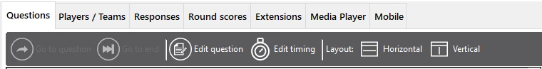

# De weergave Vragen

Het tabblad ‘Vragen’ geeft een overzicht van alle vragen in de geladen quiz. U ziet miniaturen van alle dia’s, en als u een vraag selecteert, worden de vraag, de antwoorden en de documentatie getoond in het rechterpaneel (let op: dit is geen volledige grafische weergave).

{ width="582" loading=lazy }

Met de werkbalk kunt u het volgende doen:

- **Ga naar vraag: naar een bepaalde vraag springen (alleen mogelijk wanneer er geen vraag aftelt). Klik hiervoor op een andere vraag in de lijst en klik dan op ‘Ga naar vraag’.**

- **Ga naar het eind: naar het einde van de quiz springen (alleen mogelijk wanneer er geen vraag aftelt). Als u op deze knop klikt, wordt het eindscoreoverzicht getoond.**

- **Vraag bewerken: de geselecteerde vraag direct bewerken (spelling corrigeren, het juiste antwoord wijzigen, enzovoort)**

- **Countdowntijd wijzigen**: de timing van uw vragen (aftelttijd) aanpassen

- **Indeling horizontaal/verticaal: schakelen tussen een horizontale of verticale indeling**

In de lijst met vragen staat een visuele aanduiding van de vragen die zijn bezocht (groen) en van de huidige vraag (geel).

Wanneer de geselecteerde dia een minigame-dia is, kunt u dubbelklikken op dat item om de opgeslagen configuratie ‘on the fly’ te wijzigen. Een voorbeeld waarbij u dit kunt gebruiken is een quiz met meerdere Rad van Fortuin-minigames waarmee een aantal prijzen aan rondewinnaars wordt weggegeven: zodra een prijs is weggegeven, wilt u die misschien uit het volgende Rad van Fortuin halen als u maar één exemplaar van die prijs heeft.
