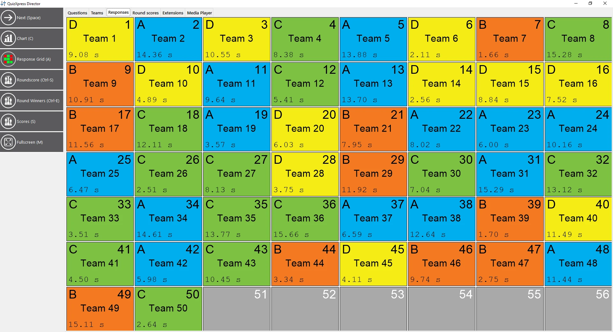

# La vista Responses

La vista ‘Responses’ offre una panoramica ‘in tempo reale’ delle risposte ricevute dal sistema. È possibile vedere il numero della pulsantiera, il nome della squadra/del giocatore, la risposta data e l’ora (se lo spazio sullo schermo lo consente). Si tratta di una vista di sola lettura, senza nulla da configurare; è utile durante lo show di quiz, ad esempio per vedere quale risposta manca ancora. Durante un Modulo Gioco, qui è anche possibile vedere quale scelta hanno fatto i giocatori durante il gioco (o quali giocatori non hanno ancora fatto una scelta).

{ loading=lazy }
