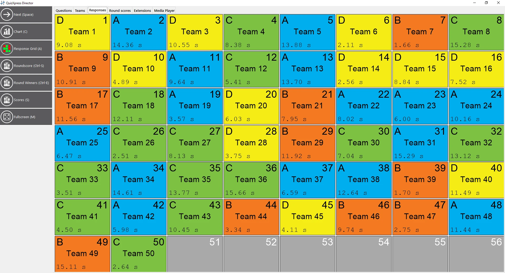

# De weergave Responses

De weergave ‘Responses’ geeft een ‘realtime’ overzicht van de responses die het systeem ontvangt. U ziet het keypadnummer, de team-/spelernaam, de gegeven response en het tijdstip (als de ruimte op het scherm het toelaat). Dit is een alleen-lezen weergave waarin niets te configureren is; ze helpt u tijdens de quizshow bijvoorbeeld om te zien welke response nog ontbreekt. Bij het spelen van een minigame ziet u hier ook welke keuze spelers tijdens het spel hebben gemaakt (of welke spelers nog geen keuze hebben gemaakt).

{ loading=lazy }
