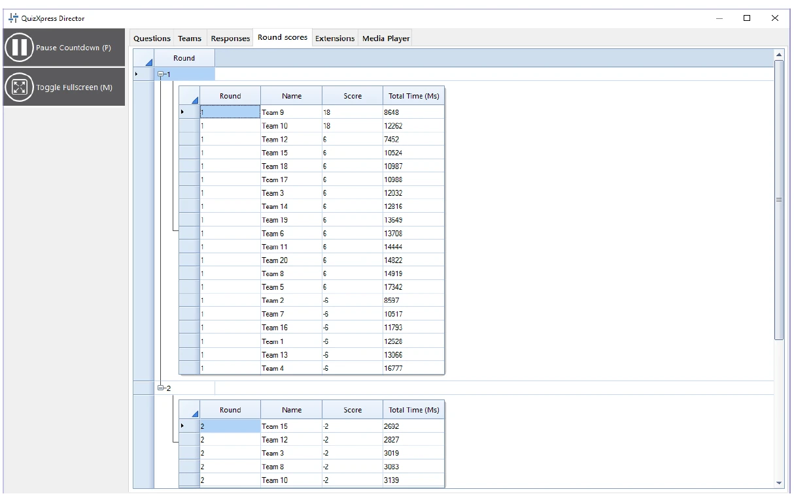

# La vue Round scores

Si votre quiz utilise des manches (c’est-à-dire qu’il y a une diapositive de fin de manche quelque part), l’onglet « Round scores » est visible dans Director.

L’onglet Round scores affiche le score total par manche. Vous pouvez afficher/masquer les scores de chaque manche en développant/réduisant les nœuds des manches.

{ loading=lazy }
