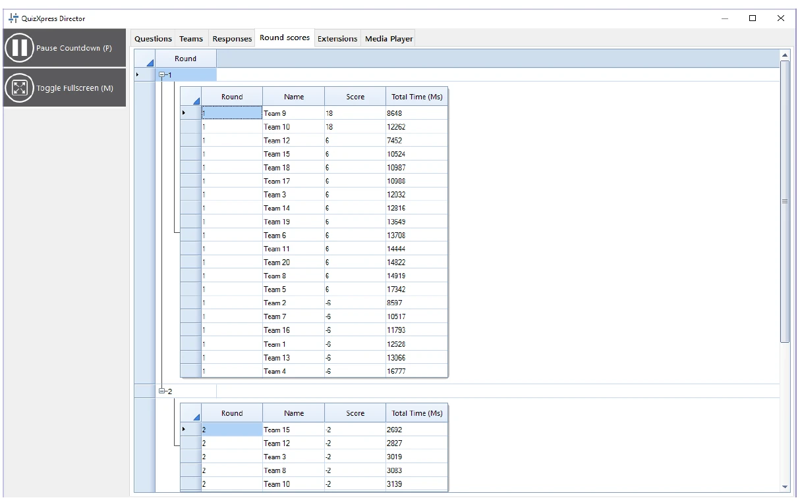

# De weergave Ronde scores

Als uw quiz rondes gebruikt (dat wil zeggen dat er ergens een einde-ronde-dia is), is het tabblad ‘Ronde scores’ zichtbaar in Director.

Het tabblad Ronde scores toont de totaalscore per ronde. U kunt de scores van elke ronde tonen/verbergen door de rondeknooppunten uit te vouwen/samen te vouwen.

{ loading=lazy }
