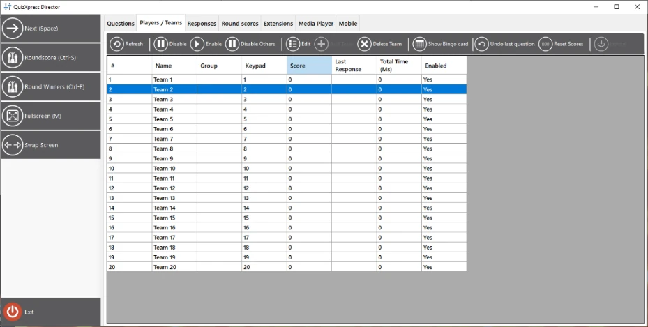
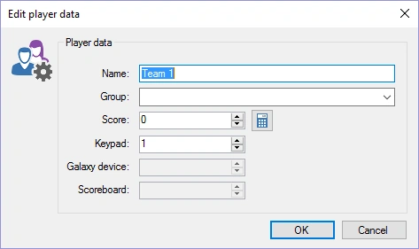
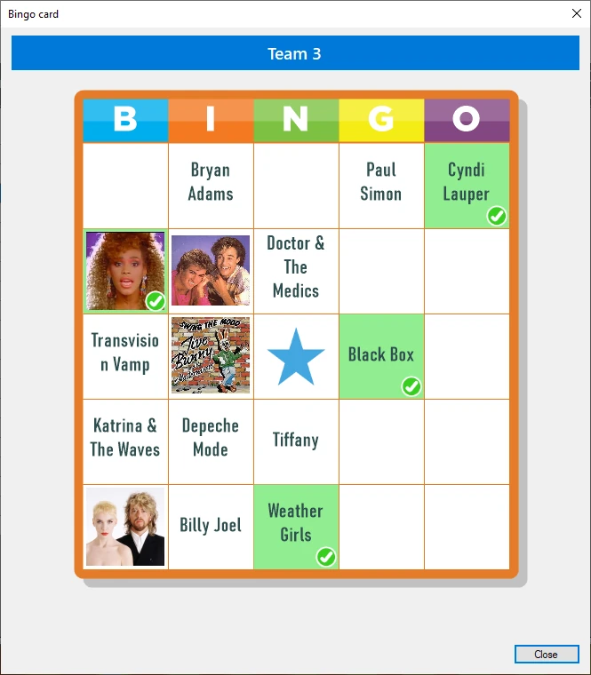
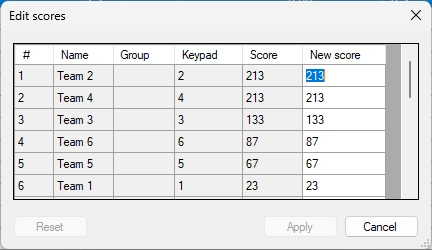
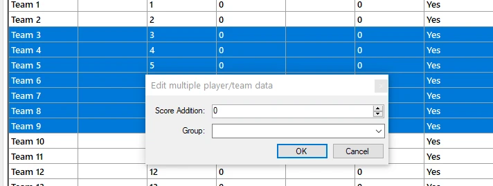

# La vue Teams

La vue « Teams » offre un aperçu de tous les joueurs/équipes actuellement actifs dans le système. Vous pouvez voir leur nom, le groupe (facultatif) auquel ils appartiennent, le keypad assigné, le score, la dernière réponse enregistrée et le temps total passé à répondre (les équipes sont classées par score ; à score égal, le temps total passé sur l’ensemble des questions est pris en compte), ainsi que l’état activé ou non d’un joueur.

{ width="592" loading=lazy }

La barre d’outils permet d’effectuer les actions suivantes :

- **Disable/Enable** : désactiver/activer un joueur

- **Disable Others : désactiver tous les autres joueurs, sauf le ou les joueurs sélectionnés.**

- **Modifier les informations d’un joueur : affiche une fenêtre permettant de modifier le nom de l’équipe, le groupe (le cas échéant), le keypad et le score. Un double-clic sur la liste affiche le même formulaire :**

> { width="355" loading=lazy }

- **Ajouter un nouveau joueur/une nouvelle équipe pendant un quiz : affiche la même fenêtre que pour la modification d’une équipe/d’un joueur. Ajouter un joueur peut être utile si un nouveau joueur doit être ajouté alors que le show de quiz est déjà en cours. Si le keypad assigné est hors de la plage de la configuration actuelle du récepteur (par exemple, vous ne pouvez pas ajouter le keypad 105 si votre configuration de keypads indique « 1-100 »), le keypad sera ajouté à la configuration et le récepteur se réinitialisera.**

- **Delete team : supprime un joueur/une équipe. Contrairement à la désactivation/activation des équipes, cette action supprime définitivement l’équipe — elle n’apparaîtra plus dans les aperçus des scores.**

- **Show Bingo card : lorsque vous jouez une manche de Bingo, vous pouvez demander la carte de Bingo du joueur sélectionné. Les cases jouées sont marquées en vert. Vous ne pouvez pas voir les cases cochées par le joueur.**

> { width="201" loading=lazy }

- **Undo : annule les modifications de score effectuées pendant la dernière question. Cela peut aider à annuler des points si, par exemple, le quiz contient une erreur.**

- **Reset scores** : remet à 0 tous les scores et le temps total passé.

- **Edit Scores : modifier facilement les scores de toutes les équipes dans un tableau**

{ width="229" loading=lazy }

- **Import** : importer les résultats (points et assignation des keypads) d’un quiz précédent.

- **Ajouter/retirer des points pour plusieurs équipes, ou regrouper dynamiquement des équipes. Sélectionnez plusieurs lignes avec Maj et/ou Ctrl+clic, puis cliquez sur le bouton Edit de la barre d’outils pour ouvrir le formulaire suivant :**

> { width="478" loading=lazy }
>
> Saisissez un nom de groupe (ou sélectionnez un groupe existant dans la liste) ou modifiez le champ Score Addition pour modifier les points de toutes les équipes sélectionnées.
>
> Lorsque vous faites un clic droit, un menu contextuel apparaît, contenant un sous-ensemble des boutons ci-dessus, ainsi que d’autres fonctions, telles que :

- Ajouter ou retirer facilement des points (utile, par exemple, pour une activité se déroulant en dehors du quiz). Les options d’ajout et de retrait de points disposent chacune d’un sous-menu avec des valeurs prédéfinies. Lorsque vous choisissez l’une de ces valeurs, les options Add et Subtract affichées dans le menu sont remplacées par cette valeur, qui sert de raccourci pour les modifications suivantes.

- L’option « add points and animate » affiche une grande coche verte au centre de l’écran. « Subtract and animate » affiche une grande croix rouge au centre de l’écran.

- L’option « vote » vous permet de saisir un vote pour un joueur (peut, par exemple, servir pour des tests)

- Si vous avez envie de vous amuser, vous pouvez laisser une IA « charrier » publiquement un joueur après une mauvaise réponse. Vous pouvez choisir un charriage gentil ou méchant (le plus « méchant » que puisse faire une IA). La génération tient compte de la question posée, du nom du joueur et de la mauvaise réponse donnée, et est lue à voix haute avec une voix générée par IA.

!!! note

    cette option nécessite 5 crédits IA (disponibles dans notre boutique) et une connexion Internet fonctionnelle.*
