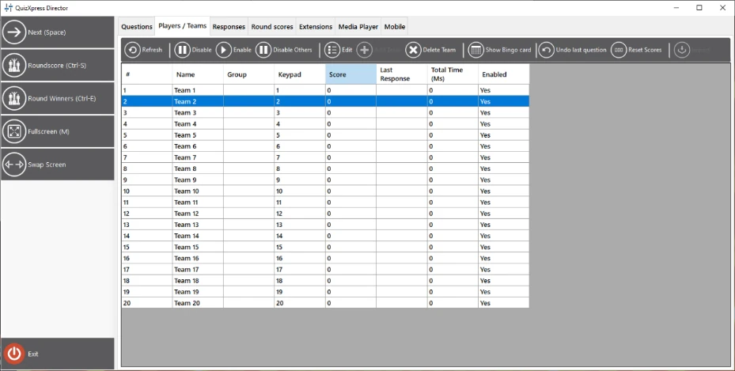
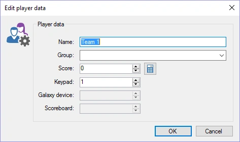
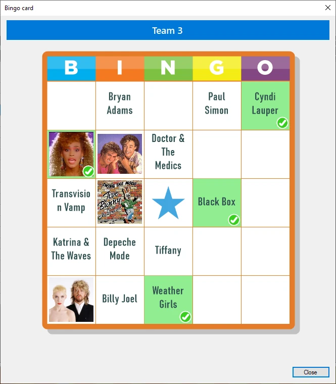
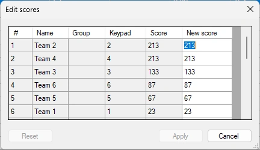
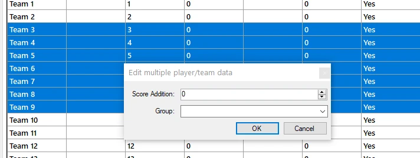

# La scheda Giocatori / Squadre

La scheda ‘Giocatori / Squadre’ offre una panoramica di tutti i giocatori/le squadre attualmente attivi nel sistema. È possibile vedere il nome, l’eventuale gruppo di appartenenza, la pulsantiera assegnata, il punteggio, l’ultima risposta registrata e il tempo totale impiegato per rispondere (le squadre sono classificate per punteggio; a parità di punteggio si considera il tempo totale impiegato su tutte le domande), nonché se un giocatore è abilitato.

{ width="592" loading=lazy }

Con la barra degli strumenti è possibile eseguire le seguenti azioni:

- **Disabilita/Abilita**: disabilitare/abilitare un giocatore

- **Disabilita Altri: disabilitare tutti gli altri giocatori tranne quelli selezionati.**

- **Modifica Giocatore: modificare i dettagli di un giocatore; mostra una finestra che consente di modificare il nome della squadra, il gruppo (se applicabile), la pulsantiera e il punteggio. La finestra può essere aperta anche facendo doppio clic sull’elenco:**

> { width="355" loading=lazy }

- **Aggiungi Giocatore: aggiungere un nuovo giocatore/una nuova squadra durante un quiz; mostra la stessa finestra della modifica di una squadra/di un giocatore. Aggiungere un giocatore può essere utile se è necessario aggiungerne uno nuovo mentre il quiz show è già in corso. Se la pulsantiera assegnata è fuori dall’intervallo previsto dalla configurazione corrente del ricevitore (ad esempio, non è possibile aggiungere la pulsantiera 105 se la configurazione delle pulsantiere indica “1-100”), la pulsantiera verrà aggiunta alla configurazione e il ricevitore si reinizializzerà.**

- **Elimina Giocatore: elimina un giocatore/una squadra. A differenza della disabilitazione/abilitazione delle squadre, questa azione rimuove definitivamente la squadra, che non verrà più mostrata nelle panoramiche dei punteggi.**

- **Mostra Cartella Bingo: durante un round di Bingo, è possibile richiedere la cartella Bingo del giocatore selezionato. Le celle giocate sono contrassegnate in verde. Non è possibile vedere le celle spuntate dal giocatore.**

> { width="201" loading=lazy }

- **Annulla Ultima Domanda: annulla le modifiche ai punteggi effettuate durante l’ultima domanda. Può servire ad annullare dei punti se, ad esempio, il quiz contiene un errore nella domanda.**

- **Reset Punteggi**: azzera tutti i punteggi e il tempo totale impiegato.

- **Modifica Punteggi: modificare facilmente in una tabella i punteggi di tutte le squadre**

{ width="229" loading=lazy }

- **Importa**: importare i risultati (punti e assegnazione delle pulsantiere) da un quiz precedente.

- **Aggiungi/sottrai punti a più squadre, o raggruppa dinamicamente le squadre. Selezionare più righe usando Maiusc e/o Ctrl+clic, quindi fare clic sul pulsante ‘Modifica Giocatore’ nella barra degli strumenti per aprire il seguente popup:**

> { width="478" loading=lazy }
>
> Immettere il nome di un gruppo (o selezionare un gruppo esistente dall’elenco) oppure modificare il campo ‘Aggiungi Punteggio’ per cambiare i punti di tutte le squadre selezionate.
>
> Facendo clic con il pulsante destro del mouse compare un menu contestuale che contiene un sottoinsieme dei pulsanti mostrati sopra, insieme ad altre funzioni, come:

- Aggiungere o sottrarre facilmente punti (utile, ad esempio, per attività che si svolgono al di fuori del quiz). Le opzioni di aggiunta e sottrazione dei punti hanno ciascuna un sottomenu con valori predefiniti. Quando si sceglie uno di questi valori, le voci ‘Aggiungi punti’ e ‘Sottrai punti’ del menu vengono sostituite da quel valore, da usare come scorciatoia per le modifiche successive.

- L’opzione ‘Aggiungi punti e anima’ mostra un grande segno di spunta verde al centro dello schermo. ‘Sottrai punti e anima’ mostra invece una grande croce rossa al centro dello schermo.

- L’opzione ‘Vota’ consente di immettere un voto per un giocatore (può essere usata, ad esempio, per i test)

- Per aggiungere un tocco di divertimento, è possibile lasciare che un’AI ‘prenda in giro’ pubblicamente un giocatore dopo una risposta errata. È possibile scegliere ‘Presa in giro AI Gentile’ o ‘Presa in giro AI Cattiva’ (la più ‘pungente’ che un’AI possa fare). La generazione tiene conto della domanda posta, del nome del giocatore e della risposta errata data, e viene letta ad alta voce con una voce generata dall’AI.

!!! note

    questa opzione richiede 5 crediti AI (disponibili nel nostro shop) e una connessione Internet funzionante.*
