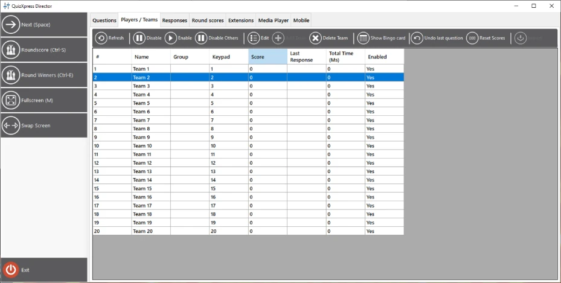
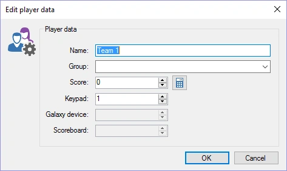
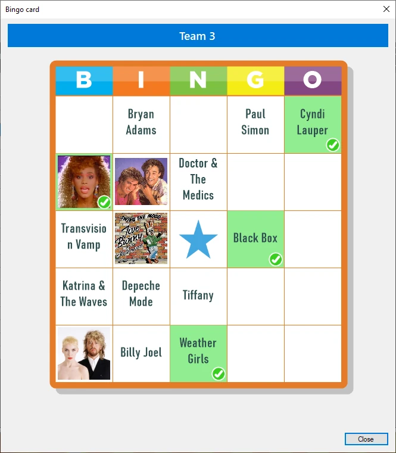
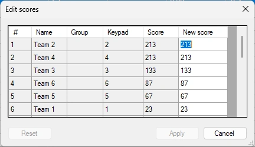
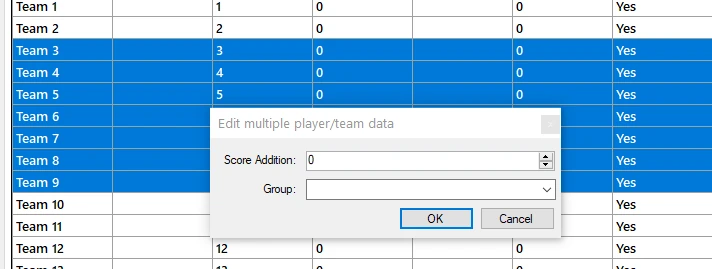

# De weergave Teams

De weergave ‘Teams’ geeft een overzicht van alle spelers/teams die momenteel actief zijn in het systeem. U ziet hun naam, de (optionele) groep waarin ze zitten, het toegewezen keypad, de score, de laatst geregistreerde response en de totale antwoordtijd (teams worden gerangschikt op score; bij gelijke scores wordt de totale tijd over alle vragen meegewogen), en ook of een speler is ingeschakeld.

{ width="592" loading=lazy }

Met de werkbalk kunt u de volgende acties uitvoeren:

- Een speler **uitschakelen/inschakelen**

- **Andere spelers uitsluiten – alle andere spelers uitschakelen behalve de geselecteerde speler(s).**

- **De gegevens van een speler bewerken: toont een venster waarin u teamnaam, groep (indien van toepassing), keypad en score kunt wijzigen. Dubbelklikken op de lijst toont hetzelfde formulier:**

> { width="355" loading=lazy }

- **Een nieuwe speler/nieuw team toevoegen tijdens een quiz: toont hetzelfde venster als bij het bewerken van een team/speler. Een speler toevoegen kan handig zijn als er een nieuwe speler moet worden toegevoegd terwijl de quizshow al bezig is. Als het toegewezen keypad buiten het bereik valt van de huidige configuratie van de ontvanger (u kunt bijvoorbeeld keypad 105 niet toevoegen als uw keypadconfiguratie “1-100” aangeeft), wordt het keypad aan de configuratie toegevoegd en wordt de ontvanger opnieuw geïnitialiseerd.**

- **Team verwijderen: verwijdert een speler/team. In tegenstelling tot het uitschakelen/inschakelen van teams verwijdert dit het team permanent — het wordt niet meer getoond in scoreoverzichten.**

- **Bingokaart tonen: bij het spelen van een Bingo-ronde kunt u de Bingo-kaart van de geselecteerde speler opvragen. De gespeelde cellen zijn groen gemarkeerd. U kunt de door de speler gemarkeerde cellen niet zien.**

> { width="201" loading=lazy }

- **De scorewijzigingen van de laatste vraag ongedaan maken. Dit kan helpen om punten terug te draaien als de quiz bijvoorbeeld een fout bevat.**

- **Scores resetten**: zet alle scores en de totale antwoordtijd terug op 0.

- **Scores bewerken: de scores van alle teams eenvoudig bewerken in een tabel**

{ width="229" loading=lazy }

- **Importeren**: de resultaten (punten en keypadtoewijzing) van een eerdere quiz importeren.

- **Punten toevoegen/aftrekken voor meerdere teams, of teams dynamisch groeperen. Selecteer meerdere rijen met Shift en/of Ctrl+klik, en klik dan op de knop Bewerken in de werkbalk om het volgende formulier te openen:**

> { width="478" loading=lazy }
>
> Voer een groepsnaam in (of selecteer een bestaande groep in de lijst) of wijzig het veld Score-toevoeging om de punten van alle geselecteerde teams aan te passen.
>
> Wanneer u met de rechtermuisknop klikt, ziet u een contextmenu met een deel van de hierboven getoonde knoppen, samen met enkele andere functies, zoals:

- Eenvoudig punten toevoegen of aftrekken (bijvoorbeeld handig voor activiteiten buiten de quiz). De opties voor punten toevoegen en punten aftrekken hebben elk een submenu met vooraf ingestelde waarden. Wanneer u een van de vooraf ingestelde waarden kiest, worden de opties Toevoegen en Aftrekken in het menu vervangen door die waarde, als snelkoppeling voor toekomstige wijzigingen.

- De optie punten toevoegen en animeren toont een groot groen vinkje midden op het scherm. Aftrekken en animeren toont een groot rood kruis midden op het scherm.

- Met de optie Stem kunt u een stem voor een speler invoeren (bijvoorbeeld handig om te testen)

- Als u zin heeft in wat plezier, kunt u AI een speler publiekelijk laten ‘roasten’ nadat die een fout antwoord heeft gegeven. U kunt kiezen voor een milde of een gemene roast (het ‘gemeenst’ wat een AI kan). Bij het genereren wordt rekening gehouden met de gestelde vraag, de naam van de speler en het gegeven foute antwoord, en de tekst wordt voorgelezen met een door AI gegenereerde stem.

!!! note

    deze optie vereist 5 AI-credits (verkrijgbaar in onze shop) en een werkende internetverbinding.*
