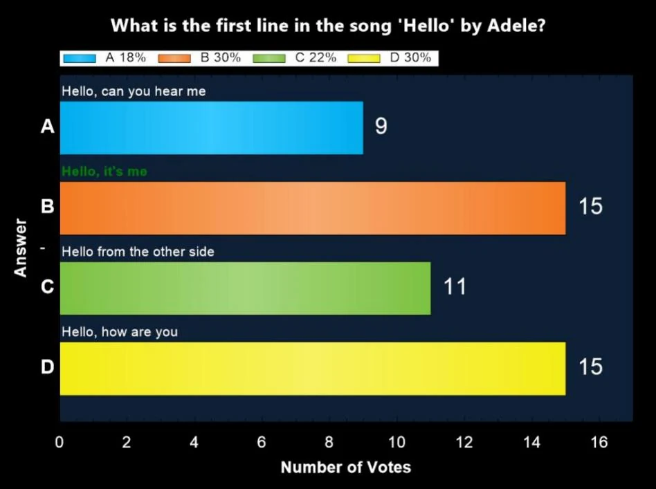

# Pantalla de gráfico

Una vez finalizada una pregunta, al pulsar ‘C’ se muestra un gráfico con las respuestas elegidas, indicando el número de personas que eligieron cada respuesta.

{ width="605" loading=lazy }

Si el público está dividido en grupos, puede pulsar ‘G’ para mostrar un gráfico con las puntuaciones por grupo de la pregunta actual. Tenga en cuenta que el aspecto del gráfico puede personalizarse por completo con el [skinning](../../advanced/skinning/index.md).
