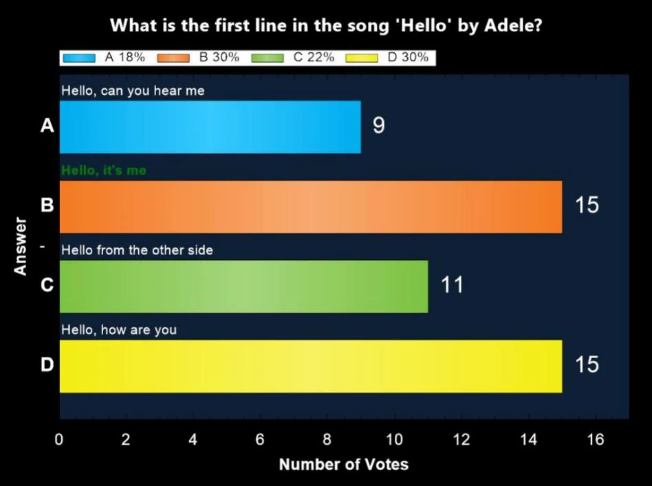

# Grafiekscherm

Nadat een vraag is afgelopen, toont ‘C’ een grafiek van de gekozen antwoorden, met het aantal mensen dat elk antwoord heeft gekozen.

{ width="605" loading=lazy }

Als het publiek in groepen is verdeeld, kunt u op ‘G’ drukken om een grafiek te tonen met de groepsscores voor de huidige vraag. Let op: het uiterlijk van de grafiek kan volledig worden aangepast met [skinning](../../advanced/skinning/index.md).
