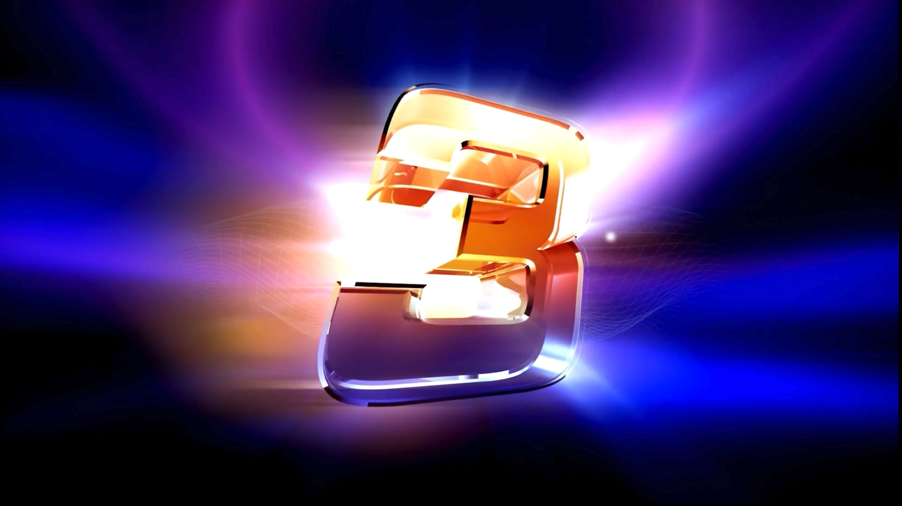

# La schermata del conto alla rovescia

Dopo la schermata di registrazione dei keypad viene mostrato un video del conto alla rovescia per creare un po’ di suspense. Se non si desidera vedere questo video prima dell’inizio del quiz, deselezionare ‘Show 3-2-1 Quiz countdown screen’ nella pagina ‘Screens’ di Quiz Setup. È possibile interrompere la schermata premendo la barra spaziatrice durante il video.

{ loading=lazy }
