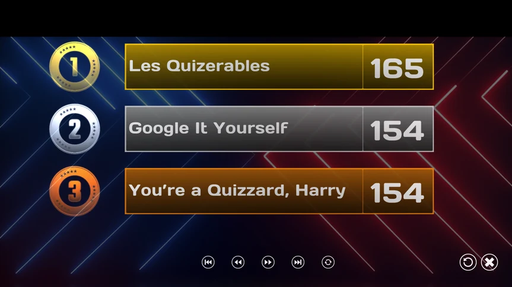
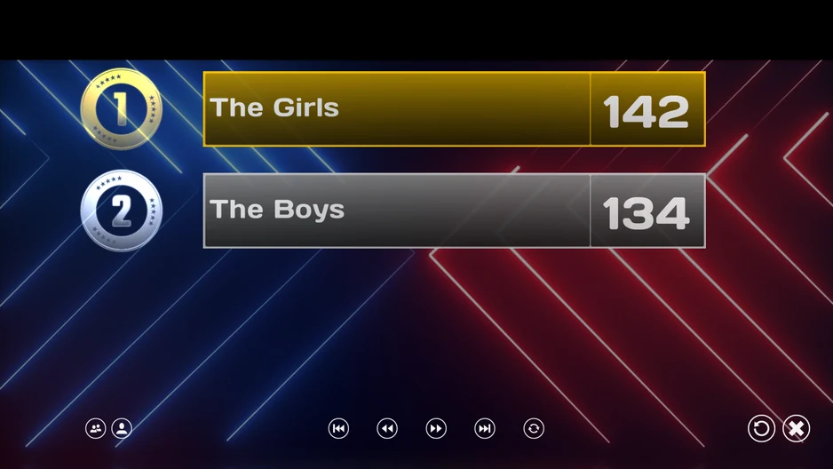

# La pantalla de puntuación final

Cuando ha terminado la última diapositiva del quiz, llega el momento de anunciar los resultados finales: suena un redoble y se muestran uno a uno los tres mejores equipos.

{ loading=lazy }

En la parte inferior de la pantalla hay unos botones que permiten desplazarse por la lista de puntuaciones. Puede avanzar o retroceder una pantalla, o saltar directamente a la primera o a la última pantalla. El botón situado más a la derecha de los cinco botones pequeños (la flecha giratoria) hace que la lista se desplace automáticamente cada pocos segundos. El botón con la ‘cruz’ cierra QuizXpress Live (o puede colocar el ratón en la parte superior derecha de la pantalla).

Como alternativa, cuando QuizXpress Director está abierto, los botones no son visibles en la parte inferior. En ese caso, puede desplazarse por las puntuaciones con los botones que se muestran en Director en el lado izquierdo, con el teclado del ordenador (espacio/página arriba/página abajo) o con el mando a distancia.

Para crear más suspense, active la siguiente opción en la pestaña Advanced de Quiz Setup:

{ width="341" loading=lazy }

Cuando esta opción está activada, al principio no se muestra ninguna puntuación. Al pulsar ‘Next’ en el mando a distancia, ‘Next’ en Director o la barra espaciadora en el teclado del ordenador, se revela primero el tercer puesto, después el segundo, luego el primero y, por último, el resto.

Si un quiz contiene varios grupos ‘Demographic’ de personas (consulte [Demographic](the-quiz-screen-voting-everybody-answers.md#demographic)), la pantalla de puntuación final tiene un aspecto ligeramente distinto.

De forma predeterminada se muestran las puntuaciones por grupo. Puede alternar entre las puntuaciones por grupo y las individuales pulsando los dos botones situados más a la izquierda en la parte inferior. Pulse el botón con ‘dos cabezas’ para mostrar las puntuaciones por grupo. Pulse el botón con ‘una persona’/‘dos personas’ para alternar entre las puntuaciones individuales y por grupo.

{ loading=lazy }
