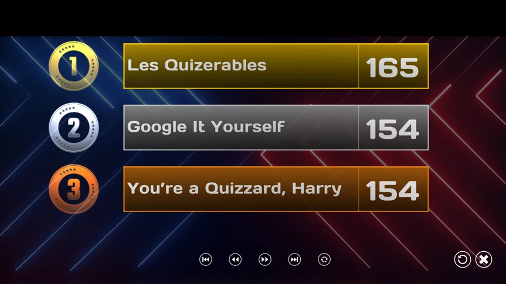
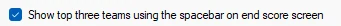
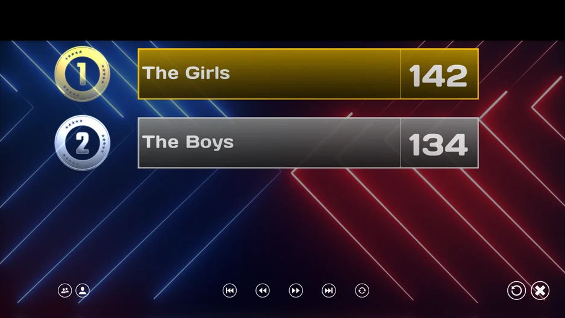

# La schermata Classifica Finale

Conclusa l’ultima diapositiva del quiz, si giunge al momento di annunciare i risultati finali! Rullo di tamburi… e le prime tre squadre classificate vengono visualizzate (tutte insieme o una per volta).

{ loading=lazy }

Nella parte inferiore della schermata, sono visualizzati una serie di pulsanti che consentono di navigare attraverso la graduatoria. È possibile passare ad una schermata in avanti/indietro o saltare subito alla prima/ultima schermata. Il pulsante più a destra dei cinque piccoli pulsanti (la freccia rotante) permette di scorrere la lista automaticamente dopo alcuni secondi. Con il pulsante più a destra (la 'croce'), si può chiudere QuizXpress Live (o è possibile passare il mouse sull’angolo in alto a destra dello schermo).

In alternativa, quando QuizXpress Director è aperto, i pulsanti non sono visibili nella parte inferiore. In tal caso è possibile scorrere i punteggi con i pulsanti mostrati in Director sul lato sinistro, con la tastiera del computer (spazio/pagina su/pagina giù) o con il telecomando remoto, Hardware o App.

Per aumentare la suspense, è possibile attivare la seguente opzione in Quiz Setup, nella scheda Avanzate:

{ width="341" loading=lazy }

Quando questa impostazione è attiva, inizialmente i punteggi non vengono mostrati. Premendo Prossimo sul telecomando, su Director o con la barra spaziatrice della tastiera, i punteggi vengono rivelati in questo ordine: prima il 3° posto, poi il 2°, quindi il 1°, e infine tutti gli altri.

Nel caso in cui un quiz contenga più gruppi "demografici" di persone  (vedere [Demographic](the-quiz-screen-voting-everybody-answers.md#demographic)), la schermata del punteggio finale appare leggermente diversa.

Per impostazione predefinita, saranno visualizzati i punteggi di gruppo. È possibile passare dai punteggi di gruppo ai punteggi individuali premendo i due pulsanti più a sinistra sul fondo. Premere il pulsante con "due teste" per mostrare punteggi dei gruppi. Premere il pulsante con “una testa” per mostrare i punteggi individuali.

{ loading=lazy }
