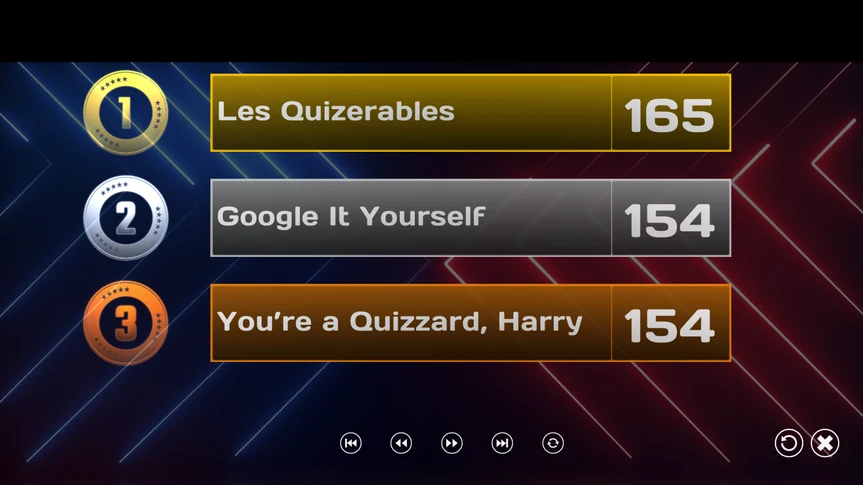
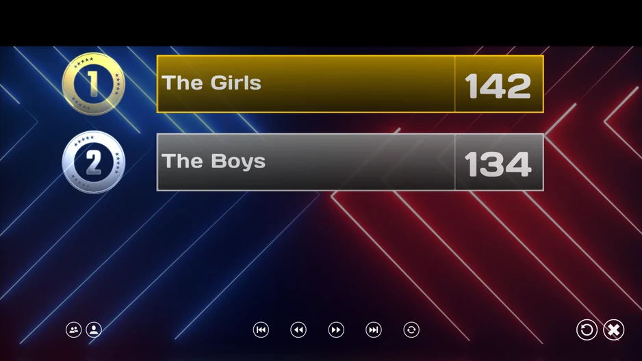

# Het eindscorescherm

Wanneer de laatste quizdia is afgelopen, is het tijd om de einduitslag bekend te maken: er klinkt een roffel en de top drie teams worden een voor een getoond.

{ loading=lazy }

Onderaan het scherm ziet u een paar knoppen waarmee u door de scorelijst navigeert. U kunt een scherm vooruit of terug springen, of direct naar het eerste of het laatste scherm gaan. Met de meest rechtse van de vijf kleine knoppen (de draaiende pijl) laat u de lijst om de paar seconden automatisch scrollen. De knop met het ‘kruisje’ sluit QuizXpress Live (of u kunt de muis naar de rechterbovenhoek van het scherm bewegen).

Wanneer QuizXpress Director geopend is, zijn de knoppen onderaan niet zichtbaar. U kunt dan door de scores navigeren met de knoppen die Director aan de linkerkant toont, het computertoetsenbord (spatie/page up/page down) of de afstandsbediening.

Voor extra spanning activeert u de volgende optie op het tabblad Geavanceerd in Quiz Setup:

{ width="341" loading=lazy }

Wanneer deze instelling is geactiveerd, worden er in eerste instantie geen scores getoond. Door op ‘Volgende’ op de afstandsbediening, ‘Volgende’ in Director of de spatiebalk op het computertoetsenbord te drukken, wordt eerst de derde plaats onthuld, dan de tweede, dan de eerste, en daarna de rest.

Als een quiz meerdere ‘demografische’ groepen mensen bevat (zie [Demografisch](the-quiz-screen-voting-everybody-answers.md#demografisch)), ziet het eindscorescherm er iets anders uit.

Standaard worden groepsscores getoond. U schakelt tussen groepsscores en individuele scores door op de twee meest linkse knoppen onderaan te drukken. Druk op de knop met ‘twee hoofden’ om groepsscores te tonen. Druk op de knop met ‘één persoon’/‘twee personen’ om te schakelen tussen individuele en groepsscores.

{ loading=lazy }
