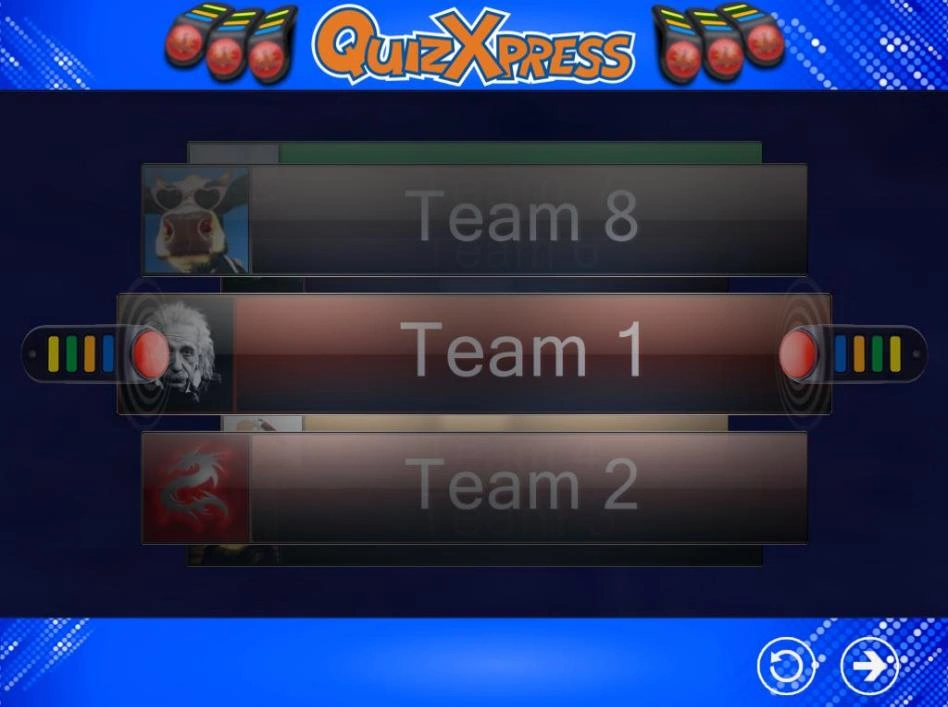
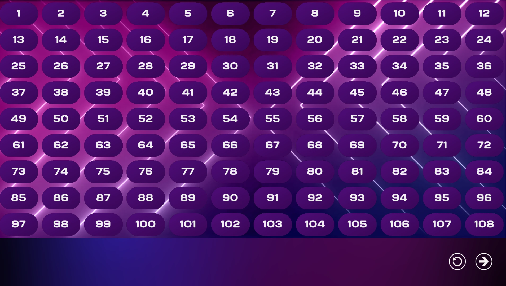
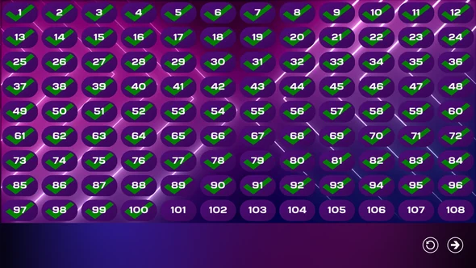

# La schermata di registrazione di keypad e buzzer

Lo scopo della schermata di registrazione è scoprire quali buzzer/keypad partecipano all'evento quiz. Facendo registrare esplicitamente i partecipanti, il software sa quanti dispositivi sono presenti. Esistono tre diverse «varianti» di schermate di assegnazione dei buzzer:

- Schermata Sony Buzzer Assignment

- Schermata Buzzer Assignment per meno di 100 partecipanti

- Schermata Buzzer Assignment per più di 100 squadre

## Schermata Sony Buzzer Assignment

Quando si utilizzano buzzer Sony, i nomi possono essere inseriti nel programma Quiz Setup per ogni partecipante/squadra. Poiché un buzzer Sony non ha un identificativo esplicito, non è possibile collegare il nome di una squadra a un buzzer specifico quando si definiscono i nomi delle squadre in Quiz Setup. La schermata Buzzer Assignment risolve il problema: mostra i nomi delle squadre uno alla volta e, quando una squadra vede il proprio nome comparire davanti al «Buzzer Assignment Carousel», deve premere il buzzer per registrarsi alla partecipazione al quiz. Di seguito è riportata una schermata di esempio della schermata Sony Buzzer Assignment.

{ width="605" loading=lazy }

In basso sono presenti due pulsanti: quello a sinistra (la freccia circolare) reimposta i dati in modo che l'assegnazione dei buzzer ricominci; il pulsante più a destra è il pulsante «start», che avvia il quiz.

## Schermata Buzzer Assignment, meno di 100 partecipanti

Ogni keypad Reply/QuizXpress ha un identificativo univoco, utilizzato anche nel software QuizXpress Live per identificare un partecipante (ad esempio, buzzer con ID 1: Squadra 1). Quando partecipano al quiz meno di 100 buzzer (come stabilito dall'impostazione «Keypads» inserita in Quiz Setup), viene mostrata una griglia con tutti gli identificativi dei buzzer.

Quando viene premuto un tasto del keypad, questo viene registrato come attivo nel sistema QuizXpress Live. Nella griglia compare un segno di spunta in corrispondenza del numero relativo all'ID del buzzer premuto.

A rigore, non è necessario che i buzzer si registrino esplicitamente. Tuttavia, il software QuizXpress Live deve sapere esattamente quante squadre partecipano, in modo da stabilire quando tutte le squadre hanno risposto a una domanda e interrompere il conto alla rovescia.

Il pulsante mostrato in basso è il pulsante «start», che avvia il quiz. Di seguito sono riportate due schermate di esempio: una mostra la schermata prima che qualcuno si sia registrato, l'altra mostra lo stato della schermata dopo che tutti si sono registrati.

| { loading=lazy } | { loading=lazy } |
|--------------------------------------------------------------------------------|---------------------------------------------------------------------------------|

!!! note

    a scopo di test, è possibile assegnare tutti i 100 buzzer in una sola volta premendo F1, oppure tutti i buzzer configurati in Quiz Setup premendo F2.*

## Schermata Buzzer Assignment, più di 100 partecipanti

Quando vengono utilizzati più di 100 buzzer, una griglia diventa sempre più difficile da leggere. Per questo motivo, in tal caso QuizXpress Live utilizza una schermata Buzzer Assignment diversa. Vedere sotto per una schermata di esempio.

Il pulsante mostrato in basso è il pulsante «start», che avvia il quiz.

!!! note

    nessuna schermata di assegnazione dei buzzer viene mostrata quando si utilizzano buzzer di tipo Keyboard o Game port, poiché questi sistemi hanno un'assegnazione fissa.*
