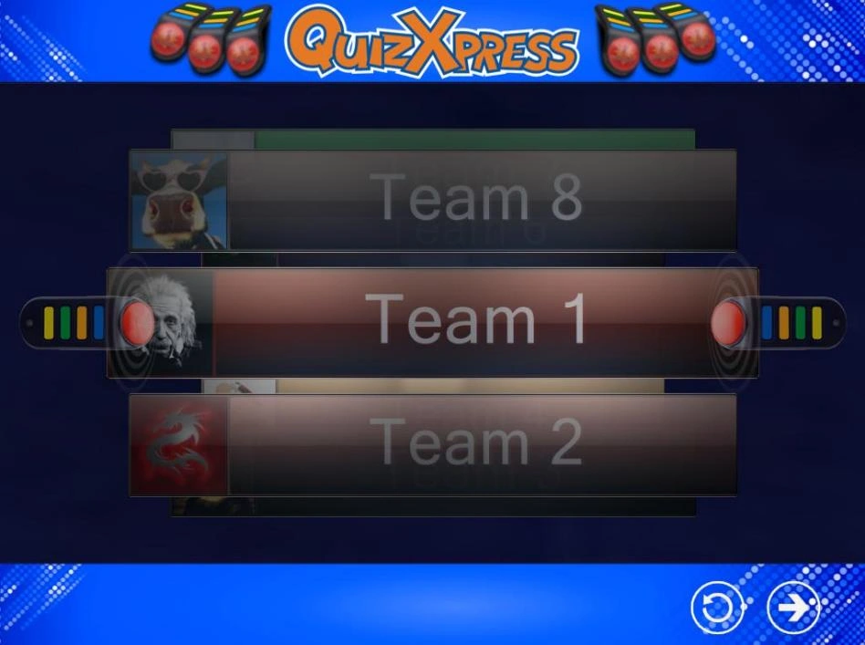
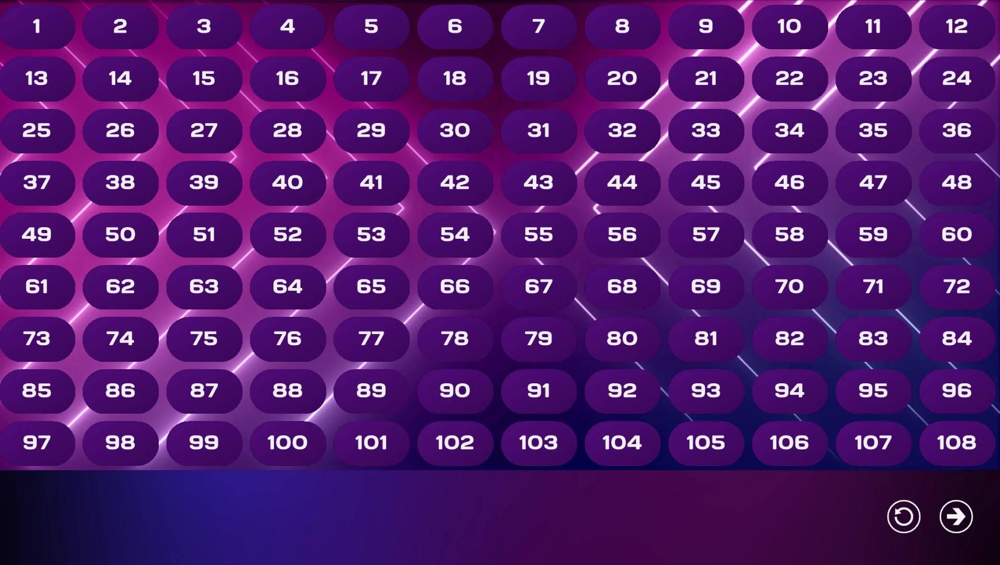
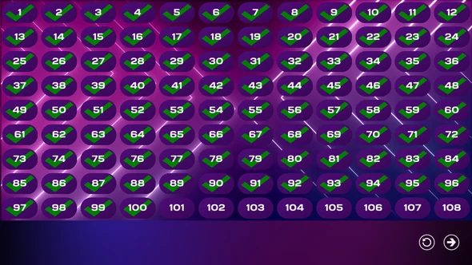
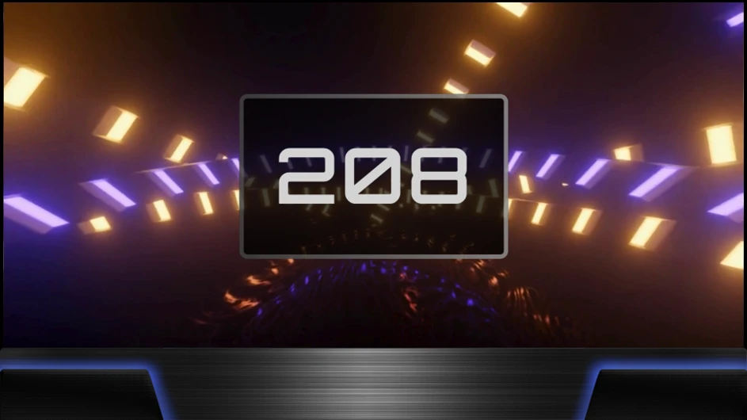

# La schermata di assegnazione delle pulsantiere

Lo scopo della schermata di registrazione è quello di verificare quali pulsantiere/buzzer partecipano all'evento quiz. Registrando esplicitamente i dispositivi, il software consentirà di sapere quanti dispositivi sono presenti. Esistono tre diverse tipologie di schermata di assegnazione:

- Schermata di assegnazione buzzer Sony

- Schermata di assegnazione fino a 100 partecipanti

- Schermata di assegnazione con più di 100 partecipanti

## Schermata di assegnazione buzzer Sony { #schermata-sony-buzzer-assignment }

Quando si utilizzano i buzzer Sony, i nomi di ogni partecipante/Squadra possono essere inseriti con l’applicazione Quiz Setup. Dato che i buzzer Sony non hanno un numero di identificazione univoco, non è possibile collegare il nome della squadra ad un buzzer specifico in QuizXpress Setup. La schermata di Assegnazione Buzzer risolve esattamente questo. Essa mostra i nomi delle squadre uno per volta. Quando una squadra vede comparire il proprio nome sul fronte del ‘Carosello di assegnazione', deve premere il proprio buzzer per registrarsi ed avere diritto di partecipare al quiz. Qui sotto è possibile vedere uno screenshot della schermata di Assegnazione Buzzer Sony.

{ width="605" loading=lazy }

In basso sono visibili due pulsanti: quello a sinistra (freccia circolare) resetta l'assegnazione dai buzzer consentendo di ripetere l’operazione di assegnazione da capo. Può accadere infatti che qualche partecipante prema erroneamente il buzzer durante l'assegnazione mentre non è il proprio turno. Il pulsante più a destra invece, è il tasto 'Start', che avvia il quiz.

## La schermata di assegnazione fino a 100 partecipanti { #schermata-buzzer-assignment-meno-di-100-partecipanti }

Ogni pulsantiera/buzzer QuizXpress ha un identificativo univoco, utilizzato anche nel software QuizXpress Live per identificare un partecipante (ad esempio, buzzer con ID 1 = Squadra 1). Quando partecipano al quiz meno di 100 buzzer (come stabilito dall'impostazione «Keypads» inserita in Quiz Setup), viene mostrata una griglia con tutti gli identificativi dei buzzer.

Quando viene premuto un tasto della pulsantiera/buzzer, questa viene registrata come attiva nel sistema QuizXpress Live. Nella griglia compare un segno di spunta in corrispondenza del numero relativo all'ID del buzzer premuto.

Non è strettamente necessario che i buzzer si registrino esplicitamente. Tuttavia, il software QuizXpress Live deve sapere esattamente quante squadre partecipano, in modo da stabilire quando tutte le squadre hanno risposto a una domanda e interrompere il conto alla rovescia.

Il pulsante mostrato in basso è il pulsante «Start», che avvia il quiz. Di seguito sono riportate due schermate di esempio: una mostra la schermata prima che i partecipanti effettuino la registrazione l'altra mostra lo stato dello schermo una volta che tutti i partecipanti hanno eseguito la registrazione.

| { loading=lazy } | { loading=lazy } |
|--------------------------------------------------------------------------------|---------------------------------------------------------------------------------|

!!! note

    In alternativa, è possibile assegnare 100 pulsantiere in una sola volta premendo il tasto F1 o tutte le pulsantiere configurate in Quiz Setup con il tasto F2*

## La schermata di assegnazione con più di 100 partecipanti { #schermata-buzzer-assignment-piu-di-100-partecipanti }

Quando vengono utilizzati più di 100 buzzer, l’utilizzo di una griglia comprometterebbe la sua buona visione e la sua lettura. In questo caso, QuizXpress Live! propone un'altra schermata di assegnazione pulsantiere. Si veda sotto uno screenshot della schermata

{ width="605" loading=lazy }

Il pulsante visualizzato nella parte inferiore destra dello schermo è il pulsante 'Start', che avvia il quiz.

!!! note

    nessuna schermata di assegnazione viene visualizzata quando si utilizza una Tastiera o Pulsantiere tipo Game Port, in quanto questi sistemi hanno una assegnazione fissa.
