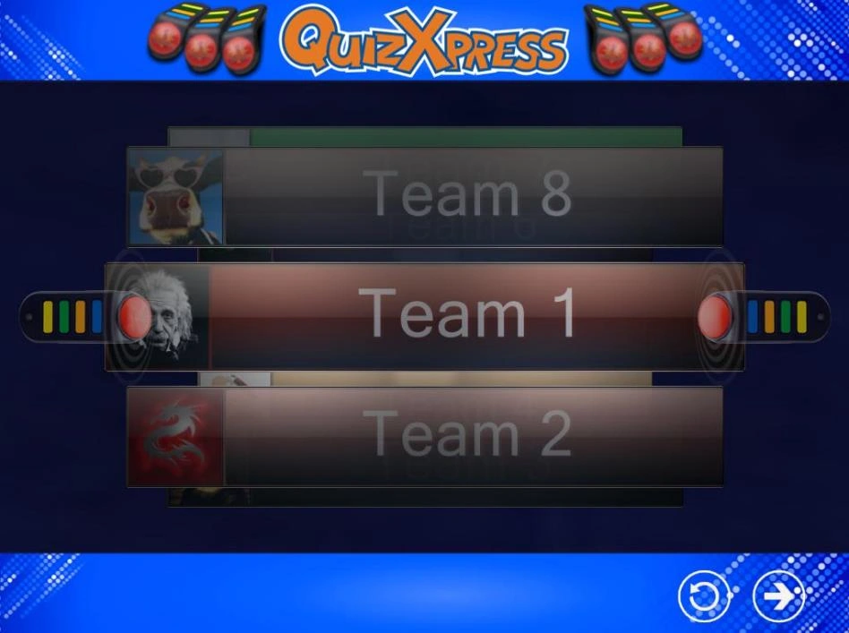
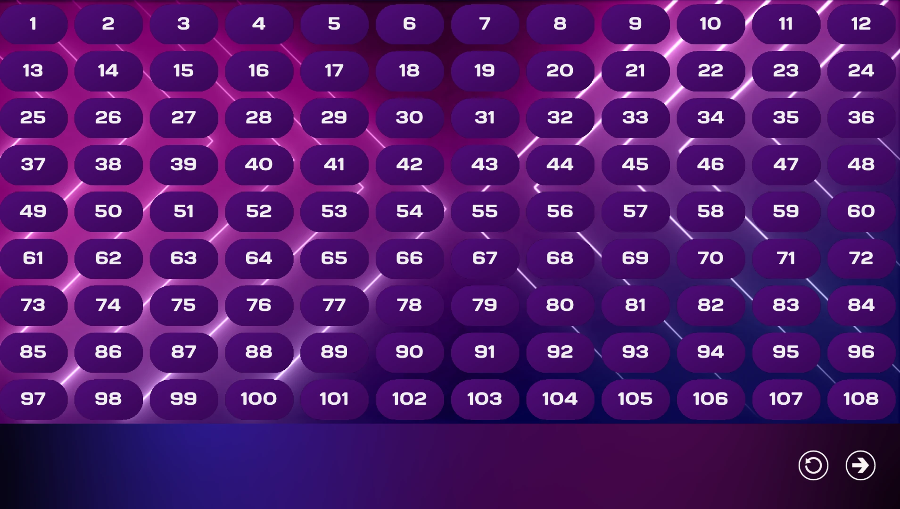
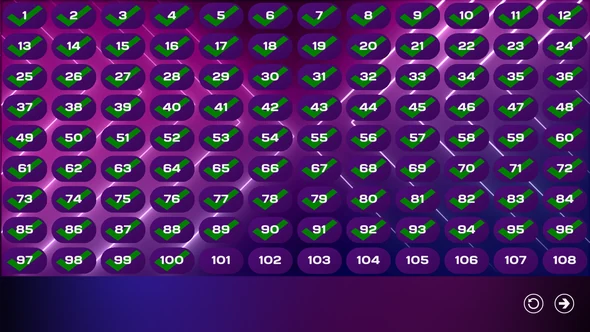

# Het keypad- en buzzerregistratiescherm

Het registratiescherm dient om vast te stellen welke buzzers/keypads aan het quizevenement deelnemen. Doordat deelnemers zich expliciet registreren, weet de software hoeveel apparaten er zijn. Er zijn drie verschillende ‘varianten’ van het buzzer-toewijzingsscherm:

- Sony Buzzer-toewijzingsscherm

- Buzzer-toewijzingsscherm voor minder dan 100 deelnemers

- Buzzer-toewijzingsscherm voor meer dan 100 teams

## Sony Buzzer-toewijzingsscherm

Bij het gebruik van Sony-buzzers kunnen in het programma Quiz Setup namen worden ingevoerd voor elke deelnemer/elk team. Omdat een Sony-buzzer geen expliciete identificatie heeft, is het niet mogelijk om bij het definiëren van de teamnamen in Quiz Setup een teamnaam aan een specifieke buzzer te koppelen. Het buzzer-toewijzingsscherm lost dit op: het toont de teamnamen een voor een, en wanneer een team zijn naam vooraan in de ‘Buzzer-toewijzingscarrousel’ ziet verschijnen, moet de buzzer worden ingedrukt om zich te registreren voor deelname aan de quiz. Hieronder ziet u een schermafbeelding van het Sony Buzzer-toewijzingsscherm.

{ width="605" loading=lazy }

Onderaan ziet u twee knoppen: de linker (de ronde pijl) reset de gegevens zodat de buzzer-toewijzing opnieuw begint; de meest rechtse knop is de ‘start’-knop, waarmee de quiz wordt gestart.

## Buzzer-toewijzingsscherm, minder dan 100 deelnemers

Elk Reply/QuizXpress-keypad heeft een unieke identificatie, die in de QuizXpress Live-software ook wordt gebruikt om een deelnemer te identificeren (bijvoorbeeld buzzer met ID 1: Team 1). Wanneer er minder dan 100 buzzers aan de quiz deelnemen (zoals bepaald door de instelling ‘Keypads’ in Quiz Setup), wordt een raster getoond met alle buzzer-ID’s.

Wanneer een toets op een keypad wordt ingedrukt, wordt het keypad in het QuizXpress Live-systeem als actief geregistreerd. Er verschijnt een vinkje in het raster bij het nummer dat overeenkomt met het ID van de ingedrukte buzzer.

Strikt genomen is het niet nodig dat de buzzers zich expliciet aanmelden. De QuizXpress Live-software moet echter precies weten hoeveel teams er deelnemen, zodat ze kan bepalen wanneer alle teams een vraag hebben beantwoord en het aftellen kan stoppen.

De knop onderaan het scherm is de ‘start’-knop, waarmee de quiz wordt gestart. Hieronder ziet u twee schermafbeeldingen: een van het scherm voordat iemand zich heeft aangemeld, en een van de toestand zodra iedereen zich heeft aangemeld.

| { loading=lazy } | { loading=lazy } |
|--------------------------------------------------------------------------------|---------------------------------------------------------------------------------|

!!! note

    om te testen kunt u alle 100 buzzers in één keer toewijzen door op F1 te drukken, of alle buzzers die in Quiz Setup zijn geconfigureerd door op F2 te drukken.*

## Buzzer-toewijzingsscherm, meer dan 100 deelnemers

Wanneer er meer dan 100 buzzers worden gebruikt, wordt een raster steeds moeilijker te lezen. Daarom gebruikt QuizXpress Live in dat geval een ander buzzer-toewijzingsscherm. Zie hieronder voor een schermafbeelding.

De knop onderaan het scherm is de ‘start’-knop, waarmee de quiz wordt gestart.

!!! note

    bij Toetsenbord- of Gameport-buzzers wordt geen buzzer-toewijzingsscherm getoond, omdat deze systemen een vaste toewijzing hebben.*
