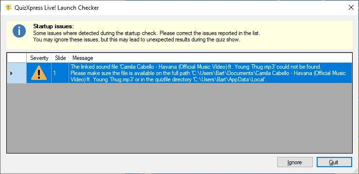

# El comprobador de inicio

Antes de que comience su show, QuizXpress Live comprueba varias condiciones, como si los vídeos externos del quiz siguen disponibles, si se puede acceder a diversos directorios y si se encuentran todos los archivos de sonido personalizados. Esto evita sorpresas durante el quiz.

Cuando se detectan problemas, aparece la siguiente ventana (los mensajes de advertencia reales pueden diferir):

{ width="591" loading=lazy }

Puede decidir si continúa con la ejecución del quiz (haciendo clic en ‘Ignore’) o si lo detiene para corregir los problemas (haciendo clic en ‘Quit’). Continuar con el show mientras hay advertencias o errores puede provocar problemas o un comportamiento inesperado durante el quiz.
