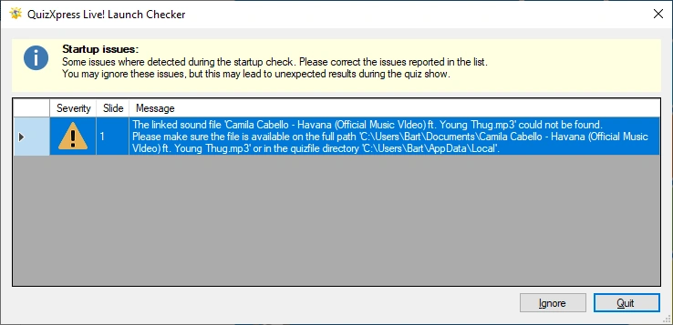

# Il controllo di avvio

Prima di avviare lo show, QuizXpress Live esegue dei controlli nei confronti di una serie di condizioni, per verificare per esempio se i video collegati al quiz sono ancora disponibili, se le varie directory sono accessibili, se tutti i file audio personalizzati sono stati trovati, ecc. Tale operazione previene spiacevoli inconvenienti di presentazione durante il quiz.

Qualora venissero rilevati dei problemi, viene visualizzata la finestra seguente (i messaggi effettivi potrebbero essere diversi):

{ width="591" loading=lazy }

Si può quindi decidere se continuare l'esecuzione del quiz (facendo clic su ‘Ignora’) oppure fermarsi e risolvere i problemi (facendo clic su ‘Esci’). Continuare l'esecuzione del quiz in presenza di avvisi o errori può causare problemi o comportamenti imprevisti durante il quiz.
