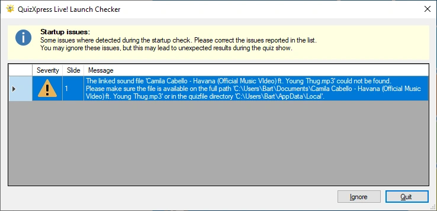

# De opstartcontrole

Voordat uw show begint, controleert QuizXpress Live een aantal voorwaarden, zoals of de externe video’s in de quiz nog beschikbaar zijn, of verschillende mappen toegankelijk zijn en of alle eigen geluidsbestanden kunnen worden gevonden. Dit voorkomt verrassingen tijdens de quiz.

Wanneer er problemen worden gevonden, verschijnt het volgende venster (de werkelijke waarschuwingen kunnen afwijken):

{ width="591" loading=lazy }

U kunt beslissen of u de quiz toch wilt starten (door op ‘Negeren’ te klikken) of wilt stoppen om de problemen op te lossen (door op ‘Afsluiten’ te klikken). Als u de show blijft draaien terwijl er waarschuwingen of fouten zijn, kan dat tijdens de quizshow tot problemen of onverwacht gedrag leiden.
