# L'écran du quiz : voting (tout le monde répond)

Après la vidéo du compte à rebours (qui peut être désactivée et/ou remplacée par votre propre vidéo dans Quiz Setup), l'écran du quiz apparaît. Comme vous pouvez le voir sur la capture d'écran ci-dessous, certaines zones demandent une attention particulière ; elles font toutes partie de ce que nous appelons l'« Information Panel » :

1.  Le minuteur du compte à rebours. Ce minuteur décompte à partir du temps indiqué lors de la création du quiz dans QuizXpress Live jusqu'à zéro. Sous le minuteur, vous voyez la position de la question dans le quiz, au format \<numéro de la question/nombre total de questions>.

2.  Les équipes (participants) qui ont appuyé sur leur keypad. Cet indicateur comporte trois étapes : il affiche d'abord une grille de carrés indiquant de quel keypad une réponse a été reçue, ce qui donne une vue d'ensemble. Lorsqu'il ne reste que quelques keypads, il affiche les numéros individuels des keypads. Lorsqu'il en reste encore moins, il affiche les noms des joueurs tels que définis dans Quiz Setup, ce qui aide l'animateur de quiz à identifier les derniers joueurs qui doivent encore répondre.

3.  Le nombre total de joueurs qui ont déjà donné une réponse.

4.  Le nombre de points à gagner en répondant correctement à la question. Notez que les points peuvent diminuer avec le temps selon les paramètres de la diapositive définis dans Studio.

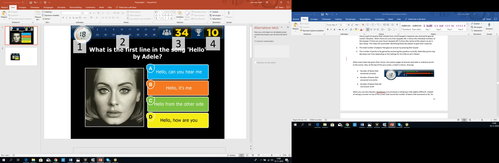{ loading=lazy }

Lorsque chaque équipe a fait son choix, le système évalue toutes les réponses et ajoute ou retire des points aux scores. En haut de l'écran du quiz, un graphique est également affiché :

<table>
<colgroup>
<col style="width: 36%" />
<col style="width: 63%" />
</colgroup>
<thead>
<tr class="header">
<th><ul>
<li>
Nombre d'équipes ayant répondu correctement
</li>
<li>
Nombre d'équipes ayant répondu incorrectement
</li>
<li>
Nombre d'équipes n'ayant pas répondu du tout
</li>
</ul></th>
<th></th>
</tr>
</thead>
<tbody>
</tbody>
</table>

Lorsque vous utilisez des Sony Buzzers, QuizXpress Live traite une diapositive de quiz de type voting de manière légèrement différente. Au lieu d'un compteur en haut de l'écran indiquant le nombre d'équipes ayant déjà répondu, un panneau s'affiche avec le nom et l'avatar de chaque équipe au moment où elle répond. Une fois que tout le monde a appuyé sur son buzzer (ou que le compte à rebours a atteint zéro), QuizXpress Live affiche toutes les réponses choisies, les évalue et affiche les scores totaux de toutes les équipes. Une représentation visuelle de cette séquence est présentée ci-dessous.

| 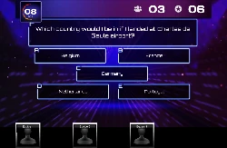{ width="160" loading=lazy } | 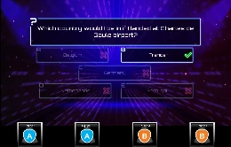{ width="166" loading=lazy } |                                                                                 | 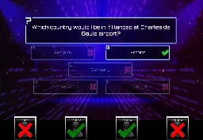{ width="155" loading=lazy } |
|---------------------------------------------------------------------------------|---------------------------------------------------------------------------------|---------------------------------------------------------------------------------|---------------------------------------------------------------------------------|
| 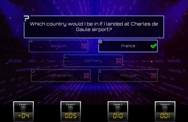{ loading=lazy } |                                                                                 | 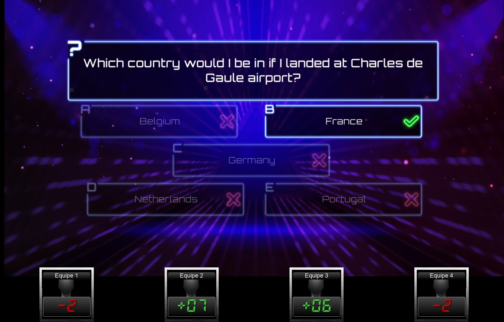{ loading=lazy } | 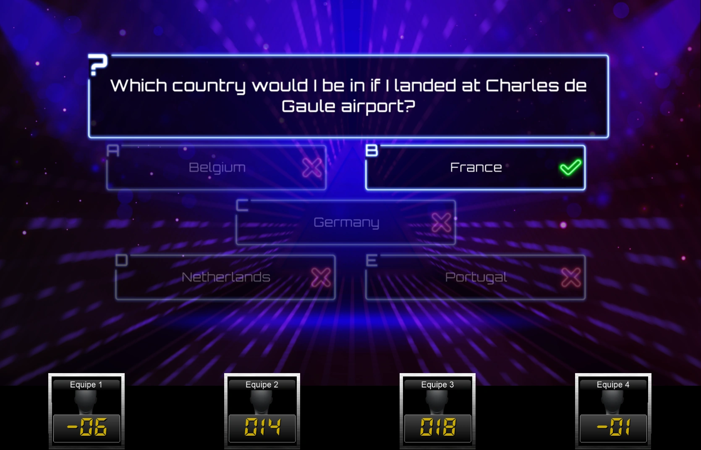{ loading=lazy } |

Le voting est l'un des modes possibles d'une diapositive de quiz. Les autres variantes sont décrites ci-dessous.

## Fastest Finger/ Lock-out

Dans la section précédente, nous avons présenté l'écran d'une question « voting », à laquelle tout le monde peut répondre. Avec une question fastest-finger, seule la première personne à appuyer sur son buzzer peut répondre. Si elle répond incorrectement, des points sont retirés de son score et le compte à rebours continue. Les autres joueurs ont alors la possibilité d'appuyer sur leur buzzer (le joueur qui a répondu incorrectement ne peut plus répondre à la question en cours).

Sur la page suivante, vous voyez une image d'un écran fastest finger typique. La principale différence par rapport à un écran voting est la présence, en bas de l'écran, d'une grande barre avec le nom de l'équipe (ou de la personne) qui a appuyé la première sur son buzzer. Cette barre affiche également la réponse donnée, l'avatar de l'équipe ainsi que les points gagnés/perdus. Dans ce cas, l'équipe 17 a donné la bonne réponse et gagne 10 points. La grande coche verte indique que la question a reçu une réponse correcte. Dans cet exemple, la bonne réponse a été définie sur Answer-‘D’ dans QuizXpress Studio, et l'option ‘autojudge’ (judge question automatically dans le ruban du menu) de la diapositive de quiz était définie sur true. Dans ce cas, QuizXpress évalue automatiquement la réponse lorsqu'un bouton à choix multiples est pressé sur un buzzer. Lorsqu'un buzzer n'a pas de bouton à choix multiples (par exemple les Sparkle poles), l'option ‘auto judge’ ne s'applique automatiquement pas. Dans ce cas, l'équipe\le joueur doit répondre oralement, puis l'animateur de quiz doit évaluer la réponse à l'aide de sa télécommande, du clavier de l'ordinateur ou de QuizXpress Director. Vous pouvez en savoir plus sur les commandes de l'animateur de quiz dans [Contrôler le quiz](../controlling-the-quiz.md).

Le fait que « Team 17 » ait appuyé en premier peut être vérifié en consultant l'« Information Panel » en haut de l'écran. Ce panneau affiche, dans des cases séparées, l'heure à laquelle chaque équipe a buzzé. Chaque case contient le nom d'une équipe qui a appuyé sur son buzzer, ainsi que l'horodatage de son appui, classés de gauche à droite en commençant par l'équipe la plus rapide.

| 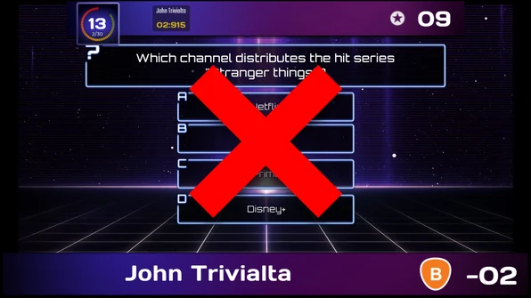{ loading=lazy } | 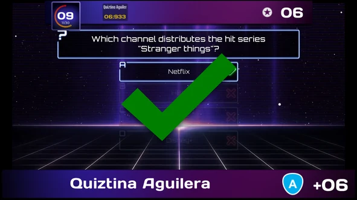{ loading=lazy } |
|---------------------------------------------------------------------------------|---------------------------------------------------------------------------------|

Notez que l'Information Panel en haut affiche le nombre de points à gagner (qui peut diminuer avec le temps, comme expliqué précédemment). De plus, il n'y a pas d'indicateur du nombre d'équipes ayant répondu, car cela ne s'applique pas à une question fastest-finger.

!!! note

    Lorsque vous utilisez les buzzers QuizXpress (qui disposent à la fois de boutons à choix multiples ABCD et d'un gros bouton buzzer) pour des questions à choix multiples, gardez ces deux options à l'esprit :*

- *Lorsque ‘auto judge’ est sur ‘true’ dans la fenêtre des propriétés (équivalent dans le ruban du menu : ‘Judge question’ est défini sur ‘Automatically’), les participants doivent utiliser les boutons ABCD du buzzer. QuizXpress évalue automatiquement la réponse donnée.*

- *Lorsque ‘auto judge’ est sur ‘false’ dans la fenêtre des propriétés (équivalent dans le ruban du menu : ‘Judge question’ est défini sur ‘Manual’), les participants doivent utiliser le gros bouton buzzer pour buzzer. Le joueur qui a appuyé le plus vite donne alors la réponse oralement, et l'animateur de quiz l'évalue.*

## Billboard

Une diapositive de quiz Billboard est une diapositive de quiz avec laquelle aucune interaction des joueurs n'est possible — il s'agit simplement d'un affichage statique. Vous pouvez concevoir une diapositive Billboard comme une question normale, avec du texte, des couleurs, des images, des sons et des vidéos.

Voici quelques utilisations utiles d'une diapositive Billboard :

- Indication de la manche

- Afficher la question (en aperçu) avant une diapositive de quiz voting.

- Afficher des informations marketing sous forme d'images, de sons ou de vidéos

## End of Round

Dans QuizXpress, vous pouvez indiquer qu'une diapositive de quiz marque la « fin d'une manche ». Pour ce faire, définissez le type d'une diapositive de quiz sur ‘End of Round’ dans QuizXpress Studio.

Lorsqu'une diapositive End of Round est affichée pendant un quiz, aucune interaction avec les participants n'a lieu. Vous pouvez par exemple l'utiliser pour afficher le texte « Fin de la manche 3 ». Comme précédemment, vous pouvez concevoir la diapositive comme vous le souhaitez, avec de la vidéo, du son et des images.

Lorsque vous définissez une diapositive sur ‘End of Round’, une autre option, appelée ‘end of round action’, peut être définie. Elle peut prendre l'une des valeurs suivantes :

- Disable one player : élimine automatiquement le joueur ayant le moins de points. Si plusieurs joueurs sont à égalité en bas de la liste des scores intermédiaires, l'animateur de quiz choisit quel joueur sera éliminé, à l'aide des touches fléchées du clavier ou de la télécommande de l'animateur de quiz. Le joueur/l'équipe sélectionné(e) est mis(e) en évidence par un voyant rouge clignotant. Appuyer sur la barre d'espace du clavier, ou sur le bouton du bas de la télécommande de l'animateur, élimine le joueur sélectionné. Décider quel joueur éliminer lorsque plusieurs équipes ont le même score ne relève pas de QuizXpress Live — par exemple, un animateur de quiz pourrait poser une question d'estimation et éliminer le joueur dont la réponse est la plus éloignée de la bonne.

> 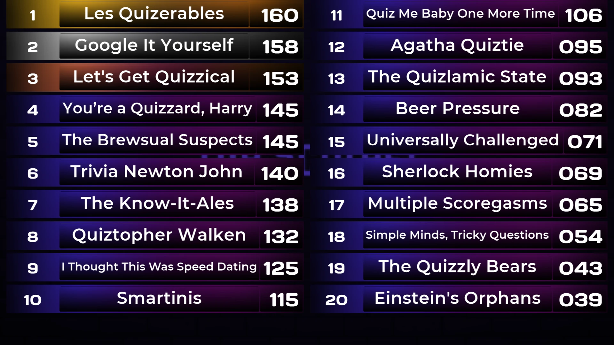{ loading=lazy }

- Manually dismiss players : l'animateur de quiz peut sélectionner autant de joueurs qu'il le souhaite à éliminer. Il le fait un par un, là encore à l'aide du clavier ou de la télécommande de l'animateur pour les sélectionner. Un exemple de diapositive de quiz ‘End of Round, quizmaster selects losers’ est présenté ci-dessus. Le bouton « play » en bas de l'écran indique que l'animateur de quiz a fini d'éliminer des joueurs ; l'activer (le sélectionner avec le clavier et appuyer sur espace) fait continuer le quiz. Le bouton avec la flèche circulaire annule le processus d'élimination si l'animateur de quiz élimine quelqu'un par erreur, après quoi il peut recommencer à éliminer des joueurs.

- Automatically dismiss players : avec cette option, le système désactive automatiquement un certain nombre de joueurs (tel que configuré pour la diapositive dans Studio), sans aucun retour visuel pour le public.

Show scoreboard/Show round scores : le système affiche le classement soit pour l'ensemble du quiz, soit pour la manche en cours.

Reset scores : remet tous les scores à zéro à la fin de la manche.

Une manche est définie comme l'ensemble des diapositives situées entre :

- La première diapositive du quiz et la première diapositive End of Round (manche 1)

- Deux diapositives *End of Round*

- La diapositive qui suit la dernière diapositive *End of Round* et la dernière diapositive du quiz

Vous trouverez ci-dessous un exemple de quiz avec trois manches.

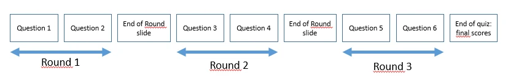{ width="595" loading=lazy }

Une diapositive ‘End of Round’ peut également être utilisée pour des manches ‘Last Man Standing’. Lorsque des questions ‘Last Man Standing’ sont utilisées, les joueurs qui répondent incorrectement sont éliminés du quiz et ne peuvent plus jouer. Lorsqu'une diapositive ‘End of Round’ est affichée, tous les joueurs qui sont hors jeu à cause de questions ‘Last Man Standing’ peuvent rejoindre la partie.

!!! note

    Les joueurs\équipes peuvent également être activés\désactivés depuis QuizXpress Director. Dans QuizXpress Director, vous pouvez aussi ajouter de nouveaux joueurs pendant un quiz ou modifier les points d'une équipe. Voir [QuizXpress Director](../quizxpress-director/index.md) pour plus d'informations sur QuizXpress Director.*

## Test Question

Une diapositive de quiz ‘Test Question’ se comporte comme une diapositive de quiz normale, sauf qu'aucun point n'est ajouté/retiré une fois la question répondue. Elle peut servir à démontrer le fonctionnement du système et est souvent utilisée comme première question d'un quiz pour familiariser les joueurs avec le système.

## Demographic

Le type de diapositive de quiz ‘Demographic’ vous permet de répartir tous les joueurs en différents groupes qui s'affrontent (parmi les exemples de ce type de quiz : « bataille des sexes », « marketing contre finance », etc.).

Pour utiliser cette fonctionnalité, définissez le type d'une diapositive de quiz sur ‘Demographic’ dans QuizXpress Studio. Un champ de saisie appelé ‘Demographic group’ apparaît alors dans la grille de propriétés, où vous pouvez saisir le nom d'un groupe démographique (par exemple ‘Males’). Pour la disposition de la diapositive de quiz, vous devez choisir une disposition qui contient une question et aucune réponse. Saisissez un texte de question indiquant aux joueurs qu'un certain groupe de personnes doit appuyer sur son buzzer pour devenir membre d'un groupe précis (par exemple « Appuyez sur votre buzzer si vous êtes un homme »).

!!! note

    Vous pouvez également répartir le public en groupes avant le début d'un quiz dans QuizXpress Setup. Vous pouvez y définir quels keypads appartiennent à quel groupe. Pour plus d'informations, reportez-vous à [Grouping keypads](../../setup/setting-up-teams-the-teams-tab-page.md#regrouper-les-keypads)*

## Last Man Standing

Une diapositive de quiz de type ‘Last Man Standing’ élimine de la manche du quiz tout joueur qui répond incorrectement à une question. Si l'élimination ne laisse qu'un seul joueur, ce joueur remporte la manche et le quiz passe à la première diapositive End of Round rencontrée, ou à la fin du quiz. Si, en revanche, tous les joueurs restants répondent incorrectement à une question, aucun d'entre eux n'est éliminé.

## Questions de réponse du public

Il s'agit d'un type de question qui peut servir à collecter des données/statistiques arbitraires auprès de votre public. Les réponses données à une question de réponse du public sont enregistrées mais n'ont aucun impact sur les scores. Après une question de réponse du public, vous pouvez afficher un graphique avec la touche « C » pour montrer la répartition des réponses données.

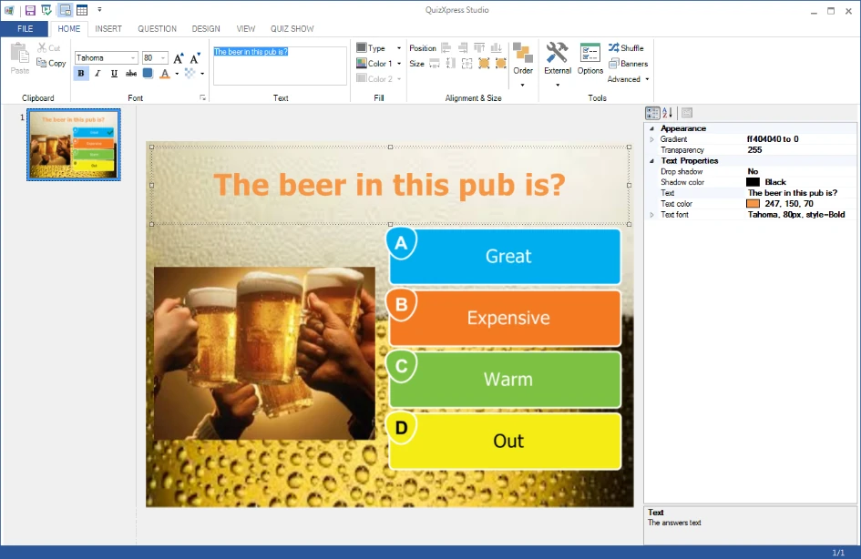{ width="604" loading=lazy }

## Question Wager

Les questions Wager permettent de faire parier le public sur l'issue de la question suivante. Elles vous permettent de créer des questions « façon Jeopardy » où les gens jouent des points selon ce qu'ils pensent savoir sur un sujet.

Lorsque vous définissez une diapositive de quiz sur le type ‘Wager’, elle se présente ainsi dans QuizXpress Studio :

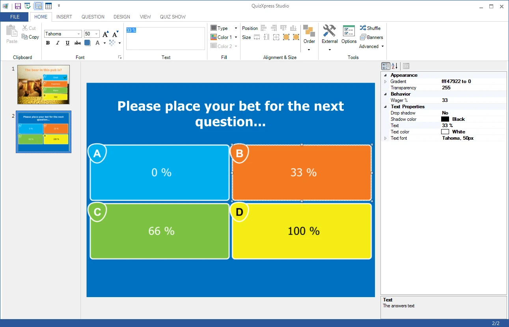{ loading=lazy }

Le texte de la question est par défaut remplacé par « Please place your bet for the next question… », mais vous pouvez modifier ce texte plus tard comme vous le souhaitez. Les réponses à ce type de question servent à définir le pourcentage du score que le joueur peut gagner ou perdre à la question suivante. Par exemple, si le joueur répond ‘C’ à cette question, cela signifie qu'il mise 66 % de son score sur la question suivante. S'il répond correctement à la question suivante, son score augmente de 66 %. Bien sûr, si vous utilisez une disposition de diapositive avec cinq réponses, les pourcentages sont répartis sur cinq options (0 %, 25 %, 50 %, 75 % et 100 %). Vous pouvez également définir le pourcentage manuellement en cliquant sur l'une des réponses et en modifiant la propriété ‘Wager %’.

Les mises (wagers) peuvent aussi être exprimées en nombre de points plutôt qu'en pourcentage.
