# Le schermate del quiz

## Votazione { #votazione }

Dopo il video del conto alla rovescia (che può essere disattivato e/o sostituito con un video personalizzato in Quiz Setup), compare la schermata del quiz. Come si vede dalla schermata di esempio qui sotto, ci sono alcune aree che richiedono particolare attenzione, tutte parte di quello che chiamiamo «Pannello informazioni»:

1. Il timer del countdown. Questo timer esegue il conto alla rovescia a partire dal momento indicato durante la creazione del quiz in QuizXpress Studio fino allo zero. Sotto l’indicatore dei secondi, si può vedere l'indicatore del numero di domanda all'interno del quiz <numero domanda attuale/numero totale di domande>

2. Le squadre (partecipanti) che hanno premuto la loro pulsantiera. Questo indicatore consta di tre fasi; Innanzitutto mostra una griglia di quadrati che indicano da quale pulsantiera è stata ricevuta una risposta per dare un'indicazione globale. Quando rimangono solo alcune pulsantiere, vengono visualizzati i singoli numeri di pulsantiera. Quando resteranno ancora meno pulsantiere, mostrerà i nomi dei giocatori/squadre come impostati in Quiz Setup. Questo aiuterà il quizmaster a identificare gli ultimi giocatori a dover dare la loro risposta.

3. Il numero totale di persone che hanno dato una risposta, premendo la propria pulsantiera

4. Il numero di punti in palio, rispondendo correttamente alla domanda. I punti possono diminuire nel tempo a seconda delle impostazioni della diapositiva come impostato in Studio.

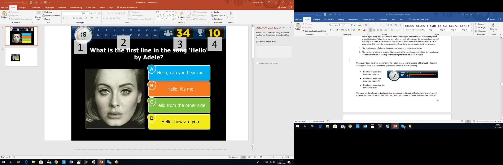{ loading=lazy }

Quando ogni squadra ha espresso la propria scelta, il sistema giudicherà automaticamente tutte le risposte ed aggiunge o decurta i punti in palio ai punteggi delle squadre. Inoltre, nella parte superiore dello schermo Quiz, apparirà un grafico che mostra:

<table>
<colgroup>
<col style="width: 36%" />
<col style="width: 63%" />
</colgroup>
<thead>
<tr class="header">
<th><ul>
<li>
Numero di squadre che hanno risposto correttamente
</li>
<li>
Numero di squadre che hanno risposto in modo errato
</li>
<li>
Numero di squadre che non hanno risposto affatto
</li>
</ul></th>
<th></th>
</tr>
</thead>
<tbody>
</tbody>
</table>

Quando si utilizzano i buzzer Sony, QuizXpress Live elabora una diapositiva di votazione leggermente diversa. Invece di avere un contatore nella parte superiore dello schermo che conta il numero di squadre che hanno risposto, per ogni squadra che risponde, apparirà in basso un segnalino con il nome della squadra ed il proprio avatar. Quando tutti hanno risposto (o il conto alla rovescia ha raggiunto lo zero), QuizXpress Live mostra tutte le risposte scelte, giudica tutte le risposte e mostra i punteggi totali di tutte le squadre. Una rappresentazione visiva di questa sequenza è visualizzata qui sotto.

| 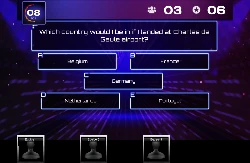{ width="160" loading=lazy } | 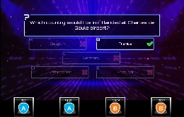{ width="166" loading=lazy } |                                                                                 | 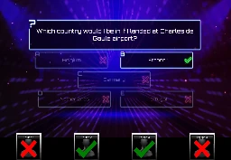{ width="155" loading=lazy } |
|---------------------------------------------------------------------------------|---------------------------------------------------------------------------------|---------------------------------------------------------------------------------|---------------------------------------------------------------------------------|
| 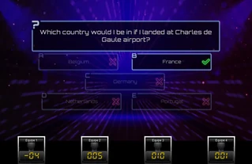{ loading=lazy } |                                                                                 | 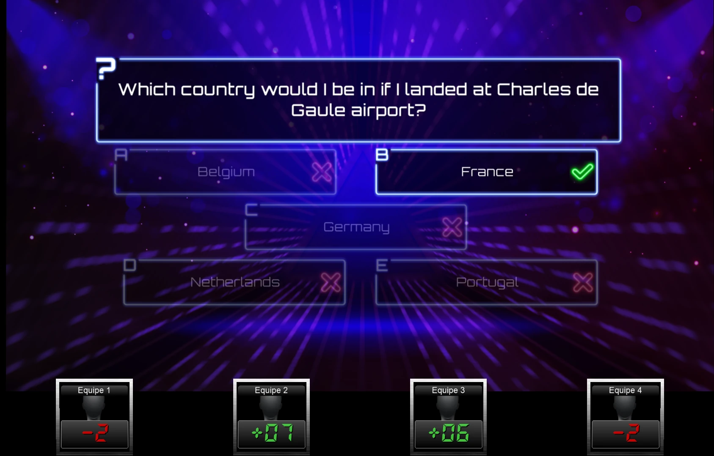{ loading=lazy } | 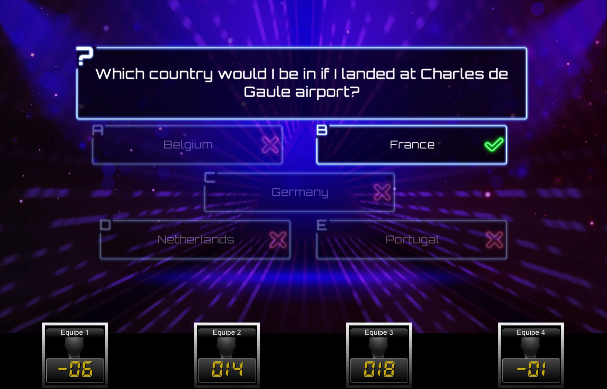{ loading=lazy } |

La “Votazione” è una delle possibili tipologie applicabili ad una diapositiva quiz. Esistono altre varianti, che verranno descritte di seguito.

## Dito più Veloce { #fastest-finger-lock-out }

La schermata quiz nella sezione precedente rappresenta una domanda di tipo 'Votazione', il che significa che tutti i giocatori possono partecipare alla domanda. In una domanda “Dito più Veloce”, solo chi preme per primo il suo buzzer/pulsantiera, ha il diritto di rispondere alla domanda. Qualora rispondesse alla domanda in modo non corretto, i punti in palio verranno decurtati dal punteggio del partecipante ed il conto alla rovescia prosegue. Gli altri giocatori hanno quindi la facoltà di premere la propria pulsantiera (il giocatore che ha risposto in modo non corretto non può più rispondere alla domanda attuale).

Di seguito è mostrata una tipica schermata Dito più Veloce. La differenza più importante rispetto a una schermata di votazione è che in questa schermata, in basso, c'è una grande barra con il nome della squadra (o della persona) che ha premuto per prima il proprio buzzer. Questa barra mostra anche la risposta data, l'avatar della squadra e i punti guadagnati/persi. In questo caso la squadra ha dato la risposta giusta, guadagnando così 10 punti. Il grande segno di spunta verde indica che la domanda ha ricevuto una risposta corretta. In questo esempio, la risposta corretta era stata impostata sulla Risposta-‘D’ in QuizXpress Studio e l'opzione 'Giudica Risposta' della diapositiva Quiz è stata impostata su “Automaticamente”. In questo caso, quando viene premuto un pulsante a scelta multipla sul buzzer/pulsantiera, QuizXpress giudicherà automaticamente la risposta. Quando un buzzer non ha un pulsante a scelta multipla (ad esempio i buzzer Kube), ‘Giudica Risposta Automaticamente' non verrà applicata. In tal caso la squadra\il giocatore deve rispondere a voce, dopodiché il Quizmaster deve valutare la risposta utilizzando la pulsantiera Master, la tastiera del computer o QuizXpress Director. Per ulteriori informazioni sui comandi del Quizmaster, vedere [Controllo del quiz](../controlling-the-quiz.md).

La conferma del giocatore che ha premuto per primo, può essere verificata osservando il 'Pannello Informazioni' nella parte superiore dello schermo. Questo pannello mostra in “box” individuali il tempo di risposta di ogni squadra che ha premuto. Ogni box contiene il nome della squadra ed il tempo impiegato a premere, ordinato da sinistra a destra, a partire dal squadra più veloce.

| 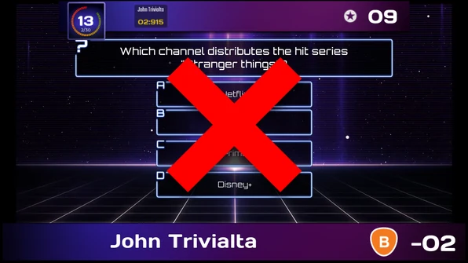{ loading=lazy } | 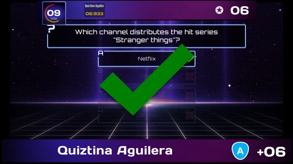{ loading=lazy } |
|---------------------------------------------------------------------------------|---------------------------------------------------------------------------------|

Si noti che il pannello informazioni nella parte superiore mostra il numero di punti che si possono ottenere (e che possono diminuire nel tempo, come spiegato in precedenza). Inoltre, non c'è nessun indicatore del numero di squadre che hanno risposto, poiché non è applicabile ad una domanda “Dito più Veloce”.

!!! note

    Quando si utilizzano i buzzer QuizXpress (che dispongono sia dei pulsanti ABCD sia di un grande pulsante luminoso) per domande a scelta multipla, tenere presenti queste due opzioni:

- Quando l’opzione “Giudica Domanda” è impostata su 'automaticamente', i partecipanti devono utilizzare i pulsanti ABCD del buzzer. QuizXpress valuterà automaticamente la risposta data.

- Quando l’opzione “Giudica Domanda” è impostata su 'Manualmente' i partecipanti devono utilizzare il pulsante grande del buzzer per prenotare la risposta. Il giocatore che ha premuto più velocemente darà verbalmente la risposta e il Quizmaster giudicherà la risposta.

## Tabellone { #billboard }

Una diapositiva di tipo “Tabellone” è una diapositiva quiz dove non è possibile alcuna interazione da parte dei giocatori. È semplicemente una visualizzazione statica. È possibile progettare una diapositiva “Tabellone”, esattamente come si progetta una diapositiva domanda normale, facendo uso di testi, colori, immagini, file audio e video.

Principali applicazioni di una diapositiva Tabellone sono:

- Indicazione dei Round

- Visualizzazione della domanda (come anteprima) prima della diapositiva quiz di votazione

- Visualizzazione di informazioni di marketing, sotto forma di immagini, file audio o video

## Fine Round { #end-of-round }

In QuizXpress si può impostare una diapositiva quiz affinché segnali la 'fine di un round'. A tale scopo, modificare in QuizXpress Studio l'impostazione “Tipo” della diapositiva quiz, scegliendo la tipologia “Fine Round”.

Quando viene mostrata una diapositiva Fine Round durante un quiz, nessuna interazione è possibile da parte dei partecipanti. Per esempio, può essere utilizzata per mostrare il testo “Fine del 3° Round. Anche in questo caso, è possibile progettare la diapositiva quiz come si desidera, con video, suoni ed immagini.

Quando si imposta una diapositiva di tipo ‘Fine Round’, si attiva un’altra proprietà, chiamata ‘Azione Fine Round’, che può essere impostata su una delle seguenti opzioni:

- ‘Elimina un Giocatore’: esclude automaticamente il giocatore con il minor numero di punti. Qualora ci fossero più giocatori in fondo alla classifica intermedia con la stessa quantità di punti, il Quizmaster può scegliere quale giocatore escludere. Questa operazione può essere eseguita utilizzando i tasti freccia della tastiera o la pulsantiera Master. La squadra/giocatore selezionato viene evidenziato con una luce rossa lampeggiante. Premendo la barra spaziatrice sulla tastiera o il pulsante in basso sulla pulsantiera Master, si esclude il giocatore selezionato. La scelta di quale giocatore escludere nel caso in cui vi siano più squadre con lo stesso punteggio non rientra nelle facoltà automatiche di QuizXpress Live: in casi del genere, il Quizmaster potrebbe ad esempio, fare verbalmente una domanda extra ai giocatori coinvolti. Sarà escluso il giocatore la cui risposta è più lontana da quella corretta.

> 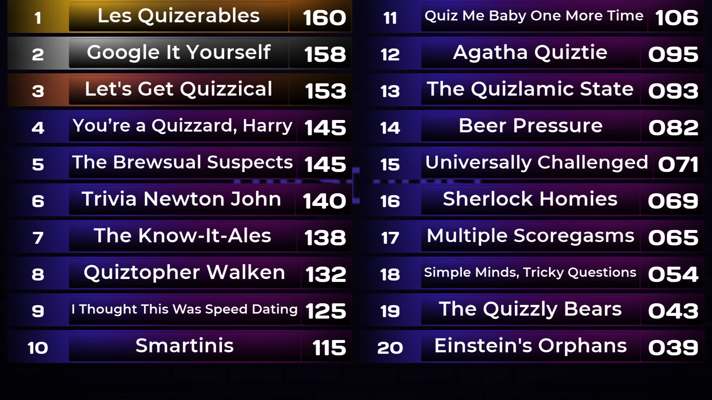{ loading=lazy }

- ‘Elimina Giocatori Manualmente’: il Quizmaster può selezionare un numero qualsiasi di giocatori da eliminare. Lo fa uno alla volta, sempre utilizzando la tastiera o la pulsantiera Master per selezionarli. Un esempio di diapositiva di quiz Fine Round con ‘Elimina Giocatori Manualmente’ è mostrato sopra. Il pulsante «play» in basso nello schermo indica che il Quizmaster ha finito di eliminare i giocatori; premerlo (selezionarlo con la tastiera e premere spazio) fa proseguire il quiz. Il pulsante con la freccia rotante annulla il processo di eliminazione se il Quizmaster elimina qualcuno per errore, dopodiché può ricominciare a eliminare i giocatori.

- ‘Elimina Giocatori Automaticamente’: con questa opzione, il sistema disattiva automaticamente una percentuale dei giocatori in fondo alla classifica (come configurato per la diapositiva in Studio), senza alcun riscontro visivo per il pubblico.

‘Mostra la Classifica’/‘Mostra Punteggi Round’: il sistema mostra la classifica dell'intero quiz o quella del round corrente.

‘Mostra Vincitori e Punteggi di tutti i Round’: il sistema mostra i vincitori e i punteggi di tutti i round.

‘Azzera Punteggi’: azzera tutti i punteggi alla fine del round.

Un round è definito come l'insieme di diapositive comprese tra:

- La prima diapositiva del quiz e la prima diapositiva “Fine Round” (round 1)

- Due diapositive “Fine Round”

- La diapositiva che segue l'ultima diapositiva “Fine Round” e l'ultima diapositiva del quiz.

Di seguito è riportato un esempio di un quiz composto da tre round.

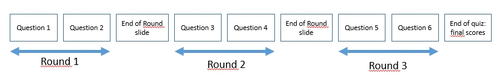{ width="595" loading=lazy }

Una diapositiva "Fine Round" può essere utilizzata anche per i round di tipo "Ultimo Uomo". Quando si usano domande del tipo 'Ultimo Uomo', i giocatori che si sbagliano vengono esclusi dal quiz e non possono più giocare. Quando viene mostrata una diapositiva "Fine Round", tutti i giocatori esclusi dal gioco in precedenza dalle domande "Ultimo Uomo" possono giocare di nuovo.

!!! note

    I giocatori\le squadre possono anche essere attivati\disattivati da QuizXpress Director. In QuizXpress Director è inoltre possibile aggiungere nuovi giocatori durante un quiz o modificare i punti di una squadra. Per ulteriori informazioni su QuizXpress Director, vedere [QuizXpress Director](../quizxpress-director/index.md).*

## Domanda Test { #test-question }

La diapositiva quiz “Domanda Test” si comporta esattamente come una diapositiva quiz normale, salvo che non vengono sommati/sottratti punti quando la domanda è stata risposta. Può essere utilizzata per illustrare il funzionamento del sistema ed è spesso utilizzata come domanda rompi-ghiaccio in un quiz per fare familiarizzare i giocatori con il sistema.

## Demografica { #demographic }

La diapositiva quiz di tipo 'Demografica' consente di suddividere tutti i giocatori in gruppi diversi in competizione l'uno contro l'altro (esempi di questa tipologia di quiz possono essere “la battaglia dei sessi”, “Amministrazione contro Venditori”, ecc.).

Per utilizzare questa funzionalità, in QuizXpress Studio selezionare 'Demografica' nel campo 'Tipo' di diapositiva quiz. Verrà visualizzato un campo di immissione nella griglia delle proprietà chiamato ‘Gruppo Demografico’. Qui è possibile inserire un nome di gruppo demografico (ad esempio, " Maschi"). Il layout di questo tipo di diapositiva quiz, deve contenere una domanda e nessuna risposta. Immettere un testo della domanda che indichi ai giocatori del quiz che un certo gruppo di persone deve premere la propria pulsantiera per diventare membro di un gruppo specifico (per esempio: 'Per favore, tutti i giocatori maschi premano la propria pulsantiera).

!!! note

    In alternativa, è possibile dividere il pubblico in gruppi prima dell'inizio del quiz in QuizXpress Setup. Qui si può definire quali pulsantiere appartengono a quale gruppo. Per ulteriori informazioni, fare riferimento a [Raggruppare le pulsantiere](../../setup/setting-up-teams-the-teams-tab-page.md#raggruppare-i-keypad)*

## Ultimo Uomo { #last-man-standing }

Una domanda di tipo “Ultimo Uomo” elimina da un round quiz tutti i giocatori/squadre che rispondono ad una domanda in modo errato. Quando resterà in gara un solo giocatore, questo giocatore sarà il vincitore del round ed il quiz avanzerà sino alla prossima diapositiva “Fine del Round” o sino alla fine del quiz qualora non ne trovasse. Nel caso tutti i giocatori rimasti rispondano ad una domanda in modo errato tuttavia, nessuno sarà eliminato.

## Audience Response { #domande-di-risposta-del-pubblico }

Questo tipo di domanda può essere utilizzato per raccogliere alcuni dati arbitrari o sondaggi dal pubblico. Le risposte date ad una domanda di tipo “Audience Response” sono registrate ma non hanno alcun impatto sui punteggi. Dopo aver concluso una domanda “Audience Response”, premendo il tasto 'C' della tastiera è possibile visualizzare un grafico con la distribuzione delle risposte date.

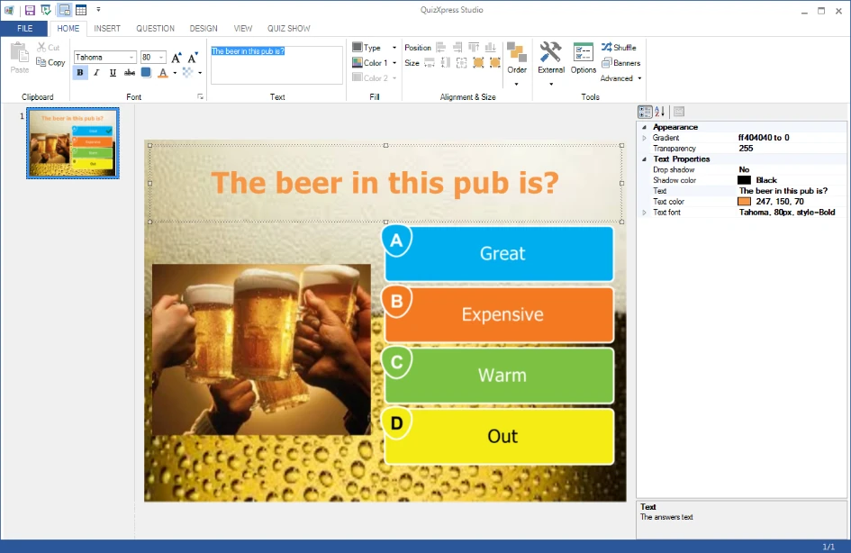{ width="604" loading=lazy }

## Scommessa { #domanda-wager }

La domanda di tipo “Scommessa” può essere usata per proporre ai partecipanti di scommettere sul risultato della domanda successiva. Permettono di creare "domande in stile Jeopardy" dove le persone scommettono punti in base a quanto pensano di saperne su un argomento. Quando si imposta una diapositiva quiz di tipo “Scommessa”, in QuizXpress Studio apparirà come segue:

Quando si imposta una diapositiva di quiz sul tipo ‘Scommessa’, in QuizXpress Studio appare come segue:

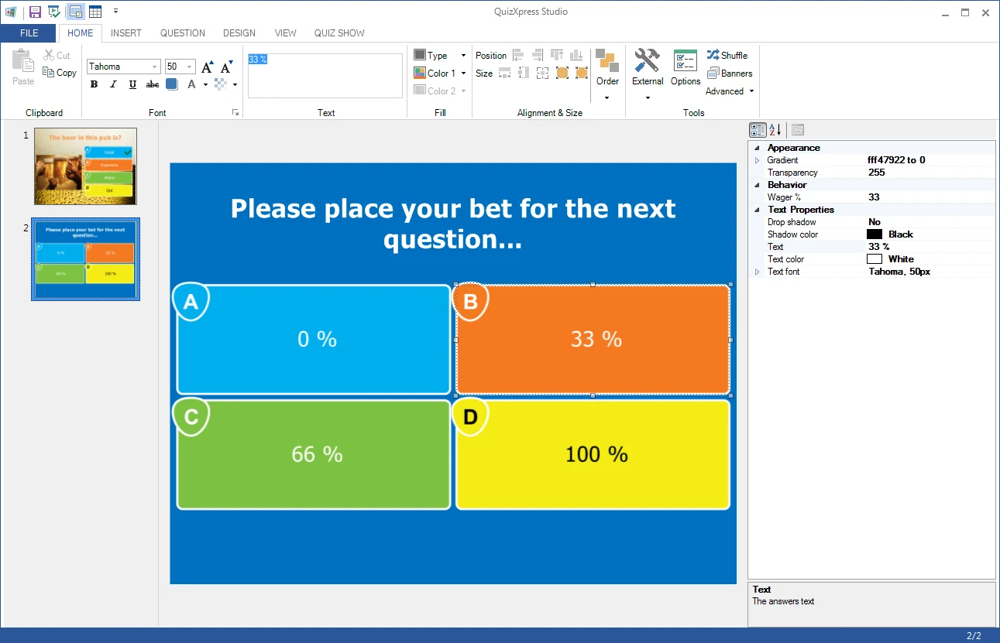{ loading=lazy }

Il testo predefinito della domanda è “Scegli quanto desideri scommettere sulla prossima domanda…” ma è possibile modificare il testo a proprio piacimento. Le risposte a questo tipo di domanda sono utilizzate per impostare la percentuale del proprio punteggio che il giocatore può vincere/perdere con la domanda successiva. Per esempio, se il giocatore sceglie 'C' a questa domanda, significa che vuole scommettere il 66% del suo punteggio nella domanda successiva. Se risponde correttamente alla domanda successiva, il suo punteggio aumenterà del 66%. In caso di risposta errata, perderà il 66% del proprio punteggio. Chiaramente, se si utilizza un layout di diapositiva con 5 risposte, le percentuali saranno suddivise automaticamente in 5 (0%, 25%, 50%, 75% e 100%). È comunque possibile impostare la percentuale manualmente facendo clic su una qualsiasi delle risposte e cambiando il valore “Scommessa %” nel pannello delle proprietà.

Le domande scommessa possono anche essere utilizzate con una quantità di punti invece di una percentuale.
