# Het quizscherm: stemmen (iedereen antwoordt)

Na de aftelvideo (die u in Quiz Setup kunt uitschakelen en/of door uw eigen video kunt vervangen) verschijnt het quizscherm. Zoals u in de onderstaande schermafbeelding ziet, zijn er enkele gebieden die specifieke aandacht vragen, allemaal onderdeel van wat we het ‘Informatiepaneel’ noemen:

1.  De afteltimer. Deze timer telt af vanaf de tijd die bij het maken van de quiz in QuizXpress Live is opgegeven tot nul. Onder de timer ziet u de positie van de vraag in de quiz, in het formaat \<vraagnummer/totaal aantal vragen>.

2.  De teams (deelnemers) die op hun keypad hebben gedrukt. Deze indicator kent drie fasen: eerst toont hij een raster van vierkantjes dat aangeeft van welk keypad een antwoord is ontvangen, zodat u een algemeen beeld hebt. Wanneer er nog maar een paar keypads over zijn, toont hij de individuele keypadnummers. Wanneer er nog minder over zijn, toont hij de namen van de spelers zoals ingesteld in Quiz Setup, zodat de quizmaster de laatste spelers die nog moeten antwoorden kan herkennen.

3.  Het totale aantal spelers dat al een antwoord heeft gegeven.

4.  Het aantal punten dat te verdienen is door de vraag juist te beantwoorden. Houd er rekening mee dat punten na verloop van tijd kunnen afnemen, afhankelijk van de instellingen van de dia in Studio.

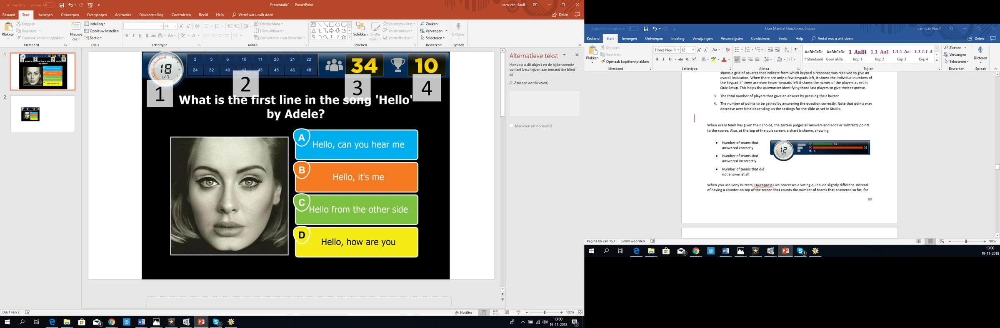{ loading=lazy }

Wanneer elk team zijn keuze heeft gemaakt, beoordeelt het systeem alle antwoorden en telt het punten bij de scores op of trekt het punten af. Bovenaan het quizscherm wordt ook een grafiek getoond:

<table>
<colgroup>
<col style="width: 36%" />
<col style="width: 63%" />
</colgroup>
<thead>
<tr class="header">
<th><ul>
<li>
Aantal teams dat juist antwoordde
</li>
<li>
Aantal teams dat onjuist antwoordde
</li>
<li>
Aantal teams dat helemaal niet antwoordde
</li>
</ul></th>
<th></th>
</tr>
</thead>
<tbody>
</tbody>
</table>

Wanneer u Sony-buzzers gebruikt, verwerkt QuizXpress Live een stemdia iets anders. In plaats van een teller bovenaan het scherm die het aantal teams telt dat tot nu toe heeft geantwoord, verschijnt een paneel met de naam en avatar van elk team op het moment dat het antwoordt. Nadat iedereen op zijn buzzer heeft gedrukt (of het aftellen nul heeft bereikt), toont QuizXpress Live alle gekozen antwoorden, beoordeelt ze en toont de totaalscores van alle teams. Hieronder ziet u een visuele weergave van deze reeks.

| 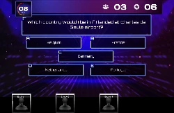{ width="160" loading=lazy } | 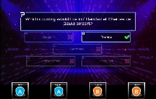{ width="166" loading=lazy } |                                                                                 | 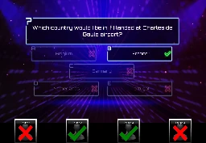{ width="155" loading=lazy } |
|---------------------------------------------------------------------------------|---------------------------------------------------------------------------------|---------------------------------------------------------------------------------|---------------------------------------------------------------------------------|
| 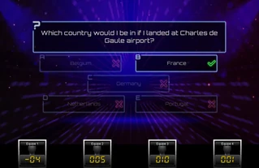{ loading=lazy } |                                                                                 | 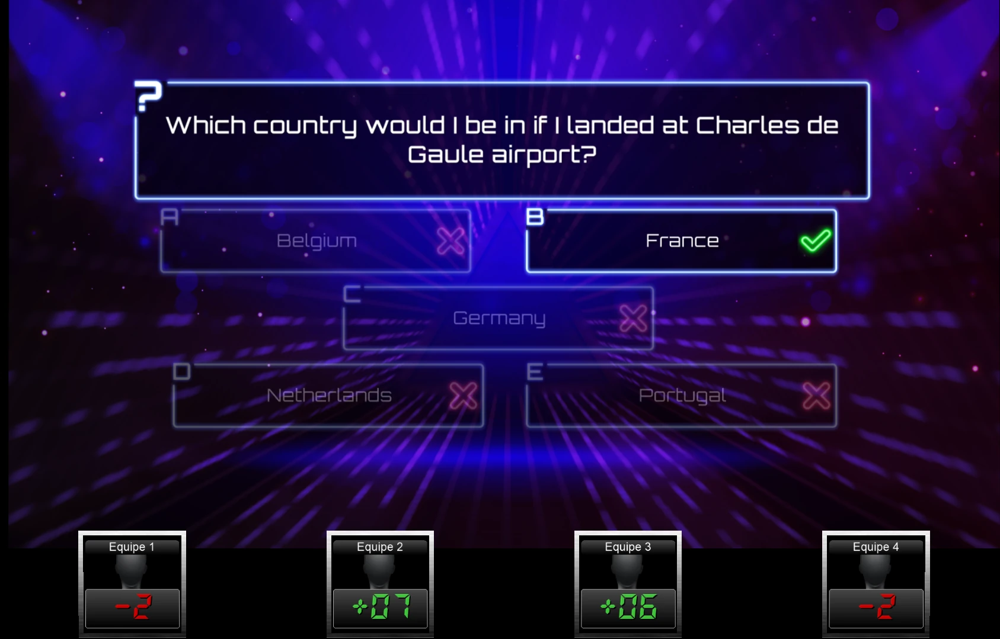{ loading=lazy } | 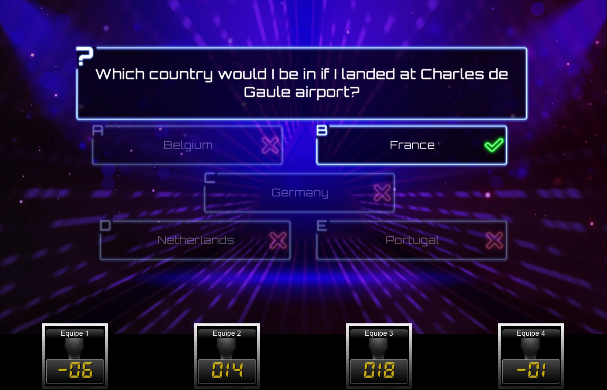{ loading=lazy } |

Stemmen is een van de mogelijke modi voor een quizdia. Andere varianten worden hieronder beschreven.

## Snelste drukker/uitsluiting

In de vorige sectie bespraken we het scherm voor een ‘stem’-vraag, waarbij iedereen kan antwoorden. Bij een vraag voor de snelste drukker kan alleen de eerste persoon die op zijn buzzer drukt antwoorden. Als die onjuist antwoordt, worden punten van zijn score afgetrokken en loopt het aftellen door. De andere spelers krijgen dan de kans om op hun buzzer te drukken (de speler die onjuist antwoordde, kan de huidige vraag niet meer beantwoorden).

Op de volgende pagina ziet u een afbeelding van een typisch scherm voor de snelste drukker. Het belangrijkste verschil met een stemscherm is dat dit scherm onderaan een grote balk heeft met de teamnaam van het team (of de persoon) dat als eerste op zijn buzzer drukte. Deze balk toont ook het gegeven antwoord, de avatar van het team en de gewonnen/verloren punten. In dit geval gaf team 17 het juiste antwoord, waarmee het 10 punten verdient. Het grote groene vinkje geeft aan dat de vraag juist is beantwoord. In dit voorbeeld was het juiste antwoord in QuizXpress Studio ingesteld op antwoord ‘D’ en was de optie ‘automatisch beoordelen’ (vraag automatisch beoordelen in het lint) van de quizdia ingesteld op true. In dat geval beoordeelt QuizXpress het antwoord automatisch wanneer op een meerkeuzeknop van een buzzer wordt gedrukt. Wanneer een buzzer geen meerkeuzeknop heeft (bijvoorbeeld de Sparkle-palen), is de optie ‘automatisch beoordelen’ vanzelf niet van toepassing. In dat geval moet het team\de speler mondeling antwoorden, waarna de quizmaster het antwoord moet beoordelen met zijn afstandsbediening, het toetsenbord van de computer of QuizXpress Director. Meer over opdrachten voor de quizmaster leest u in [De quiz bedienen](../controlling-the-quiz.md).

Dat ‘Team 17’ als eerste drukte, kunt u controleren in het ‘Informatiepaneel’ bovenaan het scherm. Dit paneel toont in afzonderlijke vakken de tijd waarop elk team heeft gedrukt. Elk vak bevat de naam van een team dat op zijn buzzer drukte, samen met het tijdstip waarop het drukte, gerangschikt van links naar rechts, te beginnen met het snelste team.

| 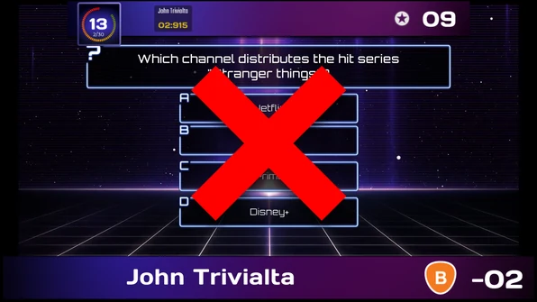{ loading=lazy } | 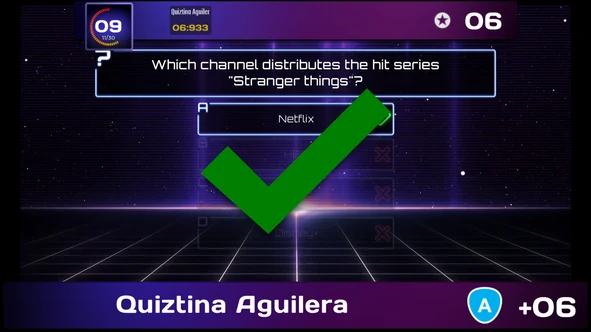{ loading=lazy } |
|---------------------------------------------------------------------------------|---------------------------------------------------------------------------------|

Houd er rekening mee dat het Informatiepaneel bovenaan het aantal te verdienen punten toont (dat na verloop van tijd kan afnemen, zoals eerder uitgelegd). Er is ook geen indicator voor het aantal teams dat heeft geantwoord, aangezien dit niet van toepassing is op een vraag voor de snelste drukker.

!!! note

    Wanneer u de QuizXpress-buzzers gebruikt (die zowel ABCD-meerkeuzeknoppen als een grote buzzerknop hebben) voor meerkeuzevragen, houd dan deze twee opties in gedachten:*

- *Wanneer ‘automatisch beoordelen’ op ‘true’ staat in het eigenschappenvenster (equivalent in het lint: ‘Beoordeel vragen’ staat op ‘Automatisch’), moeten deelnemers de ABCD-knoppen op de buzzer gebruiken. QuizXpress beoordeelt het gegeven antwoord automatisch.*

- *Wanneer ‘automatisch beoordelen’ op ‘false’ staat in het eigenschappenvenster (equivalent in het lint: ‘Beoordeel vragen’ staat op ‘Handmatig’), moeten deelnemers de grote buzzerknop gebruiken om te drukken. De speler die het snelst drukte, geeft dan mondeling het antwoord en de quizmaster beoordeelt het.*

### Antwoordtijd { #time-to-answer }

U kunt beperken hoe lang de speler die heeft gedrukt de tijd heeft om zijn antwoord te geven: stel ‘Bedenktijd’ in voor de dia in QuizXpress Studio (zie [Vraag](../../studio/slide-and-game-formats/question.md#time-to-answer-on-fastest-finger-questions)). Zonder deze instelling kan de speler er zo lang over doen als de quizmaster toestaat.

Zodra een speler drukt, loopt een balk langs de bovenkant van het scherm van rechts naar links af, van groen via oranje naar rood. In QuizXpress Director toont de knop ‘Antwoord is fout’ dezelfde balk, zodat u kunt zien hoeveel tijd er nog over is.

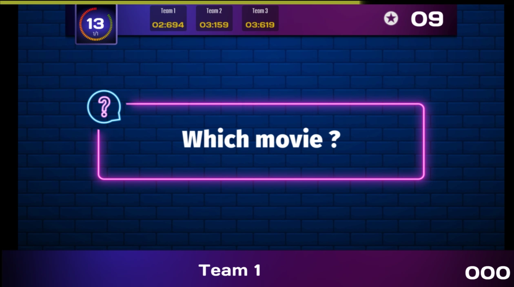{ loading=lazy }

Als u het antwoord niet hebt beoordeeld wanneer de tijd om is, telt het als een onjuist antwoord:

- De speler verliest de ‘Punten aftrek bij geen antwoord’ van de vraag, niet de punten voor een onjuist antwoord.
- Zoals bij elk onjuist antwoord wordt de speler uitgesloten (tenzij de uitsluitingsmodus van de dia nog een poging toestaat, zie [Geavanceerde diaeigenschappen](../../studio/advanced-slide-properties.md)).
- Als ‘Volgende in de rij laten antwoorden’ is ingeschakeld in Quiz Setup ([het tabblad Geavanceerd](../../setup/other-settings-the-advanced-tab-page.md)), krijgt de volgende speler die heeft gedrukt een beurt, met een nieuwe balk. In het bovenstaande voorbeeld zou Team 2 de volgende zijn, daarna Team 3.

## Billboard

Een billboard-quizdia is een quizdia waarbij geen interactie met spelers mogelijk is — het is gewoon een statische weergave. U kunt een billboard-dia net als een gewone vraag ontwerpen, met tekst, kleuren, afbeeldingen, geluiden en video’s.

Nuttige toepassingen van een billboard-dia zijn onder meer:

- Rondeaanduiding

- De vraag tonen (als voorbeeld) vóór een stemquizdia.

- Marketinginformatie tonen in de vorm van afbeeldingen, geluiden of video’s

## Einde ronde

In QuizXpress kunt u aangeven dat een quizdia het ‘einde van een ronde’ markeert. Dit doet u door in QuizXpress Studio het type van een quizdia in te stellen op ‘Einde ronde’.

Wanneer tijdens een quizshow een dia ‘Einde ronde’ wordt getoond, vindt er geen interactie met de deelnemers plaats. U kunt de dia bijvoorbeeld gebruiken om de tekst ‘Einde ronde 3’ te tonen. Zoals eerder kunt u de dia naar wens ontwerpen, met video, geluid en afbeeldingen.

Wanneer u een dia instelt op ‘Einde ronde’, is er nog een andere optie, de ‘Einde ronde-actie’, die u kunt instellen. Deze kan op een van de volgende opties worden ingesteld:

- Eén speler uitschakelen: zet automatisch de speler met de minste punten uit het spel. Als meerdere spelers onderaan de tussenstand gelijk staan, kiest de quizmaster welke speler wordt uitgeschakeld, met de pijltoetsen op het toetsenbord of de afstandsbediening van de quizmaster. De geselecteerde speler/het geselecteerde team wordt gemarkeerd met een knipperend rood licht. Door op de spatiebalk van het toetsenbord of op de onderste knop van de afstandsbediening van de quizmaster te drukken, wordt de geselecteerde speler uitgeschakeld. Beslissen welke speler wordt uitgeschakeld wanneer meerdere teams dezelfde score hebben, valt buiten het bereik van QuizXpress Live — een quizmaster kan bijvoorbeeld een schattingsvraag stellen en de speler uitschakelen wiens antwoord het verst van het juiste antwoord ligt.

> 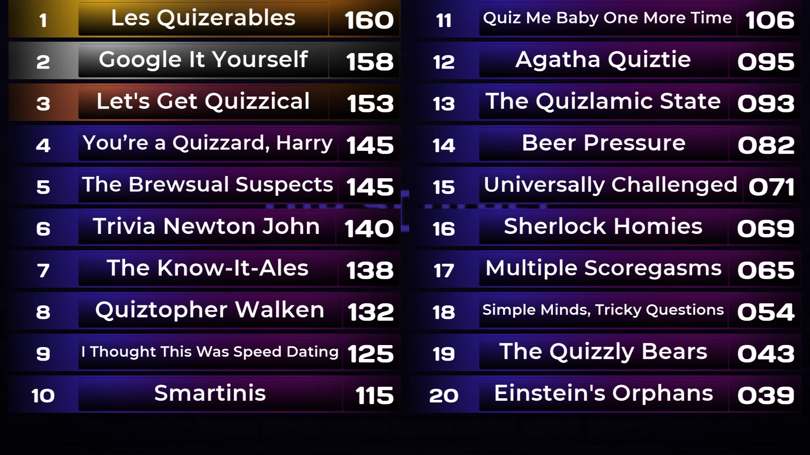{ loading=lazy }

- Spelers handmatig uitschakelen: de quizmaster kan een willekeurig aantal spelers selecteren om uit te schakelen. Dit doet hij één voor één, opnieuw met het toetsenbord of de afstandsbediening van de quizmaster om ze te selecteren. Hierboven ziet u een voorbeeld van een quizdia ‘Einde ronde, quizmaster selecteert verliezers’. De knop ‘afspelen’ onderaan het scherm geeft aan dat de quizmaster klaar is met het uitschakelen van spelers; wanneer u erop drukt (selecteer de knop met het toetsenbord en druk op spatie), gaat de quiz verder. De knop met de draaiende pijl maakt het uitschakelproces ongedaan als de quizmaster per ongeluk iemand uitschakelt, waarna hij opnieuw spelers kan gaan uitschakelen.

- Spelers automatisch uitschakelen: met deze optie schakelt het systeem automatisch een bepaald aantal spelers uit (zoals voor de dia in Studio is ingesteld), zonder dat het publiek visuele feedback ziet.

Scorebord tonen/Rondescores tonen: het systeem toont de ranglijst voor de hele quiz of voor de huidige ronde.

Scores resetten: zet alle scores terug aan het einde van de ronde.

Een ronde wordt gedefinieerd als de set dia’s tussen:

- De eerste dia in de quiz en de eerste dia ‘Einde ronde’ (ronde 1)

- Twee dia’s *Einde ronde*

- De dia na de laatste dia *Einde ronde* en de laatste dia van de quiz

Hieronder ziet u een voorbeeld van een quiz met drie ronden.

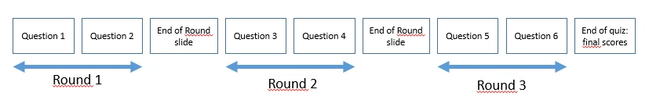{ width="595" loading=lazy }

Een dia ‘Einde ronde’ kan ook worden gebruikt voor rondes ‘Petje-op, petje-af’. Wanneer vragen ‘Petje-op, petje-af’ worden gebruikt, worden spelers die onjuist antwoorden uit de quiz gezet en kunnen ze niet meer meespelen. Wanneer een dia ‘Einde ronde’ wordt getoond, kunnen alle spelers die door vragen ‘Petje-op, petje-af’ uit het spel zijn, weer meedoen.

!!! note

    Spelers\teams kunnen ook vanuit QuizXpress Director worden geactiveerd\gedeactiveerd. In QuizXpress Director kunt u tijdens een quiz ook nieuwe spelers toevoegen of de punten van een team wijzigen. Zie [QuizXpress Director](../quizxpress-director/index.md) voor meer informatie over QuizXpress Director.*

## Testvraag

Een quizdia ‘Testvraag’ gedraagt zich precies als een gewone quizdia, behalve dat er geen punten worden opgeteld/afgetrokken wanneer de vraag is beantwoord. Hij kan worden gebruikt om te laten zien hoe het systeem werkt en wordt vaak als eerste vraag in een quiz gebruikt om de spelers vertrouwd te maken met het systeem.

## Demografisch

Met het quizdiatype ‘Demografisch’ kunt u alle spelers verdelen in verschillende groepen die tegen elkaar strijden (voorbeelden van dit soort quizzen zijn ‘mannen tegen vrouwen’, ‘marketing tegen financiën’, enzovoort).

Om deze functionaliteit te gebruiken, stelt u in QuizXpress Studio het type van een quizdia in op ‘Demografisch’. Er verschijnt dan een invoerveld in het eigenschappenraster met de naam ‘Demografische groep’, waar u de naam van een demografische groep kunt invoeren (bijvoorbeeld ‘Mannen’). Voor de indeling van de quizdia moet u een indeling selecteren die een vraag bevat en geen antwoorden. Voer een vraagtekst in die de spelers vertelt dat een bepaalde groep mensen op zijn buzzer moet drukken om lid te worden van een specifieke groep (bijvoorbeeld ‘Druk op uw buzzer als u een man bent’).

!!! note

    U kunt het publiek ook in groepen verdelen voordat een quiz begint in QuizXpress Setup. Daar kunt u bepalen welke keypads bij welke groep horen. Zie voor meer informatie [Keypads groeperen](../../setup/setting-up-teams-the-teams-tab-page.md#keypads-groeperen)*

## Petje-op, petje-af

Een quizdia van het type ‘Petje-op, petje-af’ zet elke speler die een vraag onjuist beantwoordt uit de quizronde. Als er na het uitschakelen één speler overblijft, wint die speler de ronde en gaat de quiz verder naar de eerste dia ‘Einde ronde’ die hij tegenkomt, of naar het einde van de quiz. Als alle resterende spelers een vraag onjuist beantwoorden, wordt echter niemand van hen uitgeschakeld.

## Publiekspoll-vragen

Dit is een type vraag waarmee u willekeurige gegevens/statistieken van uw publiek kunt verzamelen. De antwoorden op een publiekspollvraag worden vastgelegd maar hebben geen invloed op de scores. Na een publiekspollvraag kunt u met de toets ‘C’ een grafiek tonen met de verdeling van de gegeven antwoorden.

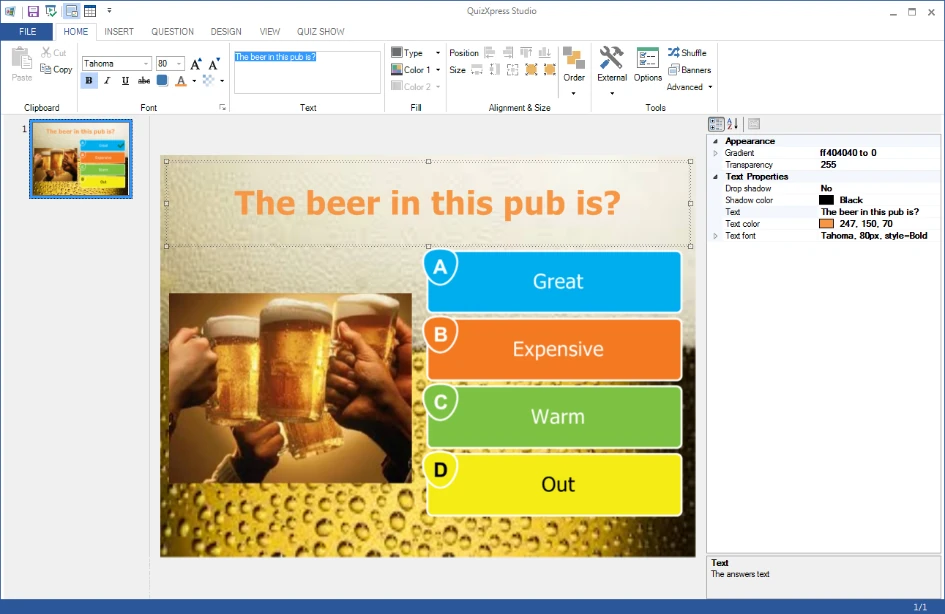{ width="604" loading=lazy }

## Weddenschapsvraag

Met weddenschapsvragen kunt u het publiek laten wedden op de uitkomst van de volgende vraag. Hiermee kunt u vragen in ‘Jeopardy-stijl’ maken waarbij mensen punten inzetten op basis van hoeveel zij denken te weten over een onderwerp.

Wanneer u een quizdia instelt op het type ‘Weddenschap’, ziet deze er in QuizXpress Studio als volgt uit:

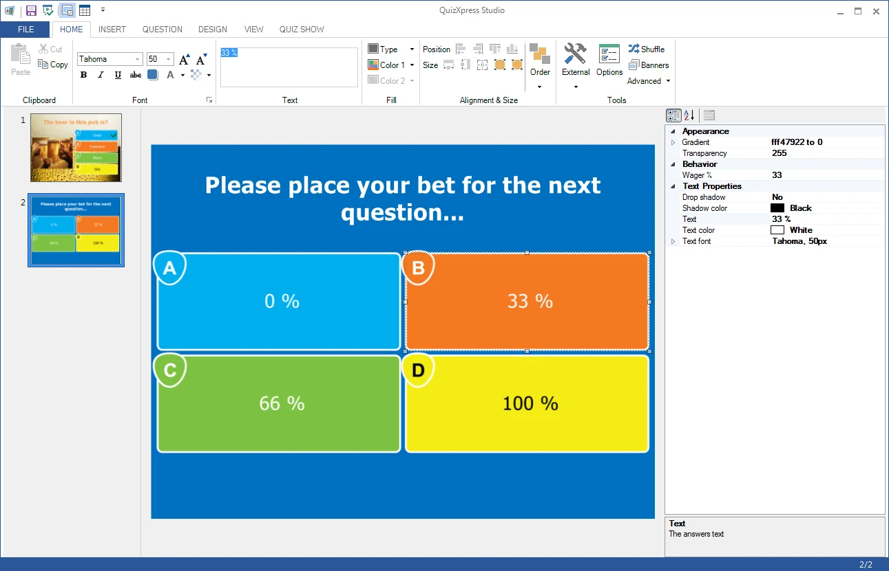{ loading=lazy }

De vraagtekst wordt standaard gewijzigd in “Plaats uw weddenschap voor de volgende vraag…”, maar u kunt de tekst later wijzigen in wat u maar wilt. De antwoorden op dit type vraag worden gebruikt om het percentage van de score in te stellen dat de speler bij de volgende vraag kan winnen of verliezen. Als de speler bijvoorbeeld ‘C’ antwoordt op deze vraag, betekent dit dat hij 66% van zijn score inzet op de volgende vraag. Als hij de volgende vraag juist beantwoordt, stijgt zijn score met 66%. Als u een dia-indeling met vijf antwoorden gebruikt, worden de percentages natuurlijk verdeeld over vijf opties (0%, 25%, 50%, 75% en 100%). U kunt het percentage ook handmatig instellen door op een van de antwoorden te klikken en de eigenschap ‘Wager %’ te wijzigen.

Weddenschappen kunnen ook worden gebruikt met een aantal punten in plaats van een percentage.
