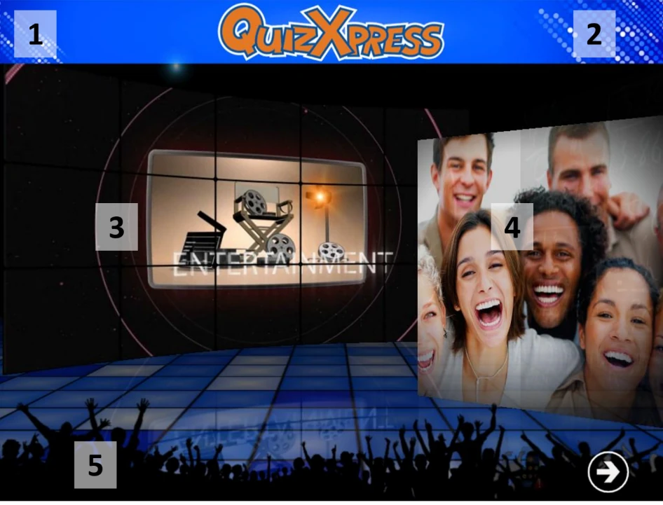

# L'écran Welcome

Au démarrage de l'application, le premier écran qui s'affiche est l'écran Welcome, illustré dans la capture d'écran ci-dessous. Plusieurs éléments de l'écran Welcome peuvent être personnalisés à l'aide de Quiz Setup ; les éléments personnalisables sont signalés visuellement sur la capture d'écran.

1.  Un texte d'en-tête.

2.  Un logo affiché à côté du texte d'en-tête.

3.  La vidéo ou l'image d'introduction affichée.

4.  Les images affichées dans le diaporama.

5.  Un texte de pied de page (si vous définissez un texte de pied de page, il sera affiché sur une bande bleue)

> { width="605" loading=lazy }

Pour passer à l'écran suivant (l'écran d'enregistrement des buzzers), appuyez sur le bouton en bas à droite de l'écran ou sur la barre d'espace du clavier.

!!! note

    Si vous voyez une icône de buzzer/keypad clignotante en bas à droite de l'écran, cela signifie que le système n'a pas trouvé le récepteur sans fil. Dans ce cas, vérifiez que le matériel est correctement connecté et que la configuration des buzzers est correcte dans Quiz Setup.*
