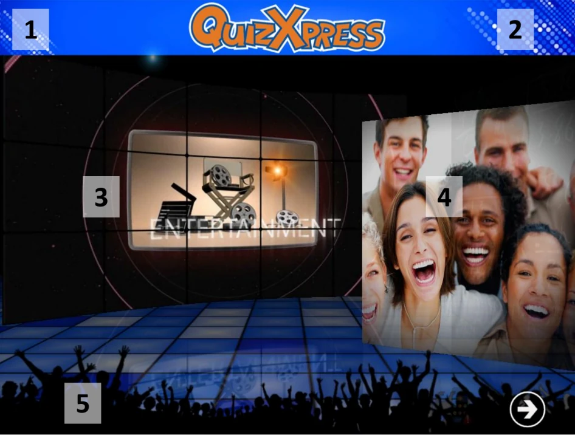

# La schermata di Benvenuto

Quando si avvia un quiz, la prima schermata ad apparire è la schermata di benvenuto mostrata nella schermata di esempio qui sotto. Diversi elementi della schermata di benvenuto possono essere personalizzati utilizzando l’applicazione Quiz Setup. Gli elementi personalizzabili sono contrassegnati visivamente nello screenshot.

1. Il testo della banda superiore (intestazione)

2. Il logo visualizzato accanto al testo dell'intestazione

3. Il video o l'immagine di introduzione mostrati.

4. Le immagini riportate nella presentazione (Slide show)

5. Il testo della banda inferiore (piè di pagina) Se inserito, sarà visualizzato sopra una banda blu.

> { width="605" loading=lazy }

Per passare alla schermata successiva (schermata di assegnazione delle pulsantiere/buzzer) premere il tasto ‘Play’ nella parte inferiore dello schermo o premere la barra spaziatrice sulla tastiera del PC.

!!! note

    Qualora venisse visualizzata una pulsantiera lampeggiante nella parte inferiore dello schermo, significa che il sistema non ha trovato il ricevitore wireless. In questo caso controllare che l'hardware sia effettivamente collegato e la configurazione nella scheda Buzzer sia impostata correttamente in Quiz Setup.
