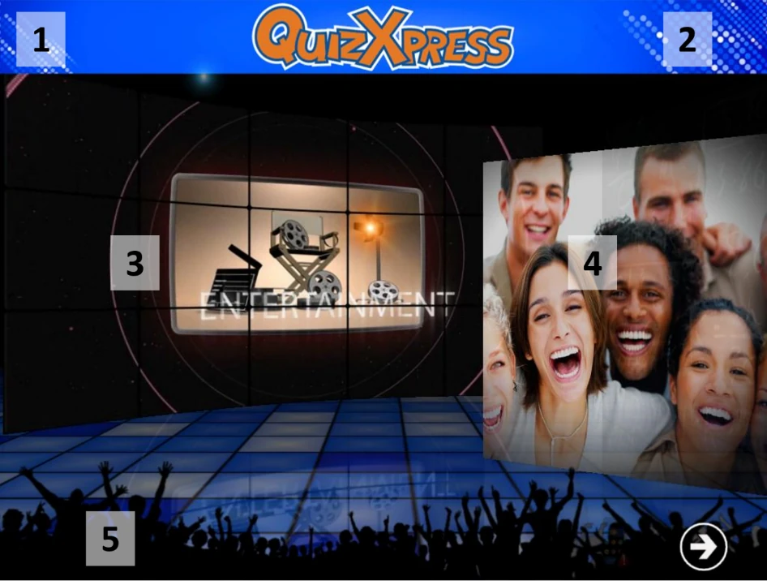

# Het welkomstscherm

Wanneer de toepassing start, is het eerste scherm dat u ziet het welkomstscherm, getoond in de onderstaande schermafbeelding. Verschillende onderdelen van het welkomstscherm kunnen worden aangepast met Quiz Setup; de aanpasbare onderdelen zijn in de schermafbeelding gemarkeerd.

1.  Een koptekst.

2.  Naast de koptekst wordt een logo getoond.

3.  De getoonde introductiefilm of afbeelding.

4.  De afbeeldingen die in de diavoorstelling worden getoond.

5.  Een voettekst (als u een voettekst instelt, wordt deze op een blauwe strook getoond)

> { width="605" loading=lazy }

Om naar het volgende scherm (het registratiescherm voor buzzers) te gaan, drukt u op de knop rechtsonder in het scherm of op de spatiebalk van het toetsenbord.

!!! note

    Als u rechtsonder in het scherm een knipperend buzzer-/keypadpictogram ziet, betekent dit dat het systeem de draadloze ontvanger niet heeft gevonden. Controleer in dat geval of de hardware correct is aangesloten en of de buzzerconfiguratie in Quiz Setup juist is ingesteld.*
