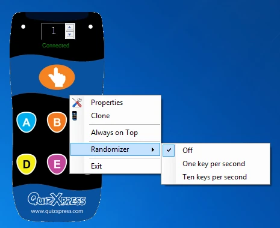

# Tester avec des Virtual Keypads

Le Virtual Keypad est utile pour tester votre quiz sans aucune dépendance externe. Il s'agit d'un keypad logiciel qui s'exécute sur la même machine que votre quiz. Vous pouvez lancer un nouveau Virtual Keypad (VK) depuis la liste déroulante External Tools de Studio ou depuis le menu Démarrer de Windows, dans la section QuizXpress. Dès qu'une instance de Virtual Keypad est en cours d'exécution, elle tente de se connecter à QuizXpress Live. Tant que la connexion n'est pas établie, les boutons du keypad sont grisés.

| { width="107" loading=lazy } | { width="105" loading=lazy } | { width="290" loading=lazy } |
|---------------------------------------------------------------------------------|---------------------------------------------------------------------------------|--------------------------------------------------------------------------------|
| Connexion en cours                                                              | Connecté                                                                        | Menu contextuel du Virtual Keypad                                              |

Une fois connecté, vous pouvez modifier le numéro du keypad à la volée avec le sélecteur numérique. Pour accéder au menu contextuel, faites un clic droit sur l'écran du keypad. Le menu contextuel propose les commandes suivantes :

| Menu          | Description                                                                                          |
|---------------|------------------------------------------------------------------------------------------------------|
| Properties    | Ouvre la boîte de dialogue Properties, où vous pouvez voir l'adresse IP et le port du serveur utilisés |
| Clone         | Clone une nouvelle instance. L'ID du keypad sera incrémenté                                          |
| Always on Top | Maintient le keypad au premier plan, devant toutes les autres applications                           |
| Randomizer    | Active/désactive un mode dans lequel le keypad envoie des entrées aléatoires pour faciliter les tests |
| Exit          | Ferme le Virtual Keypad                                                                              |
