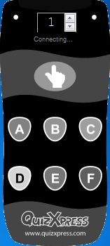
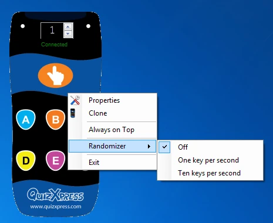

# Testen met virtuele keypads

Het virtuele keypad is handig om uw quiz te testen zonder externe afhankelijkheden. Het is een softwarekeypad dat op dezelfde computer draait als uw quiz. U kunt een nieuw virtueel keypad (VK) starten vanuit de vervolgkeuzelijst ‘Externe hulpprogramma’s’ in Studio of vanuit het Windows Start-menu, in de sectie QuizXpress. Zodra een instantie van het virtuele keypad draait, probeert het verbinding te maken met QuizXpress Live. Totdat dit lukt, zijn de keypadknoppen grijs.

| { width="107" loading=lazy } | { width="105" loading=lazy } | { width="290" loading=lazy } |
|---------------------------------------------------------------------------------|---------------------------------------------------------------------------------|--------------------------------------------------------------------------------|
| Verbinden                                                                       | Verbonden                                                                       | Contextmenu van het virtuele keypad                                            |

Zodra de verbinding tot stand is gebracht, kunt u het keypadnummer direct wijzigen met het draaiveld. Om het contextmenu te openen, klikt u met de rechtermuisknop op het keypadscherm. Het contextmenu biedt de volgende opdrachten:

| Menu          | Beschrijving                                                                             |
|---------------|------------------------------------------------------------------------------------------|
| Eigenschappen | Opent het dialoogvenster Eigenschappen, waar u het IP-adres en de poort van de server kunt zien |
| Klonen        | Kloont een nieuwe instantie. Het keypad-ID wordt opgehoogd                               |
| Altijd op voorgrond | Houdt het keypad vóór alle andere toepassingen                                     |
| Automatisch testen | Schakelt een modus in of uit waarin het keypad willekeurige invoer verzendt voor eenvoudig testen |
| Sluiten       | Sluit het virtuele keypad                                                                |
