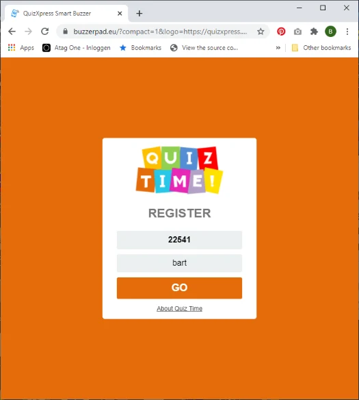

# Personalizzazione del sito web buzzerpad

Esistono tre modi per creare un aspetto personalizzato del sito web buzzerpad di QuizXpress:

1)  Possiamo acquistare un dominio personalizzato per voi e creare una versione con il vostro marchio su quel dominio. Contattateci all'indirizzo info@gameshowcrew.com per dettagli e prezzi.

2)  È possibile passare dei parametri nell'URL per personalizzare l'aspetto e inserire il collegamento dal proprio sito web (per evitare che i clienti debbano usare il link lungo) oppure usare un sito come https://tinyurl.com/ per nascondere i parametri dell'URL. Se si mostra a schermo un QR code (premere Q mentre il quiz è in esecuzione nel quiz player) per consentire ai giocatori di accedere facilmente al buzzer web, è possibile indicare i parametri di personalizzazione per il QR code in QuizXpress Director. Nella scheda Mobile, premere Settings e, nella finestra di configurazione che appare, inserire i parametri nel campo URL Extension. Per ulteriori informazioni, fare riferimento a 5.7.8.3.

3)  Incorporare il sito web buzzerpad in un iFrame e passare i parametri dal

> riferimento dell'iFrame. Questo consente anche di aggiungere il proprio stream di trasmissione (come YouTube) nella stessa
>
> pagina. Per ulteriori informazioni, non esitate a contattarci all'indirizzo info@gameshowcrew.com.

Personalizzazione con i parametri URL

È possibile passare diversi parametri al sito web buzzerpad per personalizzarne l'aspetto in base alle proprie esigenze. I parametri sono:

| **Nome**    | **Descrizione**                                                                                           | **Esempio**                                                 |
|-------------|-----------------------------------------------------------------------------------------------------------|-------------------------------------------------------------|
| name        | Passa il nome del giocatore                                                                               | name=John                                                   |
| fname       | Passa il nome del giocatore e rende il campo di immissione di sola lettura                                | fname=Peter                                                 |
| themecolor  | Il colore principale del sito                                                                             | themecolor=FE5602                                           |
| about       | Il testo «about» mostrato nella pagina di accesso (assicurarsi di usare l'escape HTML per il carattere spazio, ecc.) | about=About%20QuizXpress                          |
| abouturl    | L'URL a cui deve collegarsi il testo «about»                                                              | abouturl=https://www.quizxpress.com                         |
| gotext      | Il testo del pulsante GO                                                                                  | gotext=ENTER (nota: assicurarsi di codificare correttamente la stringa) |
| compact     | Passare 1 per rendere più compatto il layout della schermata di accesso                                   | compact=1                                                   |
| logo        | URL del proprio logo. Assicurarsi che il logo sia alto 120 pixel, con sfondo trasparente                  | logo=https://www.quizxpress.com/logo.png                    |
| pin         | Passa il codice PIN in modo che il giocatore non debba inserirlo                                          | pin=12345                                                   |
| ticket      | Passa il codice del biglietto                                                                             | ticket=AG1234F                                              |
| uid         | Passa un'identità utente fissa come GUID (il formato esadecimale è XXXXXXXX-XXXX-XXXX-XXXX-XXXXXXXXXXXX)  | uid=aed6373a-db53-499d-9428-a7ad22289272                    |
| autoconnect | Passando *fname*, *pin* e *autoconnect*=1, il keypad effettua l'accesso automaticamente                   | pin=12345&fname=Player1&autoconnect=1                       |

Ad esempio:

[https://buzzerpad.eu/?compact=1&logo=https://quizxpress.com/files/quiztime.png&themecolor=E46C0A&about=About%20Quiz%20Time](https://buzzerpad.eu/?compact=1&logo=https://quizxpress.com/files/quiztime.png&themecolor=E46C0A&about=About%20Quiz%20Time%20)

Avrà il seguente aspetto:

{ width="286" loading=lazy }

L'immagine del logo «quiz time» è stata caricata sul sito quizxpress.com in modo da poter essere usata come logo personalizzato. Il logo deve essere archiviato da qualche parte sul proprio sito web.
