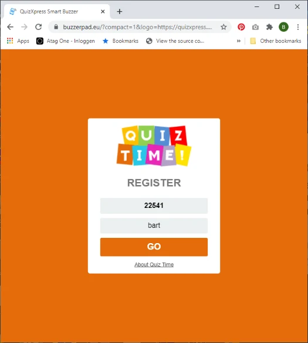

# De buzzerpad-website van uw eigen branding voorzien

Er zijn drie manieren om de buzzerpad-website van QuizXpress een eigen uiterlijk te geven:

1)  Wij kunnen een eigen domein voor u kopen en achter dat domein een versie met uw branding voor u maken. Neem contact met ons op via info@gameshowcrew.com voor details en prijzen.

2)  U kunt parameters in de URL doorgeven om het uiterlijk aan te passen en daar vanaf uw eigen website naar verwijzen (u wilt niet dat uw klanten met de lange link moeten werken) of een website zoals https://tinyurl.com/ gebruiken om de URL-parameters te verbergen. Als u op het scherm een QR-code toont (druk op Q wanneer de quiz draait in de quizspeler) zodat spelers eenvoudig toegang krijgen tot de webbuzzer, kunt u de brandingparameters voor de QR-code opgeven in QuizXpress Director. Druk op het tabblad Mobiel op Instellingen en voer in het configuratievenster dat verschijnt de parameters in het veld URL-extensie in. Zie [Het tabblad Mobiel](../quizxpress-director/the-mobile-tab.md#instellingen) voor meer informatie.

3)  Sluit de buzzerpad-website in een iFrame in en geef de parameters door vanuit de iFrame

> verwijzing. Zo kunt u ook uw uitzending (zoals YouTube) op dezelfde
>
> pagina toevoegen. Als u hierover meer informatie nodig hebt, neem dan gerust contact met ons op via info@gameshowcrew.com.

Aanpassen met URL-parameters

U kunt verschillende parameters aan de buzzerpad-website doorgeven om het uiterlijk naar wens aan te passen. De parameters zijn:

| **Naam**    | **Beschrijving**                                                                                          | **Voorbeeld**                                               |
|-------------|-----------------------------------------------------------------------------------------------------------|-------------------------------------------------------------|
| name        | Geef de spelersnaam door                                                                                  | name=John                                                   |
| fname       | Geef de spelersnaam door en maak het invoerveld alleen-lezen                                              | fname=Peter                                                 |
| themecolor  | De hoofdkleur van de site                                                                                 | themecolor=FE5602                                           |
| about       | De over-tekst die op de aanmeldpagina wordt getoond (gebruik HTML-escaping voor de spatie enzovoort)      | about=About%20QuizXpress                                    |
| abouturl    | De URL waarnaar de over-tekst moet linken                                                                 | abouturl=https://www.quizxpress.com                         |
| gotext      | De tekst op de GO-knop                                                                                    | gotext=ENTER (let op: codeer de tekenreeks correct)         |
| compact     | Geef 1 door om de indeling van het aanmeldscherm compacter te maken                                       | compact=1                                                   |
| logo        | URL naar uw eigen logo. Zorg dat het logo 120 pixels hoog is, met een transparante achtergrond           | logo=https://www.quizxpress.com/logo.png                    |
| pin         | Geef de pincode door zodat de speler deze niet hoeft in te voeren                                         | pin=12345                                                   |
| ticket      | Geef de ticketcode door                                                                                   | ticket=AG1234F                                              |
| uid         | Geef een vaste gebruikersidentiteit door als GUID (hexadecimaal formaat is XXXXXXXX-XXXX-XXXX-XXXX-XXXXXXXXXXXX) | uid=aed6373a-db53-499d-9428-a7ad22289272             |
| autoconnect | Wanneer u *fname*, *pin* en *autoconnect*=1 doorgeeft, meldt het keypad zich automatisch aan              | pin=12345&fname=Player1&autoconnect=1                       |

Bijvoorbeeld:

[https://buzzerpad.eu/?compact=1&logo=https://quizxpress.com/files/quiztime.png&themecolor=E46C0A&about=About%20Quiz%20Time](https://buzzerpad.eu/?compact=1&logo=https://quizxpress.com/files/quiztime.png&themecolor=E46C0A&about=About%20Quiz%20Time%20)

Dit ziet er als volgt uit:

{ width="286" loading=lazy }

De afbeelding van het ‘quiz time’-logo is geüpload naar de website quizxpress.com zodat deze als eigen logo kon worden gebruikt. Uw logo moet ergens op uw eigen website zijn opgeslagen.
