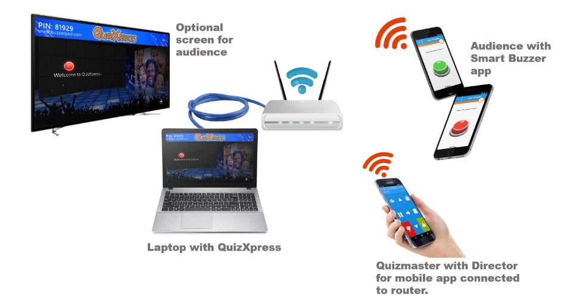

# Configurazione del sistema

Come discusso in precedenza, il sistema offre diverse possibilità per diversi scenari. Per ulteriori informazioni sulla configurazione di QuizXpress per l'uso con i telefoni cellulari, fare riferimento anche a [Configurazione del supporto per le pulsantiere mobili](../../setup/setting-up-mobile-keypad-support.md).

**Modalità server**

Quando si utilizza il sistema in modalità server, è necessaria una **connessione internet affidabile** con una velocità adeguata. Il traffico dati di QuizXpress non è molto elevato rispetto, ad esempio, a un flusso video, ma una connessione inaffidabile o forti cali di velocità avranno un impatto importante sul sistema e sull'esperienza complessiva. Naturalmente, se si trasmette il quiz in streaming su internet contemporaneamente, potrebbero esserci requisiti aggiuntivi per il flusso video. È sempre consigliabile collegare il computer al router tramite cavo per ottenere una connessione più costante e affidabile. Il pubblico può partecipare al quiz in due modi: tramite il sito web buzzerpad.com o tramite l'app Smart Buzzer. Per i dettagli, vedere i capitoli successivi. In [Configurazione del supporto per le pulsantiere mobili](../../setup/setting-up-mobile-keypad-support.md) è possibile leggere tutto sulla configurazione del sistema per la modalità server in Quiz Setup.

**Modalità Wi-Fi autonoma**

In una configurazione Wi-Fi autonoma, il laptop viene collegato al router con un cavo di rete. Il router funge da punto di accesso Wi-Fi locale per i dispositivi mobili dei giocatori, per il dispositivo che esegue l'app di controllo remoto e per il laptop. Di seguito è riportata un'immagine di una configurazione di questo tipo:

{ width="604" loading=lazy }

Il laptop ottiene un indirizzo IP dal router locale e non necessita di alcuna connessione internet. Un router standard di buona qualità supporta fino a circa 50 giocatori; sono disponibili anche router in grado di gestire più connessioni. Gli smartphone/tablet devono connettersi allo stesso router e, all'avvio dell'app Smart Buzzer, il pulsante JOIN WI-FI GAME viene abilitato non appena il dispositivo trova il quiz in esecuzione.

Si noti che alcuni pacchetti antivirus includono firewall integrati molto restrittivi, che richiedono una configurazione speciale per consentire il traffico di rete di QuizXpress. Per aggiungere un'eccezione per QuizXpress, consentire tutto il traffico per il programma *qxserver.exe*, che si trova nella cartella di installazione di QuizXpress. Questo non è necessario con il firewall standard di Windows.
