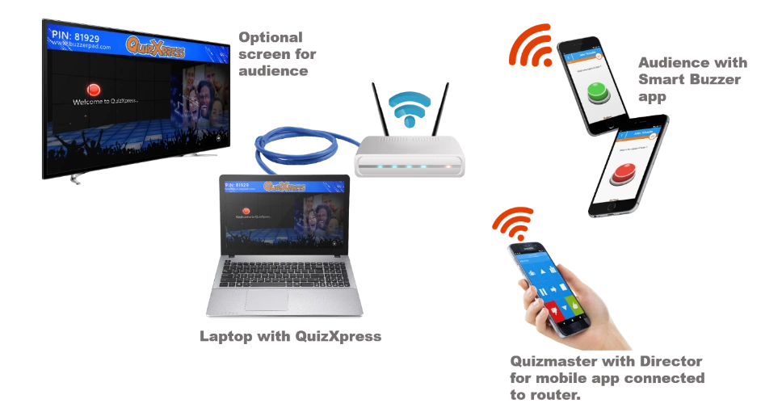

# Het systeem instellen

Zoals eerder besproken zijn er verschillende mogelijkheden waarmee het systeem verschillende scenario’s ondersteunt. Voor meer informatie over het configureren van QuizXpress voor gebruik met mobiele telefoons raadpleegt u ook [Ondersteuning voor mobiele keypads instellen](../../setup/setting-up-mobile-keypad-support.md).

**Servermodus**

Wanneer u het systeem in servermodus gebruikt, hebt u een **betrouwbare internetverbinding** met een redelijke snelheid nodig. Het dataverkeer van QuizXpress is niet erg hoog in vergelijking met bijvoorbeeld een videostream, maar een onbetrouwbare verbinding of ernstige snelheidsdalingen hebben grote invloed op het systeem en op de algehele ervaring. Wanneer u uw quiz tegelijkertijd naar internet streamt, kunnen er uiteraard extra eisen gelden voor de videostream. Het is altijd raadzaam om uw computer met een kabel op uw router aan te sluiten voor een stabielere en betrouwbaardere verbinding. Uw publiek kan op twee manieren aan uw quiz deelnemen: via de website buzzerpad.com of via de Smart Buzzer-app. Zie de volgende hoofdstukken voor details. In [Ondersteuning voor mobiele keypads instellen](../../setup/setting-up-mobile-keypad-support.md) leest u alles over het configureren van het systeem voor servermodus in Quiz Setup.

**Zelfstandige wifimodus**

Bij een zelfstandige wifi-opstelling verbindt u uw laptop met een netwerkkabel met uw router. De router fungeert als lokaal wifi-toegangspunt voor de mobiele apparaten van uw spelers, uw apparaat met de afstandsbedieningsapp en uw laptop. Hieronder ziet u een afbeelding van zo’n opstelling:

{ width="604" loading=lazy }

De laptop krijgt een IP-adres van de lokale router en heeft geen internetverbinding nodig. Een standaard, degelijke router ondersteunt tot ~50 spelers; er zijn ook routers verkrijgbaar die meer verbindingen aankunnen. De telefoons/tablets moeten verbinding maken met dezelfde router. Wanneer u de Smart Buzzer-app start, wordt de knop JOIN WI-FI GAME ingeschakeld zodra het apparaat de actieve quiz vindt.

Houd er rekening mee dat sommige antivirusprogramma’s worden geleverd met zeer strikte geïntegreerde firewalls, die speciaal moeten worden ingesteld om netwerkverkeer voor QuizXpress toe te staan. Om een uitzondering voor QuizXpress toe te voegen, staat u al het verkeer toe voor het programma *qxserver.exe*, te vinden in de installatiemap van QuizXpress. Dit is niet nodig voor de standaard Windows-firewall.
