# Utiliser les applications mobiles QuizXpress

QuizXpress Mobile propose également deux applications, toutes deux disponibles pour Android et iOS.

**QuizXpress Smart Buzzer**

C'est l'application utilisée par les joueurs du quiz. Avant de lancer votre premier quiz, demandez à vos joueurs de télécharger l'application gratuite QuizXpress Smart Buzzer depuis la boutique d'applications de leur téléphone. Il leur suffit de rechercher *QuizXpress Smart Buzzer*, de l'installer, et le tour est joué.

{ width="226" loading=lazy }

**Application QuizXpress Director**

Pour l'hôte/présentateur du quiz, nous proposons une application distincte appelée *QuizXpress Director*. Cette application permet à l'hôte de contrôler le quiz (afficher la question suivante, révéler la réponse, afficher les scores intermédiaires ou des graphiques), de gérer les équipes (modifier les scores ou les noms d'équipe), de lancer des mini-jeux, de jouer des sons via une table de sons (soundboard) et de faire bien d'autres choses !

Les sections suivantes décrivent les applications plus en détail.

## Application QuizXpress Smart Buzzer

Au démarrage de l'application, les joueurs voient l'option de rejoindre une partie par Wi-Fi local ou par PIN.

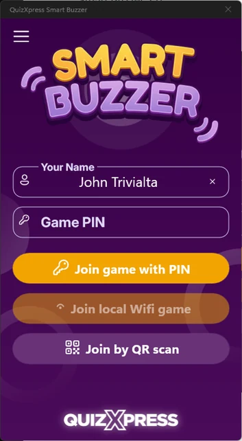{ width="177" loading=lazy }

Lorsque la partie se déroule avec un routeur Wi-Fi connecté à l'ordinateur, le bouton « Join local Wi-Fi game » est activé. Appuyer sur ce bouton connecte au quiz qui s'exécute sur le Wi-Fi local.

Lorsque vous jouez sans routeur Wi-Fi, et donc en vous connectant à distance via internet, le quiz player affiche un code PIN à l'écran. Les joueurs peuvent saisir ce code PIN en appuyant sur « Join game with PIN ».

Une fois connecté, l'écran d'accueil configuré dans la section Branding des paramètres s'affiche (veuillez consulter [Configurer la prise en charge des keypads mobiles](../../setup/setting-up-mobile-keypad-support.md)).

Si vous avez configuré des jingles en définissant le dossier Jingles dans les paramètres, les joueurs verront une liste de tous les extraits sonores disponibles. Chaque joueur peut choisir un jingle qui sera utilisé pendant la partie dans les situations suivantes :

- Bonus points - le son du joueur qui a été le premier à donner la bonne réponse est joué lorsque l'écran des points bonus est affiché.

- Fastest finger – le son du joueur qui a appuyé en premier est joué, tandis que le nom du joueur apparaît à l'écran dans le quiz player.

- Intermediate score overviews – le son du joueur classé premier est joué lors de l'affichage du classement.

> En tant qu'animateur de quiz, vous pouvez toujours déclencher manuellement la sélection de jingle pour un appareil précis dans l'onglet Mobile de Director.

À gauche, vous voyez un exemple de question de type « first letter ».

Plusieurs éléments s'affichent à l'écran :

- En haut à gauche, vous voyez le numéro attribué à votre buzzer mobile.

- En haut à droite s'affiche le nom du joueur.

- La barre supérieure contient :

  - L'index de la question en cours (ici, la première question sur 21)

  - Un trophée avec le nombre de points pouvant être gagnés. Si les points diminuent avec le temps, cela se reflète ici. Il s'agit d'une valeur approximative.

  - Une horloge décomptant le nombre de secondes restantes. Pendant les 5 dernières secondes, l'horloge clignote pour indiquer que le temps presse.

- La grille de lettres utilisée pour répondre à la question.

QuizXpress Smart Buzzer prend en charge une série de types de questions différents :

| 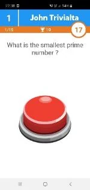{ width="96" loading=lazy }                                                                                               | 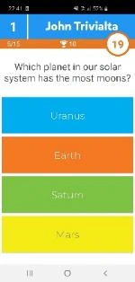{ width="96" loading=lazy }            | 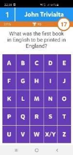{ width="96" loading=lazy }           | 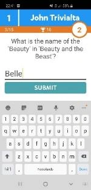{ width="96" loading=lazy }              | 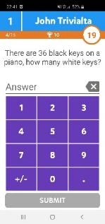{ width="95" loading=lazy }        |
|------------------------------------------------------------------------------------------------------------------------------------------------------------------------------------------------------------------------------|----------------------------------------------------------------------------------------------------------------------------------------------------------------------------------------------------------------------------|---------------------------------------------------------------------------------------------------------------------------------------------------------------------------------------------------------------------------|------------------------------------------------------------------------------------------------------------------------------------------------------------------------------------------------------------------------------|----------------------------------------------------------------------------------------------------------------------------------------------------------------------------------------------------------------------------|
| *Fastest finger*                                                                                                                                                                                                             | *Multiple Choice regular/ordered/multiple answer/eliminator*                                                                                                                                                               | *First Letter*                                                                                                                                                                                                            | *Full text*                                                                                                                                                                                                                  | *Numeric*                                                                                                                                                                                                                  |
| { width="98" loading=lazy } | 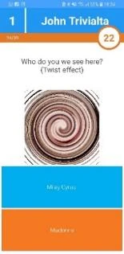{ width="99" loading=lazy } | 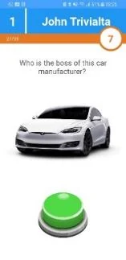{ width="100" loading=lazy } | 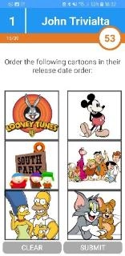{ width="100" loading=lazy } | 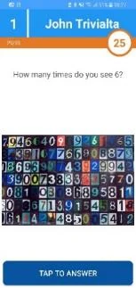{ width="98" loading=lazy } |
| *Multiple Choice with picture*                                                                                                                                                                                               | *Multiple Choice with picture effect*                                                                                                                                                                                      | *Fastest finger with picture*                                                                                                                                                                                             | *Multiple Choice pictures regular/ordered/multiple answer*                                                                                                                                                                   | *Numeric/First letter with picture*                                                                                                                                                                                        |

Le Smart Buzzer donne un retour après chaque question pour indiquer si vous aviez raison ou tort, et si vous avez reçu des points bonus :

| 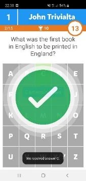{ width="109" loading=lazy } | 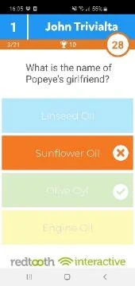{ width="109" loading=lazy } | 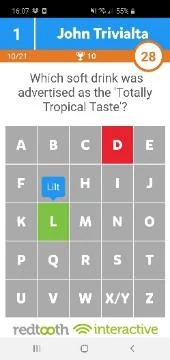{ width="108" loading=lazy } | 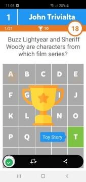{ width="109" loading=lazy } | 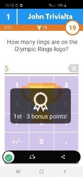{ width="109" loading=lazy } |
|--------------------------------------------------------------------------------------------------------------------------------------|-----------------------------------------------------------------------------------------------------------------------------------------------------------------------------------------------------------------------|----------------------------------------------------------------------------------------------------------------------------------------------------------------------------------------------------------------------|-------------------------------------------------------------------------------------------------------------------------------------------------------------------------------------------------------------------------------|-----------------------------------------------------------------------------------------------------------------------------------------------------------------------------------------------------------------------|
| *Réponse correcte*                                                                                                                   | *Réponse incorrecte*                                                                                                                                                                                                  | *Lettre incorrecte*                                                                                                                                                                                                  | *Animation des points bonus*                                                                                                                                                                                                  | *Points bonus gagnés*                                                                                                                                                                                                 |

Les scores sont aussi affichés sur le téléphone. Les scores finaux sont présentés en deux ou trois étapes : d'abord une annonce, puis votre classement dans le top 3 (si vous en faites partie), et enfin votre score et votre rang individuels.

| 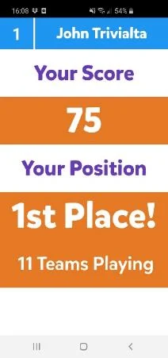{ width="136" loading=lazy } | 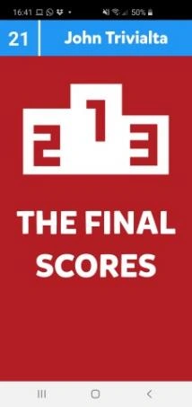{ width="137" loading=lazy } | 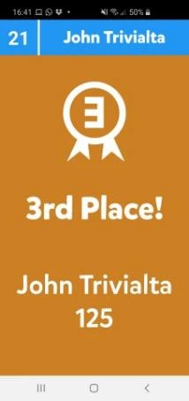{ width="137" loading=lazy } | 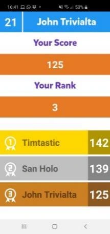{ width="137" loading=lazy } |
|--------------------------------------------------------------------------------------------------------------------------------------|--------------------------------------------------------------------------------------------------------------------------------------------------------------------------------------------------------------------------------|-----------------------------------------------------------------------------------------------------------------------------------------------|-----------------------------------------------------------------------------------------------------------------------------------------------|
| *Scores intermédiaires*                                                                                                              | *Annonce des scores finaux*                                                                                                                                                                                                    | *Score final individuel top 3*                                                                                                                | *Score individuel, rang et top* 3                                                                                                             |

L'utilisation de l'application est obligatoire si vous comptez jouer en Wi-Fi autonome. Depuis QuizXpress 8, le buzzer web sur buzzerpad offre les mêmes fonctionnalités que l'application Smart Buzzer, hormis l'option Wi-Fi local et la sélection de jingle.

## Promotions

L'application Smart Buzzer permet d'afficher des images « promotionnelles » pendant le quiz ou pendant une pause. Les images peuvent être envoyées depuis l'écran *Media Player* de QuizXpress Director. Votre image doit d'abord être ajoutée à la liste des médias disponibles. Pour présenter l'image sur l'application Smart Buzzer, sélectionnez-la dans la liste et cliquez sur *Show on Mobile* dans la barre d'outils.

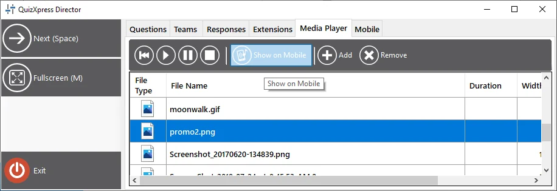{ width="526" loading=lazy }

## Thumbs Up/Thumbs Down

Avec ce mode de jeu, les joueurs peuvent gagner des points supplémentaires en votant sur l'exactitude de la réponse orale d'un autre joueur à une question ouverte. Cela s'applique aux situations où une interaction directe avec les joueurs est possible (donc pas pour une configuration en streaming). Le déroulement est le suivant :

- Une question fastest-finger est présentée aux joueurs. Des buzzers apparaissent sur toutes les applications Smart Buzzer

- Un joueur pense connaître la réponse et appuie sur le buzzer ; tous les autres sont bloqués.

- Sur l'écran ou l'application Director, une fenêtre contextuelle de jugement juste/faux apparaît avec les boutons *Thumbs Down/Poll/Thumbs Up*.

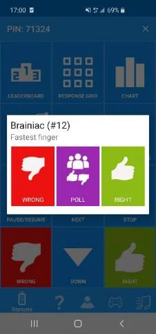{ width="145" loading=lazy }

- L'animateur de quiz échange avec le joueur pour entendre la réponse orale, puis peut soit juger la réponse juste ou fausse, soit sonder les autres joueurs pour savoir si *eux* pensent que la réponse donnée était juste ou fausse, en appuyant sur le bouton *Poll* de l'application Director.

- Sur les appareils des autres joueurs, une fenêtre contextuelle de sondage Thumbs Up/Thumbs Down apparaît pendant 10 secondes, et les joueurs peuvent voter (ou s'abstenir, auquel cas ils ne risquent pas de perdre de points).

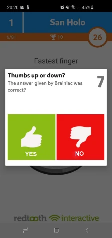{ width="141" loading=lazy }

- L'animateur de quiz juge maintenant la réponse donnée par le joueur fastest-finger en appuyant sur le bouton « Right » ou « Wrong » de l'application Director. Le joueur le plus rapide gagne ou perd ainsi des points (selon les paramètres de la question). Les autres joueurs gagnent ou perdent 50 % des points de la question, selon que leur jugement sur la réponse du joueur le plus rapide était correct ou non.

Ce mode garde tous les joueurs impliqués dans une manche fastest-finger, car ce n'est pas seulement le joueur le plus rapide qui peut gagner des points : tous les participants ont une chance d'en gagner.

## Application de télécommande – Mobile Director

Pour contrôler le quiz depuis votre tablette ou votre téléphone, vous pouvez utiliser l'application de télécommande QuizXpress Director pour iOS et Android. Après avoir installé et démarré l'application, vous verrez l'écran suivant :

Vous pouvez enregistrer l'ordinateur que vous souhaitez contrôler avec la télécommande QuizXpress Director en appuyant sur le bouton jaune « plus » en bas à droite de l'écran de votre mobile.

Dès que vous appuyez sur ce bouton, un lecteur de QR code s'affiche. Le QR code à scanner est affiché dans l'onglet Mobile de QuizXpress Setup (veuillez consulter [Configurer la prise en charge des keypads mobiles](../../setup/setting-up-mobile-keypad-support.md)). Scannez le code affiché ici et le nom de l'ordinateur apparaîtra dans l'application QuizXpress Director. Vous ne devez suivre cette procédure qu'une seule fois pour enregistrer votre ordinateur dans l'application.

Après avoir démarré un quiz, sélectionnez dans la liste l'ordinateur que vous souhaitez contrôler et appuyez dessus : l'application de télécommande mobile sera alors connectée à la session du quiz.

!!! note

    Veuillez vous assurer que le serveur sélectionné dans l'application QuizXpress Director est le même que celui sélectionné dans QuizXpress Setup. Cliquez sur le bouton de menu { .inline-icon width="23" } en haut à gauche de l'application. Cliquez sur « Settings » et vérifiez le paramètre « Mobile server to connect to ». Ce paramètre doit correspondre à celui défini dans QuizXpress Setup (veuillez consulter [Configurer la prise en charge des keypads mobiles](../../setup/setting-up-mobile-keypad-support.md) pour savoir comment définir le serveur (ou le Wi-Fi local) utilisé par le quiz player).

| **Mobile server to connect to** | **Settings server**                           |
|---------------------------------|-----------------------------------------------|
| Central US                      | [www.buzzerpad.com](http://www.buzzerpad.com) |
| Western Europe                  | [www.buzzerpad.eu](http://www.buzzerpad.eu)   |
| Local Wi-Fi                     | Local Wi-Fi                                   |

Après la connexion au quiz en cours, vous verrez l'application QuizXpress Director, qui comporte 5 onglets :

| 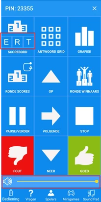{ width="103" loading=lazy } | 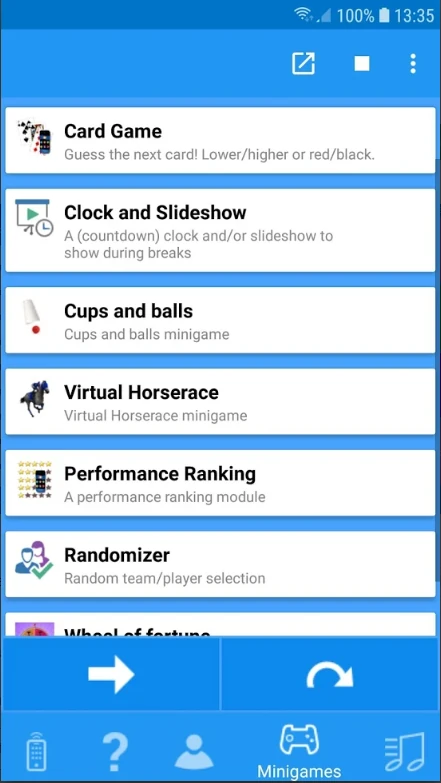{ width="114" loading=lazy } | 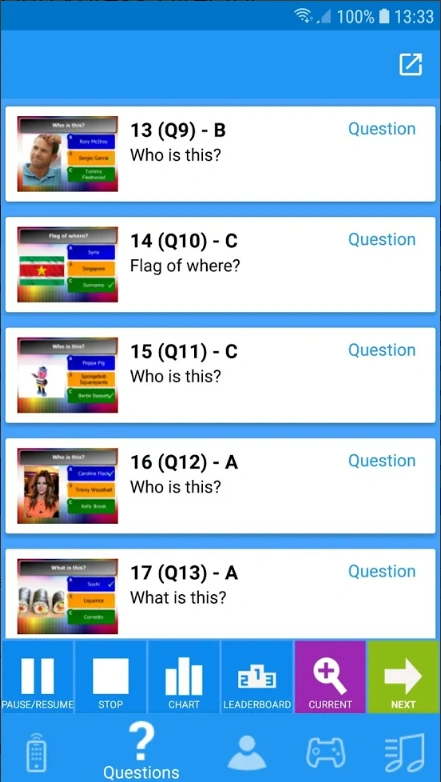{ width="113" loading=lazy } | 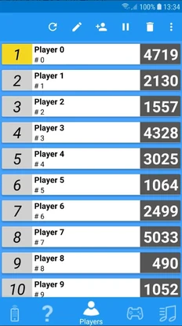{ width="116" loading=lazy } | 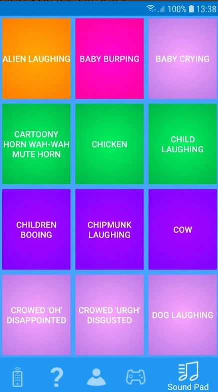{ width="115" loading=lazy } |
|-----------------------------------------------------------------------------------------------------------------------------------------------------------------------------------|---------------------------------------------------------------------------------|---------------------------------------------------------------------------------|---------------------------------------------------------------------------------|---------------------------------------------------------------------------------|
| Télécommande                                                                                                                                                                      | Démarrer/arrêter et contrôler les mini-jeux                                     | Naviguer dans les questions du quiz                                             | Aperçu des joueurs et des scores                                                | Sound Pad pour jouer des effets sonores aléatoires                              |

L'onglet de télécommande vous permet de contrôler le quiz. Les boutons suivants sont disponibles :

- Leaderboard – affiche le classement actuel. Les 22 premiers sont affichés au départ. Les boutons Up et Down font défiler les scores. Les boutons E, R, T affichent les écrans de score étendus (voir [Écrans de contrôle des scores](../starting-a-quiz/the-leaderboard.md#ecrans-de-controle-des-scores))

- Response Grid – affiche une grille indiquant pour chaque joueur s'il a eu juste, faux ou n'a pas répondu à la question à choix multiples en cours.

- Chart – affiche un graphique avec le nombre de votes pour chaque réponse.

- Round Scores – affiche les scores de la manche en cours.

- Round Winners – affiche le vainqueur de chaque manche.

- Pause/Resume – met en pause/reprend le compte à rebours.

- Stop – termine la question en cours lorsque l'horloge est en pause.

- Up/Down – fait défiler le classement vers le haut/le bas lorsqu'il y a plus de 22 joueurs.

- Next – passe à la diapositive suivante / à l'étape suivante d'un mini-jeu / à l'étape suivante des actions de fin de question (pour les actions de fin de question, veuillez consulter [Actions de fin de question](../../setup/end-of-question-actions.md))

- Right/Wrong – juge la réponse donnée oralement à une question fastest-finger.

- Volume control : modifier à distance le volume de lecture du quiz player en temps réel

- Filtering quizzes : lorsque vous utilisez la télécommande pour vous connecter à Quiz Center, vous pouvez désormais filtrer rapidement la liste des quiz disponibles.

!!! note

    Les boutons ERT et le contrôle du volume ne sont actuellement disponibles que sur Android ; la version iOS suivra.*

1.  L'onglet des mini-jeux vous permet de lancer des mini-jeux à la volée. Sélectionnez un mini-jeu et appuyez sur le bouton. Avancez dans le mini-jeu en cliquant sur la touche fléchée.

2.  L'onglet des questions affiche toutes les questions, les bonnes réponses, les notes et une vignette des diapositives. Les boutons suivants sont disponibles dans la barre d'outils inférieure :

- Bouton **Pause** - met en pause et reprend le compte à rebours.

- Bouton **Stop** - termine une question lorsque le minuteur est en pause.

- Bouton **Chart** – affiche un graphique des réponses pour la question en cours.

- Bouton **Leaderboard** – affiche les scores intermédiaires actuels.

- Bouton bascule **Current/List** – bascule entre les détails de la question en cours et la liste de toutes les questions

- Bouton **Next** (flèche) - passe à la diapositive suivante

Les diapositives déjà visitées sont colorées en jaune ; la question en cours est colorée en vert.

> Après chaque question « tout le monde répond », l'application de télécommande affiche le nombre de joueurs ayant répondu correctement (en vert), le nombre de ceux ayant répondu incorrectement (en rouge) et le nombre de ceux n'ayant pas répondu du tout (en bleu).

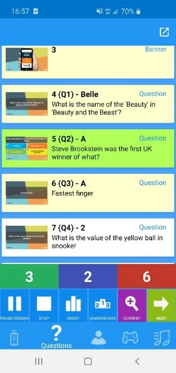{ width="189" loading=lazy }

3.  L'onglet des joueurs affiche tous les joueurs et leurs scores. Les boutons suivants sont disponibles en haut :

- Actualiser la page.

- Modifier un joueur - changer le nom, le score, le numéro de keypad (en cas de keypad physique)

- Ajouter un joueur - nom, score, numéro de keypad (en cas de keypad physique)

- Désactiver un joueur.

- Supprimer un joueur.

4.  L'onglet Sound Pad vous permet de jouer jusqu'à 12 effets sonores différents dans le quiz player. Les effets sonores sont chargés depuis un dossier défini par l'utilisateur que vous pouvez configurer dans QuizXpress Setup (veuillez consulter [Configurer les sons – l'onglet Sounds](../../setup/configuring-sounds-the-sounds-tab-page.md) pour plus d'informations).
