# Utilizzo delle App Mobili QuizXpress

QuizXpress Mobile offre anche due app, entrambe disponibili per Android e iOS.

**QuizXpress Smart Buzzer App**

Questa è l'app utilizzata dai giocatori del quiz. Prima di iniziare il quiz, invitare i giocatori a scaricare l'app gratuita QuizXpress Smart Buzzer dall'App Store preferito. Basterà cercare QuizXpress Smart Buzzer, installarla e si è pronti a iniziare.

{ width="226" loading=lazy }

**QuizXpress Director App**

Per il Quizmaster è a disposizione un'app separata chiamata *QuizXpress Director*. Questa app permette di controllare il quiz (mostrare la domanda successiva, svelare la risposta, mostrare i punteggi intermedi o i grafici), gestire le squadre (cambiare i punteggi o i nomi delle squadre), avviare i Moduli Gioco, riprodurre suoni attraverso un Sound Pad e fare molto altro!

Le sezioni seguenti descrivono le app in modo più dettagliato.

## QuizXpress Smart Buzzer App { #app-quizxpress-smart-buzzer }

All'avvio dell'app, i giocatori vedono l'opzione per partecipare a un quiz tramite PIN, Wi-Fi locale o QR Code.

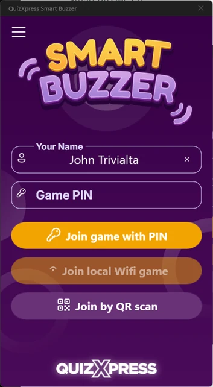{ width="177" loading=lazy }

Quando la partita si svolge con un router Wi-Fi collegato al computer, il pulsante «Accedi con WiFi locale» è abilitato. Toccando il pulsante ci si connette al quiz in esecuzione sul Wi-Fi locale.

Quando si gioca senza router Wi-Fi, e quindi ci si connette da remoto tramite internet, il riproduttore dei quiz mostra un PIN sullo schermo. I giocatori possono inserire questo PIN premendo «Accedi con PIN».

In alternativa, i giocatori possono connettersi con un codice QR. Quando il quiz è avviato, premere il tasto ‘Q’ sulla tastiera, oppure ‘Mostra Codice QR’ in QuizXpress Director, per mostrare il codice sullo schermo. I giocatori inseriscono il proprio nome, toccano ‘Accedi con QR’ nell'app, inquadrano il codice con la fotocamera del dispositivo e vengono collegati al quiz senza dover inserire il PIN.

Dopo l'accesso viene mostrata la schermata di benvenuto configurata nella sezione Personalizza delle impostazioni (fare riferimento a [Configurare il supporto delle pulsantiere mobili](../../setup/setting-up-mobile-keypad-support.md)).

Se sono stati configurati i jingle impostando la cartella Jingles nelle impostazioni, ai giocatori verrà mostrato un elenco di tutti i frammenti sonori disponibili. Ogni giocatore può scegliere un jingle da usare durante la partita nelle seguenti situazioni:

- Punti bonus – il suono del giocatore che per primo fornisce la risposta corretta viene riprodotto quando viene mostrata la schermata dei punti bonus.

- Dito più Veloce – viene riprodotto il file audio del giocatore che ha premuto per primo, insieme al suo nome che appare sullo schermo del quiz.

- Punteggi intermedi – il suono del giocatore al primo posto in classifica viene riprodotto quando si mostra la classifica.

> Come Quizmaster, è sempre possibile attivare manualmente la selezione del jingle per un dispositivo specifico nella scheda Mobile di Director.

A sinistra si vede un esempio di domanda di tipo ‘Lettera Iniziale’.

Sullo schermo si vedono diversi elementi:

- In alto a sinistra si vede il numero assegnato al proprio buzzer mobile.

- In alto a destra viene mostrato il nome del giocatore.

- La barra superiore contiene:

  - L'indice della domanda corrente (domanda corrente sulle totali - es 2/20)

  - Un trofeo con il numero di punti in palio. Se i punti decrementano nel tempo, si vedranno qui (Si tratta di un valore approssimativo).

  - Un timer di countdown, che mostra il numero di secondi rimasti. Durante gli ultimi 5 secondi il timer lampeggia per indicare che il tempo sta per scadere.

- La griglia di lettere utilizzata per rispondere alla domanda.

QuizXpress Smart Buzzer supporta una vasta gamma di tipologie di domanda:

| 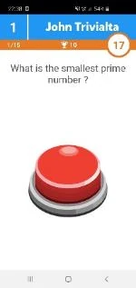{ width="96" loading=lazy }                                                                                               | 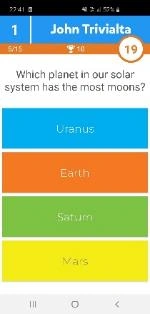{ width="96" loading=lazy }            | 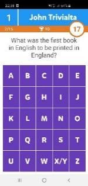{ width="96" loading=lazy }           | 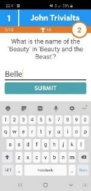{ width="96" loading=lazy }              | 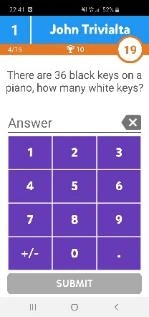{ width="95" loading=lazy }        |
|------------------------------------------------------------------------------------------------------------------------------------------------------------------------------------------------------------------------------|----------------------------------------------------------------------------------------------------------------------------------------------------------------------------------------------------------------------------|---------------------------------------------------------------------------------------------------------------------------------------------------------------------------------------------------------------------------|------------------------------------------------------------------------------------------------------------------------------------------------------------------------------------------------------------------------------|----------------------------------------------------------------------------------------------------------------------------------------------------------------------------------------------------------------------------|
| *Dito più Veloce* | *Scelta multipla/Ordinata/Risposta multipla/Eliminatoria* | *Lettera Iniziale* | *Testuale* | *Numerica* |
| { width="98" loading=lazy } | 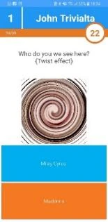{ width="99" loading=lazy } | 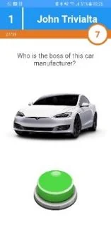{ width="100" loading=lazy } | 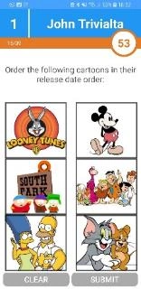{ width="100" loading=lazy } | 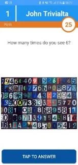{ width="98" loading=lazy } |
| *Scelta multipla con immagine* | *Scelta multipla con effetto immagine* | *Dito più Veloce con immagine* | *Scelta multipla con immagini/Ordinata/Risposta multipla* | *Numerica/Lettera Iniziale con immagine* |

Lo Smart Buzzer fornisce un riscontro dopo ogni domanda per indicare se la risposta era giusta o sbagliata e se sono stati ricevuti punti bonus:

| 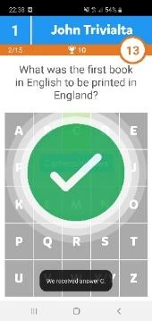{ width="109" loading=lazy } | 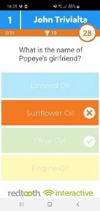{ width="109" loading=lazy } | 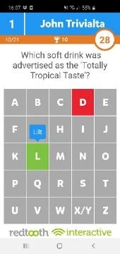{ width="108" loading=lazy } | 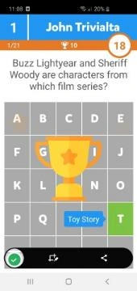{ width="109" loading=lazy } | 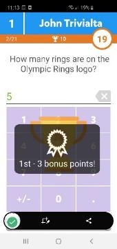{ width="109" loading=lazy } |
|--------------------------------------------------------------------------------------------------------------------------------------|-----------------------------------------------------------------------------------------------------------------------------------------------------------------------------------------------------------------------|----------------------------------------------------------------------------------------------------------------------------------------------------------------------------------------------------------------------|-------------------------------------------------------------------------------------------------------------------------------------------------------------------------------------------------------------------------------|-----------------------------------------------------------------------------------------------------------------------------------------------------------------------------------------------------------------------|
| *Risposta Corretta* | *Risposta Errata* | *Iniziale Errata* | *Animazione Punti bonus* | *Punti bonus vinti* |

I punteggi vengono visualizzati anche sul dispositivo mobile. I punteggi finali vengono mostrati in due o tre fasi: prima un annuncio, poi la classifica dei primi 3 classificati (se si è tra i primi 3) e infine il proprio punteggio individuale e la posizione in classifica.

| { width="136" loading=lazy } | { width="137" loading=lazy } | 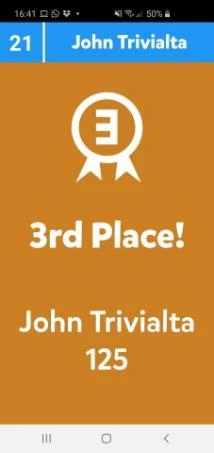{ width="137" loading=lazy } | 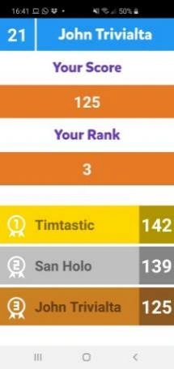{ width="137" loading=lazy } |
|--------------------------------------------------------------------------------------------------------------------------------------|--------------------------------------------------------------------------------------------------------------------------------------------------------------------------------------------------------------------------------|-----------------------------------------------------------------------------------------------------------------------------------------------|-----------------------------------------------------------------------------------------------------------------------------------------------|
| *Punteggi intermedi* | *Annuncio dei Punteggi finali* | *Punteggio finale individuale top 3* | *Punteggio individuale, posizione e top* 3 |

L'utilizzo dell'app è obbligatorio se si intende utilizzare il Wi-Fi autonomo. La pulsantiera web su buzzerpad offre le stesse funzionalità dell'app Smart Buzzer, ad eccezione dell'opzione Wi-Fi locale e della selezione dei jingle.

## Promozioni

L'app Smart Buzzer supporta la visualizzazione di immagini «promozionali» durante il quiz o durante una pausa. Le immagini possono essere inviate dalla schermata *Media Player* di QuizXpress Director. L'immagine promozionale deve prima essere aggiunta all'elenco dei media disponibili. Per presentare l'immagine sull'app Smart Buzzer, selezionarla dall'elenco e fare clic su *Mostra su Mobile* nella barra degli strumenti.

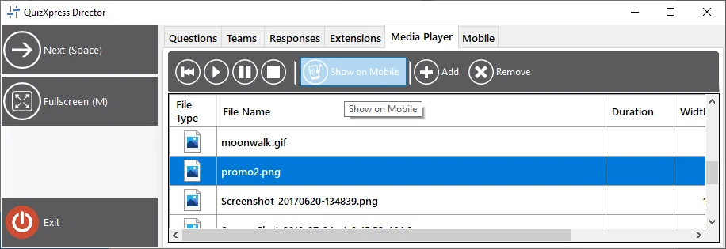{ width="526" loading=lazy }

## Pollice Su/Pollice Giù { #thumbs-upthumbs-down }

Con questa modalità di gioco, i giocatori possono guadagnare punti extra dando la propria opinione sulla correttezza di una risposta data verbalmente da un altro giocatore a una domanda aperta. Questo vale per le situazioni in cui è possibile un'interazione diretta con i giocatori (quindi non per un evento in streaming). Funziona nel modo seguente:

- Ai giocatori viene presentata una domanda Dito più Veloce. I buzzer compaiono su tutte le app Smart Buzzer

- Un giocatore pensa di conoscere la risposta e preme il buzzer; tutti gli altri vengono bloccati.

- Sulla schermata di Director o sull'app Director compare un popup di giudizio con i pulsanti *Pollice Giù/Sondaggio/Pollice Su*.

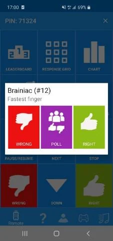{ width="145" loading=lazy }

- Il Quizmaster si confronta con il giocatore per ascoltarne la risposta verbale e può quindi giudicare la risposta giusta o sbagliata, oppure interrogare il resto dei giocatori per sapere se *loro* ritengono che la risposta data sia giusta o sbagliata, toccando il pulsante *Sondaggio* dell'app Director.

- Su tutti i dispositivi degli altri giocatori compare per 10 secondi un popup di sondaggio Pollice Su/Giù e i giocatori possono dare il proprio voto (o astenersi senza perdere punti).

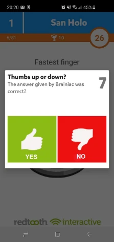{ width="141" loading=lazy }

- Il Quizmaster giudica quindi la risposta data dal giocatore più veloce toccando il pulsante ‘Corretta’ o ‘Errata’ sull'app Director. Di conseguenza, il giocatore più veloce vince o perde punti (a seconda delle impostazioni della domanda). Gli altri giocatori vincono o perdono il 50% dei punti della domanda a seconda della correttezza del loro giudizio sulla risposta data dal giocatore più veloce.

Questa modalità mantiene coinvolti tutti i giocatori in un round Dito più Veloce, poiché non è solo il singolo giocatore più veloce a poter vincere punti: tutti i partecipanti hanno la possibilità di vincerne.

## QuizXpress Director App { #app-telecomando-mobile-director }

Per controllare il quiz dal tablet o dal telefono, è possibile usare l'app telecomando QuizXpress Director per iOS e Android. Dopo aver installato e avviato l'app, si vedrà la schermata seguente:

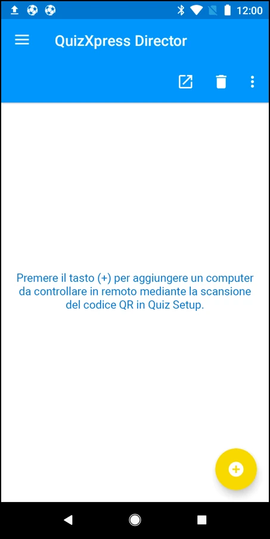{ width="226" loading=lazy }

È possibile registrare il computer che si desidera controllare con il telecomando QuizXpress Director premendo il pulsante giallo «più» in basso a destra sullo schermo del dispositivo mobile.

Premendo il pulsante, viene mostrato uno scanner di codici QR. Il codice QR da scansionare è visualizzato nella scheda Mobile di QuizXpress Setup (fare riferimento a [Configurare il supporto delle pulsantiere mobili](../../setup/setting-up-mobile-keypad-support.md)). Scansionare il codice qui visualizzato e il nome del computer verrà mostrato nell'app QuizXpress Director. Questa procedura va eseguita una sola volta per registrare il computer nell'app.

Dopo aver avviato un quiz, selezionare dall'elenco il computer che si desidera controllare e toccarlo: l'app telecomando mobile sarà quindi connessa alla sessione del quiz.

!!! note

    Assicurarsi che il server selezionato nell'app QuizXpress Director sia lo stesso selezionato in QuizXpress Setup. Fare clic sul pulsante del menu { .inline-icon width="23" } in alto a sinistra nell'app. Fare clic su «Settings» e controllare l'impostazione «Mobile server to connect to». Questa impostazione deve corrispondere a quella definita in QuizXpress Setup (fare riferimento a [Configurare il supporto delle pulsantiere mobili](../../setup/setting-up-mobile-keypad-support.md) per informazioni su come impostare il server (o il Wi-Fi locale) utilizzato dal riproduttore dei quiz).

| **Mobile server to connect to** | **Settings server**                           |
|---------------------------------|-----------------------------------------------|
| Central US                      | [www.buzzerpad.com](http://www.buzzerpad.com) |
| Western Europe                  | [www.buzzerpad.eu](http://www.buzzerpad.eu)   |
| Local Wi-Fi                     | Local Wi-Fi                                   |

Dopo la connessione al quiz in corso, si vedrà l'app QuizXpress Director, che ha 5 schede:

| 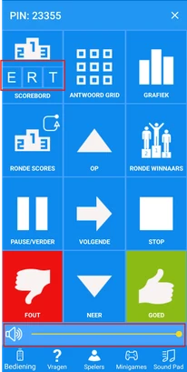{ width="103" loading=lazy } | 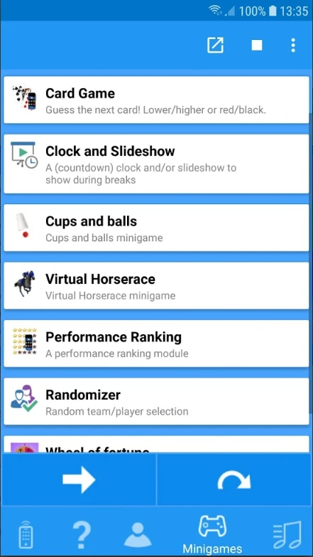{ width="114" loading=lazy } | 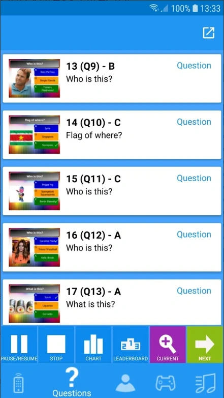{ width="113" loading=lazy } | 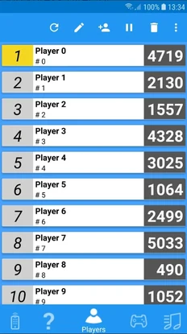{ width="116" loading=lazy } | 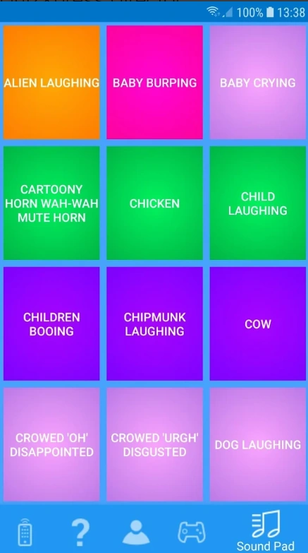{ width="115" loading=lazy } |
|-----------------------------------------------------------------------------------------------------------------------------------------------------------------------------------|---------------------------------------------------------------------------------|---------------------------------------------------------------------------------|---------------------------------------------------------------------------------|---------------------------------------------------------------------------------|
| Controlli | Avvia/arresta e controlla i Moduli Gioco | Naviga tra le domande del quiz | Panoramica di giocatori e punteggi | Sound Pad per riprodurre effetti sonori casuali |

La scheda Controlli permette di gestire il quiz. Sono disponibili i seguenti pulsanti:

- Classifica – mostra la classifica attuale. Inizialmente vengono mostrati i primi 22. I pulsanti Su e Giù scorrono i punteggi. I pulsanti E, R, T mostrano le schermate dei punteggi estese (vedere [Schermate di controllo Punteggi](../starting-a-quiz/the-leaderboard.md#schermate-di-controllo-dei-punteggi))

- Griglia Risposte – mostra una griglia che indica per ogni giocatore se ha indovinato, se ha sbagliato o se non ha risposto alla domanda a scelta multipla attuale.

- Grafico – mostra un grafico con il numero di voti per ogni risposta.

- Punteggi Round – mostra i punteggi del round in corso.

- Vincitori Round – mostra il vincitore di ogni round.

- Pausa – mette in pausa e riprende il conto alla rovescia.

- Arresta – conclude la domanda attuale quando il countdown è in pausa.

- Su/Giù – fa scorrere la classifica su e giù quando ci sono più di 22 giocatori.

- Prossimo – passa alla diapositiva successiva / al passaggio successivo di un Modulo Gioco / al passaggio successivo delle azioni di fine domanda (per le azioni di fine domanda fare riferimento a [Azioni di fine domanda](../../setup/end-of-question-actions.md))

- Corretta/Errata – giudica la risposta data verbalmente a una domanda di tipo Dito più Veloce.

- Controllo volume – modifica in tempo reale, da remoto, il volume del riproduttore dei quiz.

- Filtraggio quiz – quando si utilizza il telecomando per connettersi al Quiz Center, è possibile filtrare rapidamente l'elenco dei quiz disponibili.

!!! note

    I pulsanti ERT e il controllo volume sono attualmente disponibili solo su Android. La versione per iOS sarà resa disponibile prossimamente.*

1. La scheda Moduli consente di avviare al volo i Moduli Gioco. Selezionare un Modulo Gioco e premere il pulsante. Avanzare nel Modulo Gioco facendo clic sul tasto freccia.

2. La scheda Domande mostra tutte le domande, le risposte corrette, le note e una miniatura delle diapositive. In basso sono disponibili i seguenti pulsanti:

- Pulsante **Pausa** – mette in pausa e riprende il conto alla rovescia.

- Pulsante **Arresta** – conclude una domanda quando il countdown è in pausa.

- Pulsante **Grafico** – mostra un grafico delle risposte della domanda attuale.

- Pulsante **Classifica** – mostra i punteggi intermedi attuali.

- Pulsante **Espandi** – espande la domanda, passando dall'elenco di tutte le domande ai dettagli della domanda corrente e viceversa

- Pulsante **Freccia** – fa avanzare alla diapositiva successiva.

Le diapositive che sono state già svolte sono colorate di giallo, la domanda attuale è colorata di verde.

> Dopo ogni domanda ‘Tutti possono rispondere’, l'app Director mostra il numero di giocatori che hanno risposto correttamente (in verde), il numero di quelli che hanno risposto in modo errato (in rosso) e il numero di quelli che non hanno risposto affatto (in blu).

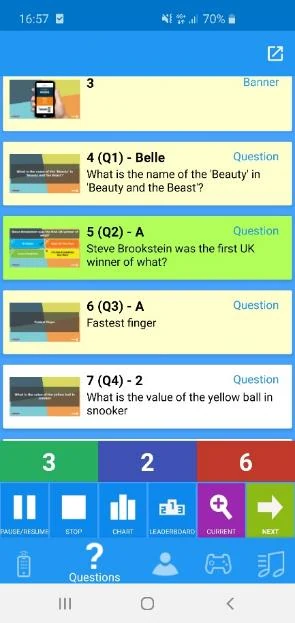{ width="189" loading=lazy }

3. La scheda Giocatori mostra tutti i partecipanti e i loro punteggi. In alto, sono disponibili i seguenti pulsanti:

- Aggiorna la pagina.

- Modifica Giocatore – cambia nome, punteggio, numero di pulsantiera (se si utilizza hardware fisico).

- Aggiungi Giocatore – nome, punteggio, numero di pulsantiera (se si utilizza hardware fisico).

- Disabilita Giocatore.

- Elimina Giocatore.

4. La scheda Sound Pad consente di riprodurre fino a 12 effetti sonori diversi nel riproduttore dei quiz. Gli effetti sonori vengono caricati da una cartella definita dall'utente che si può configurare in QuizXpress Setup (fare riferimento a [Configurare i suoni – la scheda Sounds](../../setup/configuring-sounds-the-sounds-tab-page.md) per maggiori informazioni).
