# De mobiele QuizXpress-apps gebruiken

QuizXpress Mobile biedt ook twee apps, beide beschikbaar voor Android en iOS.

**QuizXpress Smart Buzzer**

Dit is de app die door de spelers van de quiz wordt gebruikt. Vraag uw spelers, voordat u uw eerste quiz start, de gratis QuizXpress Smart Buzzer-app te downloaden uit de appstore van hun telefoon. Ze hoeven alleen te zoeken naar *QuizXpress Smart Buzzer*, de app te installeren en klaar zijn ze.

{ width="226" loading=lazy }

**QuizXpress Director-app**

Voor de host/presentator van de quiz hebben we een aparte app beschikbaar, genaamd *QuizXpress Director*. Met deze app kan de host de quiz bedienen (de volgende vraag tonen, het antwoord onthullen, tussenstanden of grafieken tonen), teams beheren (scores of teamnamen wijzigen), minigames starten, geluiden afspelen via een soundboard en nog veel meer!

In de volgende secties worden de apps in meer detail beschreven.

## QuizXpress Smart Buzzer-app

Wanneer de app start, zien spelers de optie om deel te nemen aan een spel via lokaal wifi of via pincode.

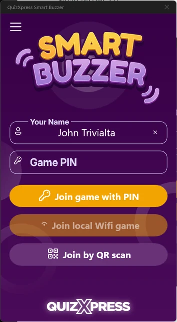{ width="177" loading=lazy }

Wanneer het spel wordt gespeeld met een wifirouter die op de computer is aangesloten, is de knop ‘Join local Wi-Fi game’ ingeschakeld. Als u op de knop tikt, maakt de app verbinding met de quiz die op het lokale wifi draait.

Wanneer u zonder wifirouter speelt en dus op afstand via internet verbinding maakt, toont de quizspeler een pincode op het scherm. Spelers kunnen deze pincode invoeren door op ‘Join game with PIN’ te drukken.

Na het aanmelden wordt het welkomstscherm getoond zoals ingesteld in de sectie Branding van de instellingen (zie [Ondersteuning voor mobiele keypads instellen](../../setup/setting-up-mobile-keypad-support.md)).

Als u jingles hebt ingesteld door in de instellingen de map met jingles op te geven, krijgen spelers een lijst met alle beschikbare geluidsfragmenten te zien. Elke speler kan een jingle kiezen die tijdens het spel wordt gebruikt in de volgende situaties:

- Bonuspunten - het geluid van de speler die als eerste het juiste antwoord gaf, wordt afgespeeld wanneer het bonuspuntenscherm wordt getoond.

- Snelste drukker – het geluid van de speler die als eerste drukte wordt afgespeeld, samen met de naam van de speler die op het scherm in de quizspeler verschijnt.

- Tussenstanden – het geluid van de speler die als eerste staat, wordt afgespeeld wanneer de ranglijst wordt getoond.

> Als quizmaster kunt u de keuze van een jingle voor een specifiek apparaat altijd handmatig starten op het tabblad Mobiel in Director.

Links ziet u een voorbeeld van een vraag van het type ‘eerste letter’.

U ziet verschillende elementen op het scherm:

- Linksboven ziet u het nummer dat aan uw mobiele buzzer is toegewezen.

- Rechtsboven wordt de naam van de speler getoond.

- De bovenste balk bevat:

  - De index van de huidige vraag (in dit geval de eerste vraag van 21)

  - Een trofee met het aantal punten dat te winnen is. Als punten na verloop van tijd afnemen, wordt dat hier weergegeven. Dit is een bij benadering bepaalde waarde.

  - Een klok die aftelt en het aantal resterende seconden toont. Gedurende de laatste 5 seconden knippert de klok om aan te geven dat de tijd opraakt.

- Het lettergrid waarmee de vraag wordt beantwoord.

QuizXpress Smart Buzzer ondersteunt een reeks verschillende vraagtypen:

| 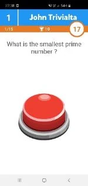{ width="96" loading=lazy }                                                                                               | 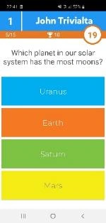{ width="96" loading=lazy }            | 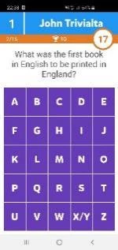{ width="96" loading=lazy }           | 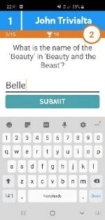{ width="96" loading=lazy }              | 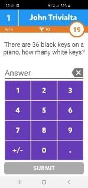{ width="95" loading=lazy }        |
|------------------------------------------------------------------------------------------------------------------------------------------------------------------------------------------------------------------------------|----------------------------------------------------------------------------------------------------------------------------------------------------------------------------------------------------------------------------|---------------------------------------------------------------------------------------------------------------------------------------------------------------------------------------------------------------------------|------------------------------------------------------------------------------------------------------------------------------------------------------------------------------------------------------------------------------|----------------------------------------------------------------------------------------------------------------------------------------------------------------------------------------------------------------------------|
| *Snelste drukker*                                                                                                                                                                                                            | *Meerkeuze regulier/met volgorde/meerdere antwoorden/eliminator*                                                                                                                                                           | *Eerste letter*                                                                                                                                                                                                           | *Volledige tekst*                                                                                                                                                                                                            | *Numeriek*                                                                                                                                                                                                                 |
| { width="98" loading=lazy } | 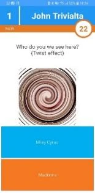{ width="99" loading=lazy } | 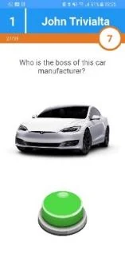{ width="100" loading=lazy } | 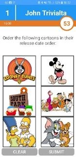{ width="100" loading=lazy } | 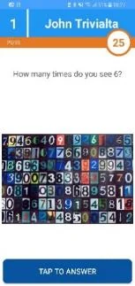{ width="98" loading=lazy } |
| *Meerkeuze met afbeelding*                                                                                                                                                                                                   | *Meerkeuze met afbeeldingseffect*                                                                                                                                                                                          | *Snelste drukker met afbeelding*                                                                                                                                                                                          | *Meerkeuze met afbeeldingen regulier/met volgorde/meerdere antwoorden*                                                                                                                                                       | *Numeriek/eerste letter met afbeelding*                                                                                                                                                                                    |

De Smart Buzzer geeft na elke vraag feedback over of u juist of onjuist antwoordde en of u bonuspunten hebt ontvangen:

| 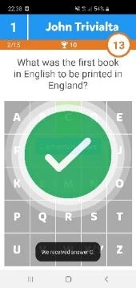{ width="109" loading=lazy } | 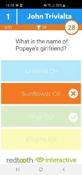{ width="109" loading=lazy } | 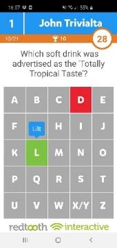{ width="108" loading=lazy } | 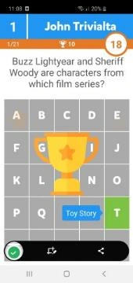{ width="109" loading=lazy } | 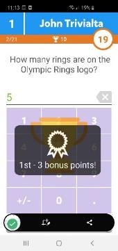{ width="109" loading=lazy } |
|--------------------------------------------------------------------------------------------------------------------------------------|-----------------------------------------------------------------------------------------------------------------------------------------------------------------------------------------------------------------------|----------------------------------------------------------------------------------------------------------------------------------------------------------------------------------------------------------------------|-------------------------------------------------------------------------------------------------------------------------------------------------------------------------------------------------------------------------------|-----------------------------------------------------------------------------------------------------------------------------------------------------------------------------------------------------------------------|
| *Juist antwoord*                                                                                                                     | *Onjuist antwoord*                                                                                                                                                                                                    | *Letter van onjuist antwoord*                                                                                                                                                                                        | *Animatie bonuspunten*                                                                                                                                                                                                        | *Bonuspunten gewonnen*                                                                                                                                                                                                |

Scores worden ook op de telefoon getoond. De eindscores worden in twee of drie stappen getoond: eerst een aankondiging, dan uw top 3-ranglijst (als u in de top 3 staat) en tot slot uw individuele score en positie.

| 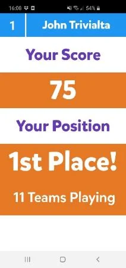{ width="136" loading=lazy } | 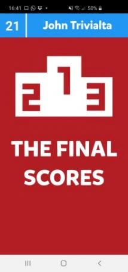{ width="137" loading=lazy } | 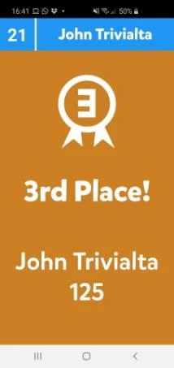{ width="137" loading=lazy } | 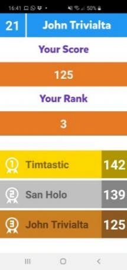{ width="137" loading=lazy } |
|--------------------------------------------------------------------------------------------------------------------------------------|--------------------------------------------------------------------------------------------------------------------------------------------------------------------------------------------------------------------------------|-----------------------------------------------------------------------------------------------------------------------------------------------|-----------------------------------------------------------------------------------------------------------------------------------------------|
| *Tussenstanden*                                                                                                                      | *Aankondiging van de eindscores*                                                                                                                                                                                               | *Individuele eindscore top 3*                                                                                                                 | *Individuele score, positie en top* 3                                                                                                         |

Het gebruik van de app is verplicht als u via zelfstandig wifi wilt spelen. Sinds QuizXpress 8 biedt de webbuzzer op buzzerpad dezelfde functionaliteit als de Smart Buzzer-app, met uitzondering van de optie voor lokaal wifi en het kiezen van jingles.

## Promo’s

De Smart Buzzer-app ondersteunt het tonen van ‘promotionele’ afbeeldingen tijdens de quiz of tijdens een pauze. De afbeeldingen kunnen worden verzonden vanuit het scherm *Mediaspeler* van QuizXpress Director. Uw afbeelding moet eerst aan de lijst met beschikbare media worden toegevoegd. Om de afbeelding in de Smart Buzzer-app te tonen, selecteert u deze in de lijst en klikt u op de werkbalk op *Show on Mobile*.

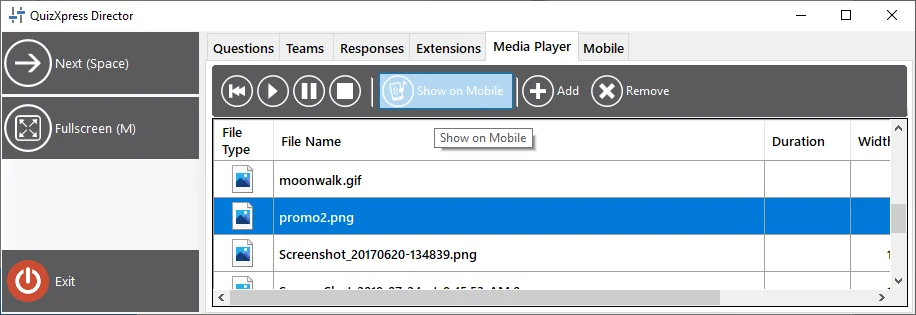{ width="526" loading=lazy }

## Thumbs Up/Thumbs Down

Met deze spelmodus kunnen spelers extra punten verdienen door te stemmen over de juistheid van het mondelinge antwoord van een andere speler op een open vraag. Dit geldt voor situaties waarin directe interactie met de spelers mogelijk is (dus niet voor een streamingopstelling). Het werkt als volgt:

- Er wordt een vraag voor de snelste drukker aan de spelers gepresenteerd. Op alle Smart Buzzer-apps verschijnen buzzers

- Eén speler denkt het antwoord te weten en drukt op de buzzer; alle anderen worden uitgesloten.

- Op het Director-scherm of in de Director-app verschijnt een pop-up voor juist/onjuist beoordelen met de knoppen *Thumbs Down/Poll/Thumbs Up*.

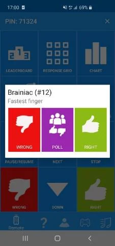{ width="145" loading=lazy }

- De quizmaster gaat in gesprek met de speler om het mondelinge antwoord te horen en kan het antwoord dan juist of onjuist beoordelen, of de rest van de spelers laten stemmen of *zij* het gegeven antwoord juist of onjuist vinden, door in de Director-app op de knop *Poll* te tikken.

- Op de apparaten van de andere spelers verschijnt gedurende 10 seconden een pop-up voor de poll Thumbs Up/Thumbs Down, en spelers kunnen hun stem uitbrengen (of zich onthouden, in welk geval er geen risico is om punten te verliezen).

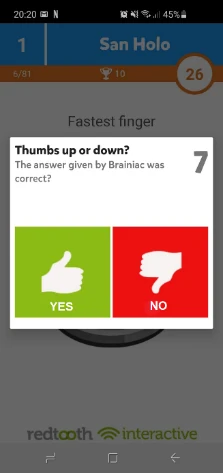{ width="141" loading=lazy }

- De quizmaster beoordeelt nu het antwoord van de speler die als eerste drukte door in de Director-app op de knop ‘Juist’ of ‘Onjuist’ te tikken. Als gevolg hiervan wint of verliest de snelste drukker punten (afhankelijk van de instellingen van de vraag). De andere spelers winnen of verliezen 50% van de vraagpunten, afhankelijk van of hun oordeel over het antwoord van de snelste drukker juist was.

Deze modus houdt alle spelers betrokken bij een ronde voor de snelste drukker, omdat niet alleen de ene snelste speler punten kan winnen — iedereen die meedoet heeft de kans om punten te winnen.

## Afstandsbedieningsapp – Mobile Director

Om de quiz vanaf uw tablet of telefoon te bedienen, kunt u de QuizXpress Director-afstandsbedieningsapp voor iOS en Android gebruiken. Na het installeren en starten van de app ziet u het volgende scherm:

U kunt de computer die u wilt bedienen registreren bij de QuizXpress Director-afstandsbediening door op de gele ‘plus’-knop rechtsonder op uw mobiele scherm te drukken.

Zodra u op de knop drukt, wordt een QR-codescanner getoond. De QR-code die u moet scannen, wordt getoond op het tabblad Mobiel in QuizXpress Setup (zie [Ondersteuning voor mobiele keypads instellen](../../setup/setting-up-mobile-keypad-support.md)). Scan de code die hier wordt getoond en de computernaam wordt getoond in de QuizXpress Director-app. U hoeft deze procedure maar één keer te volgen om uw computer in de app te registreren.

Selecteer na het starten van een quiz de computer die u wilt bedienen in de lijst en tik erop — de mobiele afstandsbedieningsapp wordt dan verbonden met de quizsessie.

!!! note

    Zorg dat de server die in de QuizXpress Director-app is geselecteerd dezelfde is als de server die in QuizXpress Setup is geselecteerd. Klik op de menuknop { .inline-icon width="23" } linksboven in de app. Klik op ‘Instellingen’ en controleer de instelling ‘Mobile server to connect to’. Deze instelling moet overeenkomen met de instelling in QuizXpress Setup (zie [Ondersteuning voor mobiele keypads instellen](../../setup/setting-up-mobile-keypad-support.md) voor informatie over het instellen van de server (of lokaal wifi) die door de quizspeler wordt gebruikt).

| **Mobile server to connect to** | **Settings server**                           |
|---------------------------------|-----------------------------------------------|
| Central US                      | [www.buzzerpad.com](http://www.buzzerpad.com) |
| Western Europe                  | [www.buzzerpad.eu](http://www.buzzerpad.eu)   |
| Local Wi-Fi                     | Local Wi-Fi                                   |

Nadat u verbinding hebt gemaakt met de actieve quiz, ziet u de QuizXpress Director-app, die 5 tabbladen heeft:

| 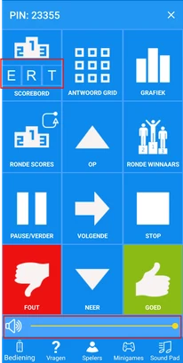{ width="103" loading=lazy } | 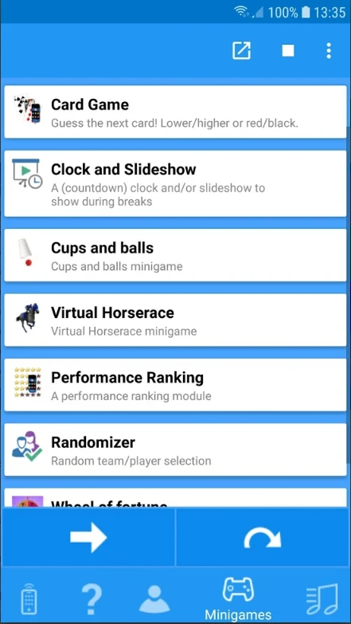{ width="114" loading=lazy } | 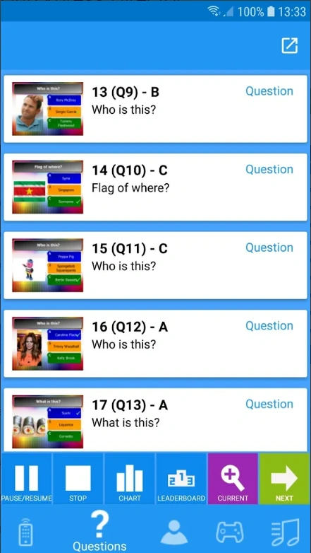{ width="113" loading=lazy } | 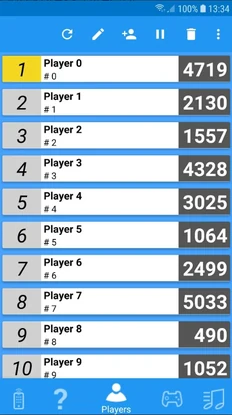{ width="116" loading=lazy } | 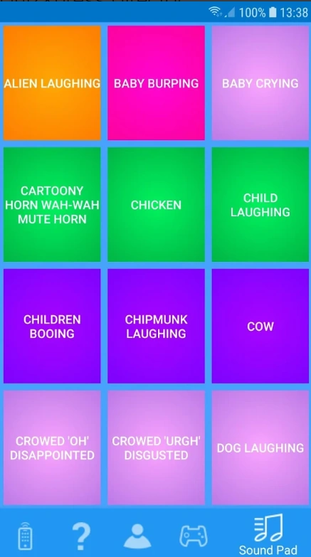{ width="115" loading=lazy } |
|-----------------------------------------------------------------------------------------------------------------------------------------------------------------------------------|---------------------------------------------------------------------------------|---------------------------------------------------------------------------------|---------------------------------------------------------------------------------|---------------------------------------------------------------------------------|
| Afstandsbediening                                                                                                                                                                 | Minigames starten/stoppen en bedienen                                           | Navigeren door de vragen in de quiz                                             | Overzicht van spelers en scores                                                 | Soundpad om willekeurige geluidseffecten af te spelen                           |

Met het tabblad Afstandsbediening kunt u de quiz bedienen. De volgende knoppen zijn beschikbaar:

- Ranglijst – toont de huidige ranglijst. Eerst worden de top 22 getoond. Met de knoppen Omhoog en Omlaag bladert u door de scores. Met de knoppen E,R,T toont u de uitgebreide scorschermen (zie [Scorebedieningsschermen](../starting-a-quiz/the-leaderboard.md#scorebeheerschermen))

- Antwoordraster – toont een raster dat voor elke speler aangeeft of de speler juist/onjuist antwoordde of de huidige meerkeuzevraag niet beantwoordde.

- Grafiek – toont een grafiek met het aantal stemmen voor elk antwoord.

- Rondescores – toont de scores voor de huidige ronde.

- Rondewinnaars – toont de winnaar van elke ronde.

- Pauzeren/Hervatten – pauzeert/hervat het aftellen.

- Stop – beëindigt de huidige vraag wanneer de klok is gepauzeerd.

- Omhoog/Omlaag – scrolt de ranglijst omhoog/omlaag wanneer er meer dan 22 spelers zijn.

- Volgende – ga naar de volgende dia/naar de volgende stap van een minigame / ga naar de volgende stap van de acties na een vraag (zie voor acties na een vraag [Acties na een vraag](../../setup/end-of-question-actions.md))

- Juist/Onjuist – beoordeel het antwoord dat mondeling op een vraag voor de snelste drukker is gegeven.

- Volumeregeling: wijzig op afstand in realtime het afspeelvolume van de quizspeler

- Quizzen filteren: wanneer u met de afstandsbediening verbinding maakt met Quiz Center, kunt u nu snel de lijst met beschikbare quizzen filteren.

!!! note

    De ERT-knoppen en de volumeregeling zijn momenteel alleen beschikbaar op Android; de iOS-versie volgt.*

1.  Met het tabblad Minigames kunt u minigames direct starten. Selecteer een minigame en druk op de knop. Ga door de minigame door op de pijltoets te klikken.

2.  Het tabblad Vragen toont alle vragen, juiste antwoorden, notities en een miniatuur van de dia’s. De volgende knoppen zijn beschikbaar op de werkbalk onderaan:

- Knop **Pauzeren** - pauzeer en hervat het aftellen.

- Knop **Stop** - beëindigt een vraag wanneer de timer is gepauzeerd.

- Knop **Grafiek** – toont een antwoordgrafiek voor de huidige vraag.

- Knop **Ranglijst** – toont de huidige tussenstanden.

- Wisselknop **Huidige/Lijst** – schakelt tussen de details van de huidige vraag/de lijst met alle vragen

- Knop **Volgende** (pijl) - ga naar de volgende dia

Dia’s die zijn bezocht, zijn geel gekleurd; de huidige vraag is groen gekleurd.

> Na elke ‘iedereen antwoordt’-vraag toont de afstandsbedieningsapp het aantal spelers dat juist antwoordde (in groen), het aantal dat onjuist antwoordde (in rood) en het aantal dat helemaal niet reageerde (in blauw).

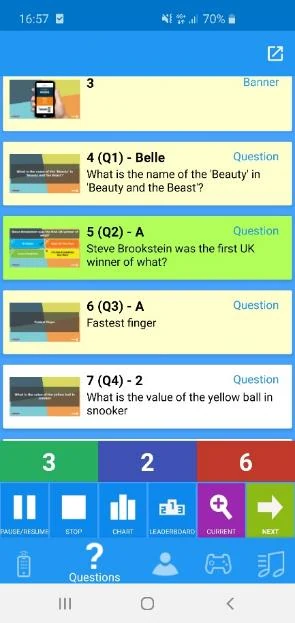{ width="189" loading=lazy }

3.  Het tabblad Spelers toont alle spelers en hun scores. Bovenaan zijn de volgende knoppen beschikbaar:

- De pagina verversen.

- Een speler bewerken - naam, score, keypadnummer (bij een fysiek keypad) wijzigen

- Een speler toevoegen - naam, score, keypadnummer (bij een fysiek keypad)

- Een speler uitschakelen.

- Een speler verwijderen.

4.  Met het tabblad Soundpad kunt u maximaal 12 verschillende geluidseffecten in de quizspeler afspelen. De geluidseffecten worden geladen uit een door de gebruiker gedefinieerde map die u in QuizXpress Setup kunt instellen (zie [Geluiden configureren – het tabblad Geluiden](../../setup/configuring-sounds-the-sounds-tab-page.md) voor meer informatie).
