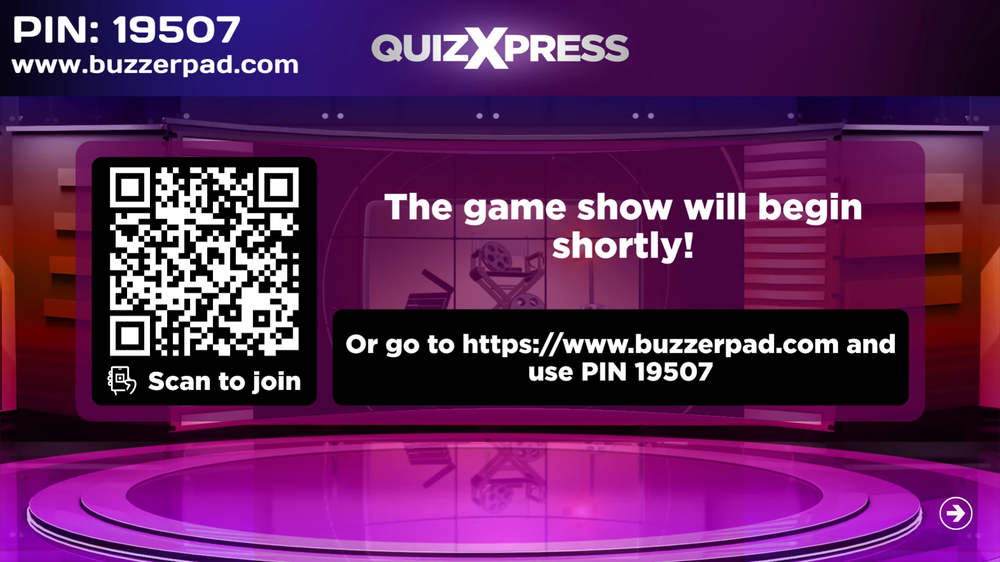
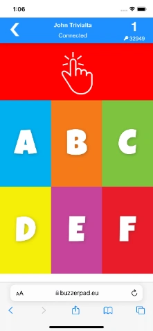
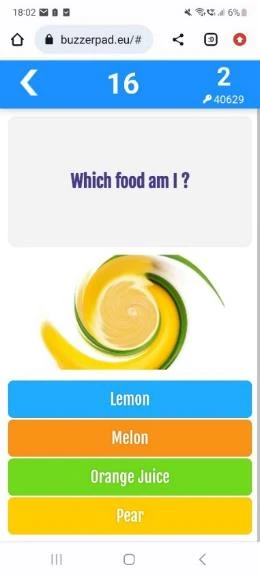
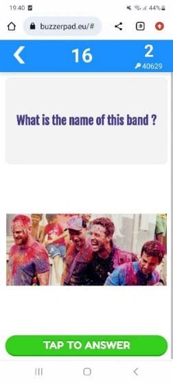

# Uso del mando móvil basado en web

El mando basado en web se puede utilizar cuando dispone de internet y no desea que sus jugadores descarguen la aplicación Smart Buzzer. Los jugadores pueden unirse al quiz simplemente con un navegador web estándar siguiendo estos pasos:

- En Quiz Setup, en la pestaña Mobile, usted indicó qué servidor se utiliza. Por ejemplo [www.buzzerpad.com](http://www.buzzerpad.com)

- El nombre del servidor y un PIN de 5 dígitos se muestran en pantalla en QuizXpress Live!

- Los jugadores acceden manualmente a [www.buzzerpad.com](http://www.buzzerpad.com) e introducen el código PIN mostrado y su nombre de jugador

- Como alternativa, pulse ‘Q’ cuando se inicie un quiz para mostrar en pantalla un código QR que los jugadores pueden escanear. Al escanear el código, accederán automáticamente al sitio web buzzerpad y se rellenará el código PIN por ellos; solo tienen que introducir un nombre de jugador único.

{ loading=lazy }

- Pulse GO en el teléfono para conectarse al quiz.

Algunas pantallas del buzzer web:

| { width="142" loading=lazy }  | { width="141" loading=lazy }  | { width="141" loading=lazy }  |
|----------------------------------------------------------------------------------|----------------------------------------------------------------------------------|----------------------------------------------------------------------------------|
| Pantalla de inicio de sesión de Buzzerpad                                        | Mando web simple                                                                 | Pregunta numérica                                                                |
| { width="161" loading=lazy } | { width="159" loading=lazy } | { width="158" loading=lazy } |
| Mostrar una promoción                                                            | Pregunta de ordenación                                                           | Pregunta con imagen                                                              |
| { width="163" loading=lazy }   | { width="158" loading=lazy }   | { width="154" loading=lazy }    |
| Efecto de imagen                                                                 | Pregunta de texto con imagen                                                     | Pregunta de opción múltiple con imágenes                                         |

En la parte superior derecha del mando se muestra el ID del mando. Debajo del ID se muestra el código PIN del quiz. Actualmente hay dos servidores disponibles: uno en Europa Occidental (buzzerpad.eu) y otro en el centro de EE. UU. (buzzerpad.com). Recomendamos utilizar el servidor más cercano a su ubicación o zona horaria, por la velocidad y las ventanas de mantenimiento del servidor. Puede configurar qué servidor utilizar en Quiz Setup, en la pestaña Mobile.

!!! note

    ofrecemos un servicio para alojar la aplicación en su propio dominio personalizado con la marca de su propia empresa. Póngase en contacto con nosotros para obtener más información.*
