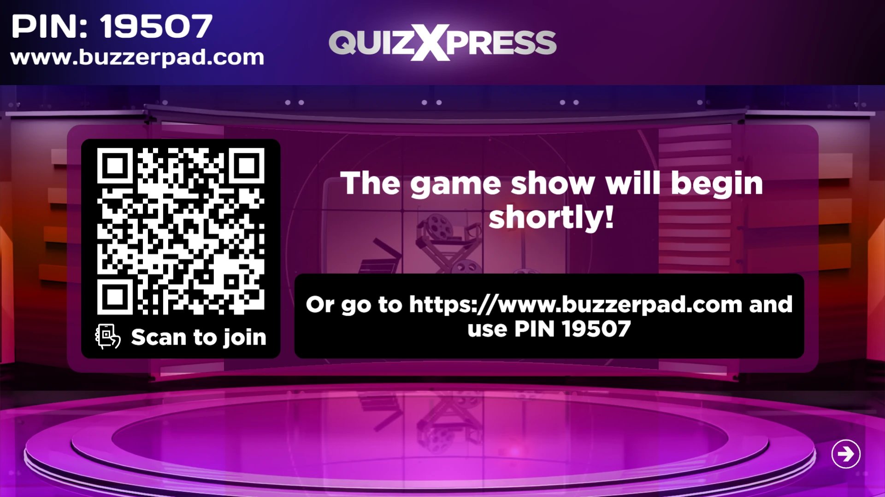
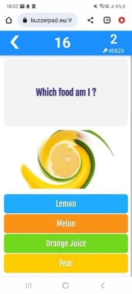
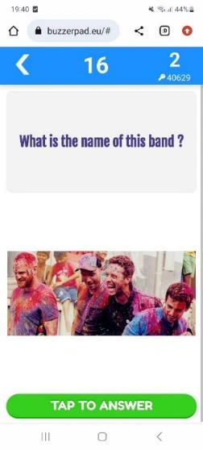

# Utilizzo della Pulsantiera Mobile web based

La pulsantiera web based può essere utilizzata nelle situazioni in cui è disponibile Internet e non si desidera che i giocatori scarichino l'app Smart Buzzer. I giocatori possono partecipare al quiz semplicemente attraverso un browser web standard seguendo questi passi:

- In Quiz Setup, nella scheda Mobile, è stato indicato quale server viene utilizzato. Ad esempio [www.buzzerpad.com](http://www.buzzerpad.com)

- Il nome del server e il PIN a 5 cifre vengono visualizzati sullo schermo di QuizXpress Live

- I giocatori accedono manualmente a [www.buzzerpad.com](http://www.buzzerpad.com) e inseriscono il PIN mostrato e il proprio nome di giocatore

- In alternativa, premere «Q» quando un quiz viene avviato per mostrare sullo schermo un codice QR che i giocatori possono scansionare. La scansione del codice li porta automaticamente al sito buzzerpad e compila il PIN al posto loro; devono solo inserire un nome di giocatore univoco.

{ loading=lazy }

- Premere GO sul dispositivo per collegarsi al quiz.

Alcune schermate della pulsantiera web buzzerpad:

| { width="142" loading=lazy }  | { width="141" loading=lazy }  | { width="141" loading=lazy }  |
|----------------------------------------------------------------------------------|----------------------------------------------------------------------------------|----------------------------------------------------------------------------------|
| Schermata di accesso a Buzzerpad                                                 | Pulsantiera web semplice                                                              | Domanda numerica                                                                 |
| { width="161" loading=lazy } | { width="159" loading=lazy } | { width="158" loading=lazy } |
| Schermata Promo | Risposte da Ordinare | Domanda Immagine |
| { width="163" loading=lazy }   | { width="158" loading=lazy }   | { width="154" loading=lazy }    |
| Effetto Immagine | Testuale con immagine | Scelta multipla Immagini |

Una volta connessi, in alto a destra della pulsantiera viene visualizzato l'ID della pulsantiera. Sotto l'ID viene mostrato il codice PIN del quiz. Attualmente sono disponibili due server: uno in Europa occidentale (buzzerpad.eu) e uno negli Stati Uniti centrali (buzzerpad.com). Si consiglia di utilizzare il server più vicino alla propria posizione/fuso orario, per la velocità e le finestre di manutenzione del server. È possibile configurare il server da utilizzare nella scheda Mobile in Quiz Setup.

!!! note

    offriamo un servizio per ospitare l'app sul proprio dominio personalizzato, con il marchio della propria azienda. Per ulteriori informazioni, contattarci.*
