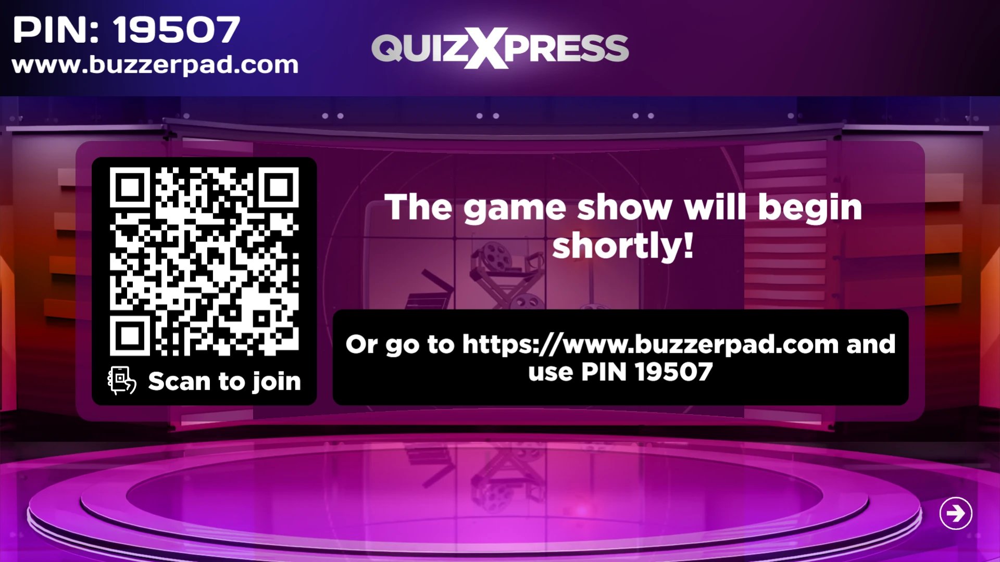
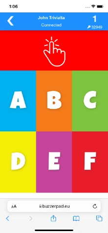
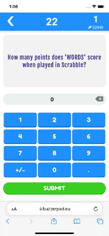
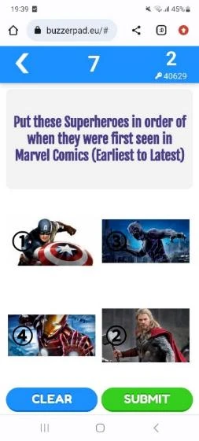
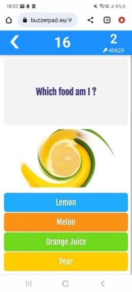
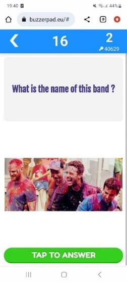

# Het webgebaseerde mobiele keypad gebruiken

Het webgebaseerde keypad kan worden gebruikt in situaties waarin u internet beschikbaar hebt en uw spelers de Smart Buzzer-app niet willen downloaden. Spelers kunnen eenvoudig met een standaard webbrowser aan de quiz deelnemen door de volgende stappen te volgen:

- In Quiz Setup hebt u op het tabblad Mobiel aangegeven welke server wordt gebruikt. Bijvoorbeeld [www.buzzerpad.com](http://www.buzzerpad.com)

- De naam van de server en een pincode van 5 cijfers worden op het scherm getoond in QuizXpress Live!

- Spelers gaan handmatig naar [www.buzzerpad.com](http://www.buzzerpad.com) en voeren de getoonde pincode en hun spelersnaam in

- U kunt ook op ‘Q’ drukken wanneer een quiz is gestart om een QR-code op het scherm te tonen die spelers kunnen scannen. Door de code te scannen gaan ze automatisch naar de buzzerpad-website en wordt de pincode voor hen ingevuld; ze hoeven alleen nog een unieke spelersnaam in te voeren.

{ loading=lazy }

- Druk op de telefoon op GO om verbinding te maken met de quiz.

Enkele schermen van de webbuzzer:

| { width="142" loading=lazy }  | { width="141" loading=lazy }  | { width="141" loading=lazy }  |
|----------------------------------------------------------------------------------|----------------------------------------------------------------------------------|----------------------------------------------------------------------------------|
| Aanmeldscherm van buzzerpad                                                      | Eenvoudig webkeypad                                                              | Numerieke vraag                                                                  |
| { width="161" loading=lazy } | { width="159" loading=lazy } | { width="158" loading=lazy } |
| Een promo tonen                                                                  | Vraag met een volgorde                                                           | Afbeeldingsvraag                                                                 |
| { width="163" loading=lazy }   | { width="158" loading=lazy }   | { width="154" loading=lazy }    |
| Afbeeldingseffect                                                                | Tekstvraag met afbeelding                                                        | Meerkeuzevraag met afbeeldingen                                                  |

Rechtsboven op het keypad wordt het ID van het keypad getoond. Onder het ID wordt de pincode van de quiz getoond. Momenteel zijn er twee servers beschikbaar: één in West-Europa (buzzerpad.eu) en één in het midden van de VS (buzzerpad.com). We raden aan de server te gebruiken die het dichtst bij uw locatie/tijdzone staat, vanwege de snelheid en de onderhoudsvensters van de servers. U kunt in Quiz Setup, op het tabblad Mobiel, instellen welke server wordt gebruikt.

!!! note

    wij bieden een service aan waarmee de app wordt gehost op uw eigen domein met de branding van uw eigen bedrijf. Neem contact met ons op voor meer informatie.*
