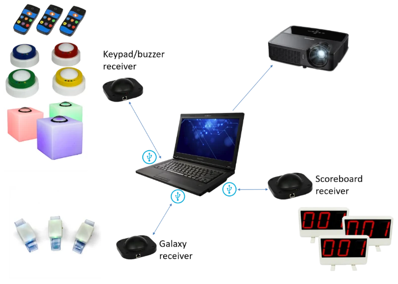
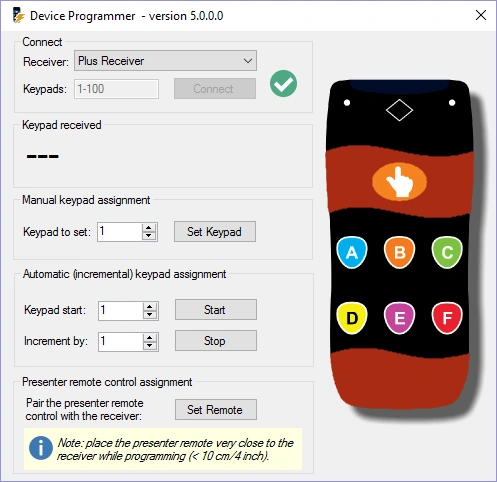
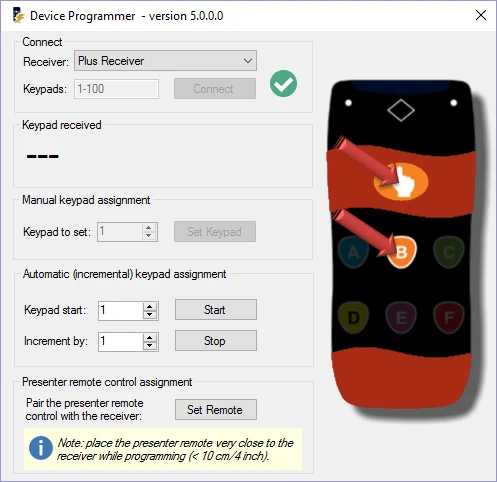
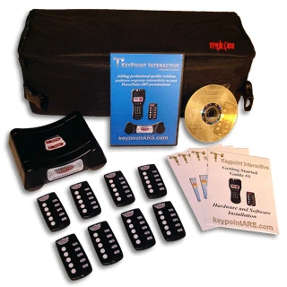
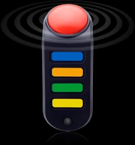

# Utiliser des appareils physiques

Une installation QuizXpress complète avec matériel peut se présenter comme suit :

{ width="514" loading=lazy }

Dans cette installation, tous les éléments matériels pris en charge par QuizXpress sont utilisés : keypads/buzzers, bracelets Galaxy et tableaux des scores. Comme vous pouvez le voir, un récepteur distinct est utilisé pour chaque type d'appareil.

Avant de décrire le logiciel en détail, examinons d'abord les types de buzzers pris en charge et la manière de les utiliser.

## Utiliser les keypads, buzzers et poteaux buzzer QuizXpress

Les deux types de keypads QuizXpress, le keypad standard et le keypad Plus, ont six boutons et un bouton fastest-finger. Lorsqu'une question est présentée, appuyer sur l'un des boutons allume le voyant rouge de transmission en haut à droite du keypad, ce qui signifie qu'il envoie son choix au récepteur sans fil connecté à l'ordinateur sur lequel s'exécute QuizXpress Live. Tant que le voyant rouge du keypad continue de s'allumer, le keypad essaie d'envoyer le choix au récepteur. Lorsque le voyant vert en haut à gauche clignote, le signal a été traité avec succès. Si la transmission a échoué, la LED rouge clignote plusieurs fois.

Les keypads QuizXpress sont appairés à un seul récepteur, et chaque récepteur possède un numéro de série unique (si vous souhaitez donc commander un récepteur de secours, n'oubliez pas d'indiquer le numéro de série). QuizXpress est livré avec un outil pratique pour *appairer* un keypad au récepteur connecté et lui attribuer un numéro. L'outil *QuizXpress Device Programmer* se trouve dans l'entrée QuizXpress du menu Démarrer de Windows, ou dans le menu *Tools* de QuizXpress Studio.

| { width="287" loading=lazy } | { width="288" loading=lazy } |
|---------------------------------------------------------------------------------|---------------------------------------------------------------------------------|

Pour commencer à programmer un keypad ou un buzzer QuizXpress, connectez le récepteur à l'ordinateur et choisissez le type de récepteur dans la liste déroulante des récepteurs. Saisissez la plage de keypads que vous allez programmer et appuyez sur Connect. Une coche verte devrait apparaître pour indiquer que la connexion au récepteur a réussi.

L'outil de programmation vous permet de programmer le numéro (id) d'un seul keypad, ou de manière semi-automatique pour tout un lot de keypads (vous devez toujours appuyer sur les boutons « main » et « B » de chaque keypad). Pour programmer un seul keypad, saisissez le numéro souhaité dans le champ « Keypad to set », cliquez sur « Set », puis, dans les 4 secondes, appuyez à la fois sur les boutons « main » et « B » du keypad (voir l'image de droite).

Les keypads sont associés de manière unique au récepteur et doivent d'abord être appairés avec lui. Lorsque vous définissez l'id d'un keypad, celui-ci est aussi immédiatement appairé avec le récepteur connecté. Pour appairer la télécommande QuizXpress, appuyez sur le bouton « Set » de l'outil de programmation et appuyez en même temps sur les boutons Power et Up de la télécommande.

Pour programmer les buzzers QuizXpress, cliquez sur le bouton « Set Buzzer » de l'outil de programmation. Le voyant jaune du récepteur s'allume alors. Appuyez maintenant ensemble sur le bouton B et sur le gros bouton. Maintenez le gros bouton enfoncé jusqu'à ce qu'il clignote. Dès qu'il clignote, attendez que le voyant jaune s'éteigne, puis appuyez sur le buzzer. Le numéro du buzzer apparaît alors dans l'outil de programmation.

Pour programmer les buzzers QuizXpress Galaxy RGB, suivez les mêmes étapes que pour les buzzers ci-dessus, mais au lieu d'appuyer sur B et sur le gros bouton, appuyez sur C et sur le gros bouton jusqu'à ce que le buzzer clignote.

Les poteaux buzzer Sparkle, ainsi que la table buzzer Luminous, peuvent aussi être programmés. Ils utilisent le même récepteur que les buzzers QuizXpress.

Pour programmer les poteaux buzzer Sparkle :

- Éteignez le buzzer.

- Appuyez sur le bouton « Set Buzzer » dans le QuizXpress Device Programmer.

- Appuyez ensuite sur le bouton buzzer du Sparkle et rallumez le Sparkle.

- Il clignote alors, indiquant qu'il est programmé avec l'ID indiqué dans l'application de programmation.

Pour programmer les tables de quiz Luminous :

- { width="106" loading=lazy }Éteignez le Luminous.

- Appuyez sur le bouton « Set Buzzer » dans le QuizXpress Device Programmer.

- Appuyez ensuite sur le petit bouton noir à côté du bouton On/Off du Luminous et rallumez le Luminous.

- Il clignote alors, indiquant qu'il est programmé avec l'ID indiqué dans l'outil de programmation.

## Utiliser les keypads Fleetwood Reply Systems

| { width="193" loading=lazy } | Les keypads Fleetwood Reply Mini ont cinq boutons. Lorsqu'une question est affichée, appuyer sur l'un des boutons allume le voyant de transmission en haut du keypad, ce qui signifie qu'il envoie son choix au récepteur sans fil connecté à l'ordinateur sur lequel s'exécute Quiz Show. Lorsque le voyant du keypad devient rouge, cela signifie que la réponse n'a pas été reçue par le récepteur sans fil et que le participant doit essayer d'envoyer à nouveau sa réponse. Lorsque le voyant devient vert, le signal a été traité avec succès. |
|---------------------------------------------------------------------------------|----------------------------------------------------------------------------------------------------------------------------------------------------------------------------------------------------------------------------------------------------------------------------------------------------------------------------------------------------------------------------------------------------------------------------------------------------------------------------------------------------------------------------------------|

## Utiliser les buzzers Sony

Les buzzers Sony BuzzTM existent en deux versions : filaire et sans fil. Ils ont quatre boutons de couleur, représentant les réponses à choix multiples A (bleu), B (orange), C (vert) et D (jaune), ainsi qu'un gros bouton rouge. Le bouton rouge peut s'allumer.

Dans Quiz Show, les réponses à choix multiples ont la même couleur que les quatre boutons de couleur à choix multiples du buzzer.

| { width="65" loading=lazy } | Dès qu'une question est affichée dans QuizXpress Live, les boutons rouges de tous les buzzers (à l'exception de ceux des joueurs déjà éliminés de la partie) s'allument, ce qui signifie que les buzzers attendent une réponse. |
|---------------------------------------------------------------------------------|---------------------------------------------------------------------------------------------------------------------------------------------------------------------------------------------------|

Lorsqu'une question est à choix multiples (que ce soit en fastest finger ou en vote ; voir [Animer le show avec QuizXpress Live](index.md)), un joueur doit appuyer sur l'un des boutons à choix multiples pour répondre. Lorsqu'une question est « ouverte » (ce qui implique qu'elle est toujours en fastest finger), il faut appuyer sur le bouton rouge pour répondre.

Lorsqu'une question est en « fastest finger » et qu'un joueur est le plus rapide à appuyer, le voyant rouge se met à clignoter. Si la question était une « question ouverte », le joueur donne sa réponse à l'animateur de quiz, qui la juge. Si la question était à choix multiples, le joueur a déjà donné sa réponse en appuyant sur l'un des quatre boutons à choix multiples ; dans ce cas, Quiz Show juge automatiquement la réponse et ajoute ou retire des points.

Si la réponse était fausse, le compte à rebours continue. Le joueur qui a répondu de manière incorrecte ne peut plus participer à la réponse à la question en cours, son buzzer ne s'allumera donc pas avant l'affichage de la question suivante.
