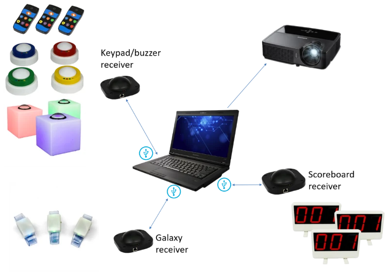
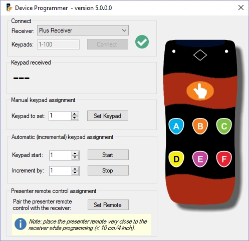
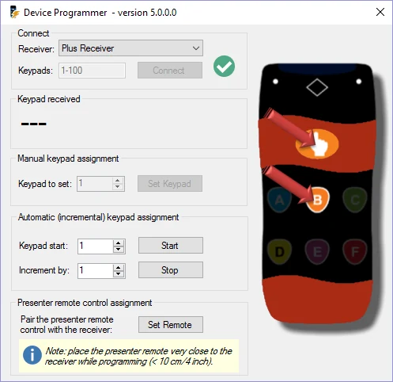
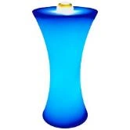
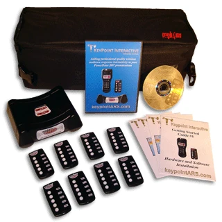
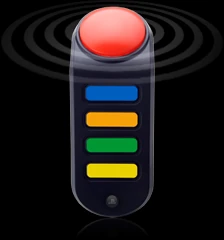

# Fysieke apparaten gebruiken

Een volledige QuizXpress-systeemopstelling met hardware kan er als volgt uitzien:

{ width="514" loading=lazy }

In deze opstelling worden alle door QuizXpress ondersteunde hardwareonderdelen gebruikt: keypads/buzzers, Galaxy-polsbandjes en scoreborden. Zoals u ziet, wordt voor elk type apparaat een aparte ontvanger gebruikt.

Voordat we de software in detail beschrijven, kijken we eerst naar de ondersteunde buzzertypen en hoe u ze gebruikt.

## De QuizXpress-keypads, buzzers en buzzerpalen gebruiken

Beide typen QuizXpress-keypads, het gewone en het Plus-keypad, hebben zes knoppen en een knop voor de snelste drukker. Wanneer een vraag wordt getoond, gaat bij het indrukken van een van de knoppen het rode verzendlampje rechtsboven op het keypad branden, wat betekent dat het zijn keuze verzendt naar de draadloze ontvanger die is aangesloten op de computer waarop QuizXpress Live draait. Zolang het rode lampje op het keypad blijft branden, probeert het keypad de keuze naar de ontvanger te verzenden. Wanneer het groene lampje linksboven knippert, is het signaal met succes verwerkt. Als de verzending is mislukt, knippert de rode led een paar keer.

De QuizXpress-keypads worden gekoppeld aan één ontvanger en elke ontvanger heeft een uniek serienummer (geef dus het serienummer door als u een reserveontvanger wilt bestellen). QuizXpress wordt geleverd met een handig hulpprogramma om een keypad aan de aangesloten ontvanger te *koppelen* en er een nummer aan toe te wijzen. Het hulpprogramma *QuizXpress Device Programmer* vindt u onder QuizXpress in het Windows Start-menu, of onder het menu *Extra* in QuizXpress Studio.

| { width="287" loading=lazy } | { width="288" loading=lazy } |
|---------------------------------------------------------------------------------|---------------------------------------------------------------------------------|

Om een QuizXpress-keypad of -buzzer te programmeren, sluit u de ontvanger aan op de computer en kiest u het ontvangertype in de vervolgkeuzelijst voor de ontvanger. Voer het bereik in van de keypads die u gaat programmeren en druk op Verbinden. Er zou een groen vinkje moeten verschijnen als teken dat de verbinding met de ontvanger is gelukt.

Met het programmeerhulpprogramma kunt u het nummer (id) van één keypad programmeren, of halfautomatisch voor een hele set keypads (u moet nog steeds op elk keypad op de knoppen ‘hand’ en ‘B’ drukken). Om één keypad te programmeren, stelt u het gewenste nummer in het veld ‘Keypad nummer’ in, klikt u op ‘Instellen’ en drukt u binnen 4 seconden op zowel de knop ‘hand’ als de knop ‘B’ van het keypad (zie de afbeelding rechts).

Keypads hebben een unieke koppeling met de ontvanger en moeten eerst aan de ontvanger worden gekoppeld. Wanneer u het id van een keypad instelt, wordt het keypad ook meteen aan de aangesloten ontvanger gekoppeld. Om de QuizXpress-afstandsbediening te koppelen, drukt u op de knop ‘Instellen’ in het programmeerhulpprogramma en drukt u tegelijk op de knoppen Power en Omhoog op de afstandsbediening.

Om de QuizXpress-buzzers te programmeren, klikt u op de knop ‘Toewijzen’ in het programmeerhulpprogramma. Het gele lampje op de ontvanger gaat dan branden. Druk nu tegelijk op de B-knop en de grote knop. Houd de grote knop ingedrukt totdat deze knippert. Wacht zodra deze knippert tot het gele lampje uitgaat en druk dan op de buzzer. Het nummer van de buzzer verschijnt nu in het programmeerhulpprogramma.

Om de QuizXpress Galaxy RGB-buzzers te programmeren, volgt u dezelfde stappen als voor de buzzers hierboven, maar drukt u in plaats van op B en de grote knop op C en de grote knop totdat de buzzer knippert.

De Sparkle-buzzerpalen en de Luminous-buzzertafel kunnen ook worden geprogrammeerd. Ze gebruiken dezelfde ontvanger als de QuizXpress-buzzers.

Om de Sparkle-buzzerpalen te programmeren:

- Schakel de buzzer uit.

- Druk op de knop ‘Toewijzen’ in de QuizXpress Device Programmer.

- Druk nu op de buzzerknop op de Sparkle en schakel de Sparkle weer in.

- Hij knippert nu, wat aangeeft dat hij is geprogrammeerd met het id dat in de programmeertoepassing wordt getoond.

Om de Luminous-quiztafels te programmeren:

- { width="106" loading=lazy }Schakel de Luminous uit.

- Druk op de knop ‘Toewijzen’ in de QuizXpress Device Programmer.

- Druk nu op de kleine zwarte knop naast de aan/uit-knop van de Luminous en schakel de Luminous weer in.

- Hij knippert nu, wat aangeeft dat hij is geprogrammeerd met het id dat in het programmeerhulpprogramma wordt getoond.

## De Fleetwood Reply Systems-keypads gebruiken

| { width="193" loading=lazy } | Fleetwood Reply Mini-keypads hebben vijf knoppen. Wanneer een vraag wordt getoond, gaat bij het indrukken van een van de knoppen het verzendlampje bovenaan het keypad branden, wat betekent dat het zijn keuze verzendt naar de draadloze ontvanger die is aangesloten op de computer waarop Quiz Show draait. Wanneer het lampje op het keypad rood wordt, betekent dit dat het antwoord niet door de draadloze ontvanger is ontvangen en dat de deelnemer opnieuw moet proberen zijn antwoord in te dienen. Wanneer het lampje groen wordt, is het signaal met succes verwerkt. |
|---------------------------------------------------------------------------------|----------------------------------------------------------------------------------------------------------------------------------------------------------------------------------------------------------------------------------------------------------------------------------------------------------------------------------------------------------------------------------------------------------------------------------------------------------------------------------------------------------------------------------------|

## De Sony-buzzers gebruiken

Sony BuzzTM-buzzers zijn er in twee varianten: bedraad en draadloos. Ze hebben vier gekleurde knoppen, die de meerkeuzeantwoorden A (blauw), B (oranje), C (groen) en D (geel) vertegenwoordigen, en één grote rode knop. De rode knop kan oplichten.

In Quiz Show hebben de meerkeuzeantwoorden dezelfde kleur als de vier gekleurde meerkeuzeknoppen op de buzzer.

| { width="65" loading=lazy } | Zodra een vraag in QuizXpress Live wordt getoond, lichten de rode knoppen van alle buzzers op (behalve die van spelers die al uit het spel zijn gezet), wat betekent dat de buzzers wachten op invoer. |
|---------------------------------------------------------------------------------|---------------------------------------------------------------------------------------------------------------------------------------------------------------------------------------------------|

Wanneer een vraag een meerkeuzevraag is (snelste drukker of stemmen; zie [De show uitvoeren met QuizXpress Live](index.md)), moet een speler op een van de meerkeuzeknoppen drukken om te antwoorden. Wanneer een vraag ‘open’ is (wat impliceert dat het altijd snelste drukker is), moet de rode knop worden ingedrukt om te antwoorden.

Wanneer een vraag ‘snelste drukker’ is en een speler als eerste drukt, begint het rode lampje te knipperen. Als de vraag een ‘open vraag’ was, vertelt de speler zijn antwoord aan de quizmaster, die het beoordeelt. Als de vraag een meerkeuzevraag was, heeft de speler zijn antwoord al gegeven door op een van de vier meerkeuzeknoppen te drukken; in dat geval beoordeelt Quiz Show het antwoord automatisch en telt het punten op of trekt het punten af.

Als het antwoord onjuist was, loopt het aftellen door. De speler die onjuist antwoordde, kan niet meer deelnemen aan het beantwoorden van de huidige vraag, dus zijn buzzer licht pas weer op bij de volgende vraag.
